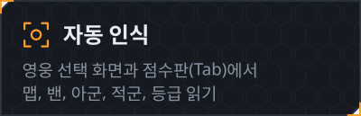
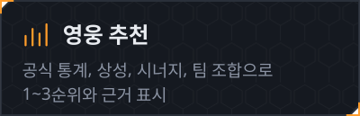
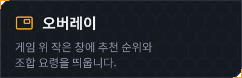
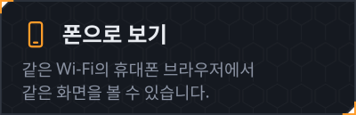
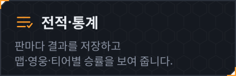
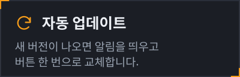

<!-- 표 첫 칸 글자 사이의 &#8288; 는 화면이 좁아도 한 글자씩 줄바꿈되지 않게 막는 보이지 않는 문자입니다. -->

&nbsp;&nbsp;

<a href="#install">설치</a> · <a href="#usage">사용 방법</a> · <a href="#screens">화면 구성</a> · <a href="#trouble">문제 해결</a> · <a href="#notice">안내 사항</a>

맵 → 밴 → 아군·적군 순으로 정보가 들어올 때마다 추천이 갱신됩니다. (시험용 화면)

 

 

Windows 10/11 64비트에서 동작합니다.

### 간편 설치 (권장)

1. **[OW-MapPicker.bat](https://github.com/no2thingmore/ow-map-picker-release/releases/latest/download/OW-MapPicker.bat)** 을 내려받습니다.
2. 받은 파일을 더블클릭합니다.
3. 브라우저에 추천 화면이 열리면 준비가 끝난 것입니다. 처음 한 번은 필요한 구성 요소를 받느라 1~3분 정도 걸립니다.

설치·업데이트·실행이 자동으로 진행되며, 바탕 화면에 **오버워치 영웅 선택 가이드 (베타 버전)** 바로가기가 만들어집니다. 다음부터는 이 바로가기로 실행하면 됩니다.

처음 실행할 때 아래와 같은 창이 나타날 수 있습니다.

| 나타나는 창 | 선택 |
|---|---|
| 브라우저의 "흔하지 않은 파일" 경고 | **유지** |
| 파란색 "Windows의 PC 보호" 창 | **추가 정보** → **실행** |
| 관리자 확인 창 | **예** |

관리자 확인 창은 한국어 글자 인식 기능이 없는 PC에서만 나타나며, 한국어 Windows에서는 대부분 나타나지 않습니다.

<b>직접 설치 (zip)</b>

 

1. **[OW-MapPicker.zip](https://github.com/no2thingmore/ow-map-picker-release/releases/latest/download/OW-MapPicker.zip)** (약 5.2MB, 항상 최신 버전)을 내려받습니다. 지난 버전은 [Releases](https://github.com/no2thingmore/ow-map-picker-release/releases)에 있습니다.
2. zip 파일을 오른쪽 클릭 → **속성** → 아래쪽 **차단 해제**를 체크하고 확인을 누릅니다. 이 과정을 건너뛰면 실행할 때마다 보안 경고가 나타납니다.
3. 원하는 위치에 압축을 풉니다. `OW-MapPicker` 폴더가 만들어집니다.
4. 폴더 안의 **start.bat** 을 더블클릭합니다. 필요한 구성 요소가 자동으로 설치됩니다. (처음 한 번 1~3분)
   - Python이 없으면 python.org 공식 설치 파일로 현재 계정에만 설치합니다. 관리자 권한은 필요하지 않습니다.
   - 한국어 글자 인식(OCR) 기능이 없으면 함께 설치합니다. 관리자 확인 창이 한 번 나타나면 **예**를 누릅니다.
5. 브라우저에 추천 화면이 열리면 완료입니다.

 

1. 프로그램을 켜 둔 채 오버워치를 실행합니다. 선호 영웅 선택·영웅 선택 화면에서 맵과 내 영웅이 자동으로 표시됩니다.
2. 게임 중 **Tab** (점수판)을 1~2초 누르고 있으면 아군·적군 영웅을 읽어 상성과 시너지를 계산합니다.
3. 처음 보는 얼굴 그림이나 등급 아이콘은 화면에서 한 번 지정해 주면 다음부터 자동으로 인식합니다.
4. 경기가 끝나면 승패를 읽어 전적에 기록합니다. 인식하지 못한 경우 화면에서 직접 선택할 수 있습니다.

> [!IMPORTANT]
> 검은 창은 닫지 말고 최소화해 두세요. 이 창을 닫거나 추천 화면(브라우저 탭)을 모두 닫으면 프로그램이 종료됩니다.

자세한 사용법은 프로그램 폴더의 `사용법.txt` 에서 확인할 수 있습니다. 간편 설치를 했다면 프로그램 폴더는 `%LOCALAPPDATA%\OW-MapPicker` 입니다.

 

### 추천 화면

| 위치 | 내용 |
|---|---|
| **상&#8288;단** | 지금 판에서 고르기 좋은 1~3순위 영웅 카드 (추천 점수 · 맵 승률 · 평소 대비, 적을 알면 카운터픽 점수) |
| **왼&#8288;쪽** | 맵, 이 맵에서 내 영웅의 성적, 이번 판 밴(대기실 금지까지 최대 5명)·아군·적군 (자동 입력되며 직접 수정 가능) |
| **가&#8288;운&#8288;데** | 내 포지션 영웅 전체를 추천·보통·비추천 표로 정렬 (맵 승률 · 평소 대비 · 픽률 · 밴률 · 카운터 · 추천 점수) · 바로 옆 칸에 적 조합 대응 표와 가장 까다로운 적, 적 영웅별 카운터픽·피할 픽·스왑 |
| **오&#8288;른&#8288;쪽** | 조합 분석(상대 주 성향 · 받아칠 성향 · 운영 요령), 점수 계산 설명 |

- 노트북처럼 작은 화면이나 브라우저를 확대했을 때는 1~3순위를 작게 줄이고 그 아래 조합 분석 · 적 조합 대응을 나란히 놓아 한 화면에 보이고, 목록은 그 아래에 있습니다.
- 화면이 바뀌면 칸이 살짝 들어오고 그래프가 차오르는 짧은 효과(0.2초 남짓)가 있습니다. Windows의 '애니메이션 효과'를 끄면 함께 꺼집니다.

### 오버레이

<table>
<tr>
<td width="50%"></td>
<td width="50%"></td>
</tr>
</table>

화면 위쪽 **📌 오버레이** → **켜기** 로 사용합니다.

- 게임 중에는 **Ctrl+Shift+O** 로 켜고 끌 수 있으며, 설정 창의 **바꾸기** 에서 단축키를 변경할 수 있습니다.
- 오버워치 화면 모드를 **전체 창 모드** 로 설정해야 합니다. 전체 화면 모드에서는 오버레이가 보이지 않을 수 있습니다. (설정 › 비디오 › 화면 모드)
- 게임 중 표시 시점은 **늘 보이기** 또는 **영웅 선택·점수판(Tab)일 때만** 중에서 고를 수 있습니다. 후자는 교전 중 화면을 가리지 않습니다.
- 점수판에서 다른 플레이어가 영웅을 바꾸면 "적 겐지 → 트레이서 교체" 같은 알림이 잠시 표시됩니다.
- 게임에 아무것도 주입하지 않는 일반 창이므로 계정에 영향을 주지 않습니다.

<b>오버레이 세부 설정</b>

 

- 마우스로 끌어 옮기면 그 위치를 기억합니다. 설정의 **처음 자리로** 를 누르면 오른쪽 위로 돌아갑니다.
- **마우스 통과** 를 켜면 창 위를 클릭해도 게임으로 전달됩니다.
- 진하기·크기·사용량(고성능 / 표준 / 가벼운)을 조절할 수 있습니다.
- 창이 화면 밖으로 나가지 않도록 위치가 자동 보정되며, 예기치 않게 꺼지면 다시 켜집니다.

### 모바일 보기 · 인식 모드

<table>
<tr>
<td width="40%" valign="top"></td>
<td width="60%" valign="top">

**모바일 보기** 
화면 위쪽 **📱 폰** → **켜기** 를 누른 뒤, 표시되는 주소를 휴대폰 브라우저에 입력합니다. PC와 휴대폰이 같은 Wi-Fi에 연결되어 있어야 합니다. 처음 켤 때 Windows 방화벽 창이 나타나면 **허용** 을 누릅니다.

**인식 모드** 
**🐢 가벼운 모드** (기본값)와 **⚡ 성능 모드** 중 하나를 선택합니다. 옆의 **!** 에 마우스를 올리면 두 모드의 차이를 확인할 수 있습니다.

</td>
</tr>
</table>

### 업데이트

- 새 버전이 나오면 화면 위에 "최신 버전이 확인되었습니다" 알림이 표시됩니다. **다운로드하기** 를 누르면 자동으로 교체한 뒤 다시 시작합니다. 전적·학습한 얼굴·설정은 그대로 유지됩니다.
- **자동 업데이트** 를 선택하면 오버워치를 2분 이상 하지 않을 때 자동으로 업데이트합니다. 게임 중에는 진행하지 않습니다.
- 버전별 변경 사항은 오른쪽 위 "v… 업데이트 내역"에서 확인할 수 있습니다.
- 사진으로 보는 변경 사항 (개선 전 / 개선 후): [v0.8.2](docs/releases/v0.8.2.md) 중요한 순서대로 배치·대기실 금지 · [v0.8.1](docs/releases/v0.8.1.md) 표 목록·조합 분석 · [v0.8.0](docs/releases/v0.8.0.md) 새 HUD 디자인 · [v0.7.2](docs/releases/v0.7.2.md) 화면 움직임 · [v0.7.0](docs/releases/v0.7.0.md) 추천 목록·상대 카운터·상성 계산 · [v0.6.5](docs/releases/v0.6.5.md) 점수판 인식 · [v0.6.4](docs/releases/v0.6.4.md) 오버레이 · [v0.6.3](docs/releases/v0.6.3.md)

 

| 증상 | 해결 방법 |
|---|---|
| **인&#8288;식&nbsp;안&nbsp;됨** | 게임 화면 모드를 **전체 창 모드** (테두리 없는 창)로 바꿔 주세요. |
| **게&#8288;임&nbsp;끊&#8288;김** | **🐢 가벼운 모드** 를 켜고, 오버레이 사용량을 **가벼운** 으로 낮춰 주세요. |
| **0&#8288;.&#8288;2&#8288;.&#8288;0&nbsp;실&#8288;행&#8288;기** | 0.2.0 버전의 간편 실행기를 쓰고 있다면 [OW-MapPicker.bat](https://github.com/no2thingmore/ow-map-picker-release/releases/latest/download/OW-MapPicker.bat) 을 한 번 다시 내려받아 실행해 주세요. 실행기만 교체되며 기록은 유지됩니다. |
| **그&nbsp;밖&#8288;의&nbsp;문&#8288;제** | 검은 창의 내용과 문제가 생긴 시점의 게임 화면 스크린샷을 제작자에게 보내 주세요. |

 

- 개인이 만든 **비공식** 도구이며, 블리자드·넥슨과 관련이 없습니다.
- 게임 파일을 읽거나 수정하지 않으며, 게임에 아무것도 주입하지 않습니다. 화면을 캡처해 글자와 그림만 인식합니다.
- 전적과 학습 데이터는 프로그램 폴더 안에만 저장되며 외부로 전송되지 않습니다. 인터넷은 통계·영웅 그림·새 버전을 받을 때만 사용합니다.
- 데이터 출처: 영웅 통계는 넥슨 오버워치 공식 영웅 통계, 상성·시너지는 Counterwatch, 영웅·맵·티어 그림은 블리자드 공식 자료·나무위키·게임 화면입니다.
