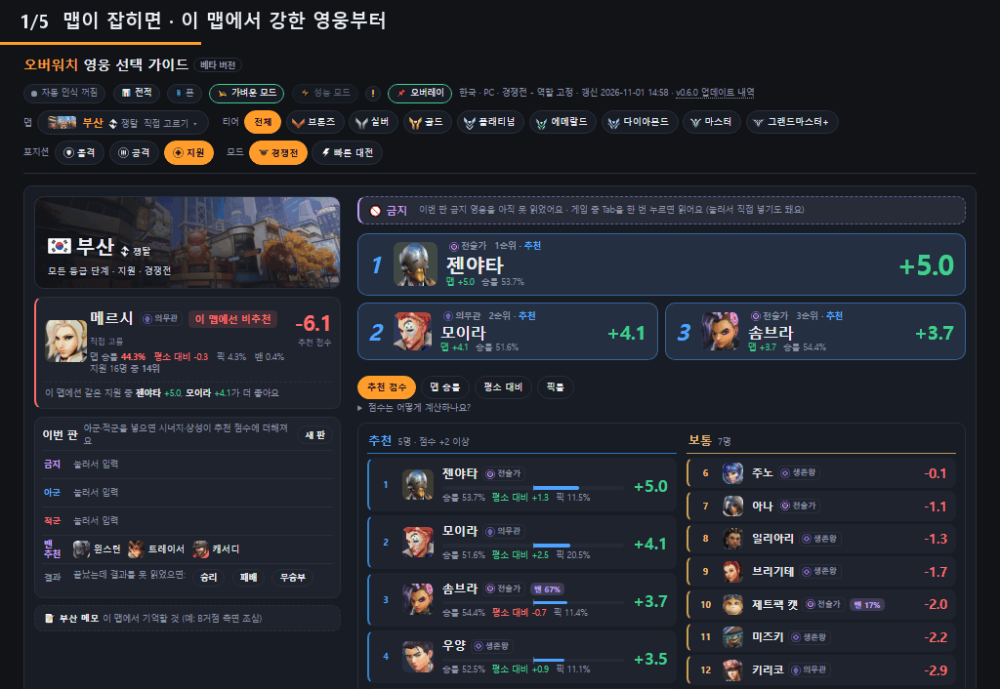
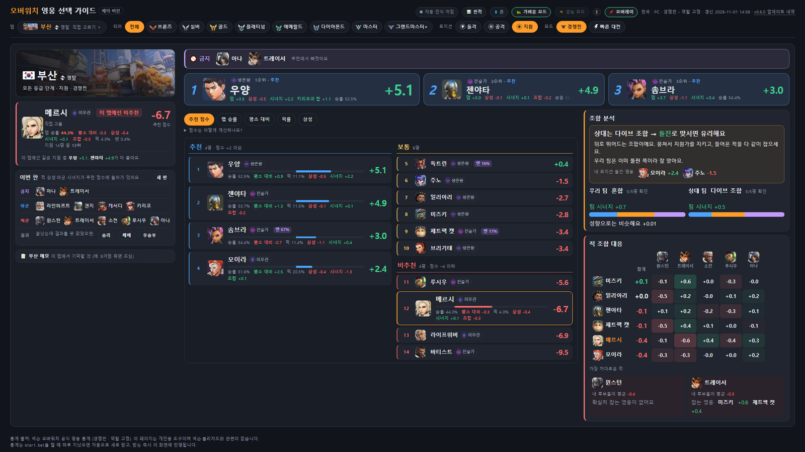
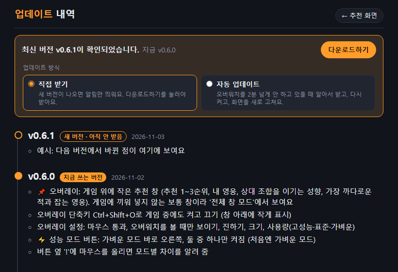

# 오버워치 영웅 선택 가이드 (베타 버전)

오버워치 2를 하는 동안 **화면을 읽어서**, 이번 맵·금지 영웅·양 팀 조합에 맞는 영웅을 추천해 주는 개인용 **비공식** 도구예요.
Windows 10/11 64비트 PC에서만 돼요.

맵이 잡히면 그 맵에서 강한 영웅부터 → 금지 영웅은 빼고 → 아군·적군을 알면 시너지·상성·조합까지 계산해요. (화면은 시험용 판이에요)

## 간편 사용자용

**[OW-MapPicker.bat 받기](https://github.com/no2thingmore/ow-map-picker-release/releases/latest/download/OW-MapPicker.bat)** → 받은 파일 더블클릭

**이거 실행하면 끝입니다.** 설치·업데이트·실행을 알아서 하고, 바탕 화면에 **맵 픽 도우미** 바로가기(프로그램 이름)를 만들어요. 다음부터는 그 바로가기만 누르면 돼요.

- 처음 한 번만 몇 가지 창이 뜰 수 있어요
  - 브라우저가 "흔하지 않은 파일" 경고를 하면 → **유지**
  - 파란 "Windows의 PC 보호" 창이 뜨면 → **추가 정보** → **실행**
  - 한국어 글자 인식(OCR)이 없는 PC면 관리자 확인 창이 한 번 떠요 → **예** (한국어 Windows면 보통 안 떠요)
- 처음엔 필요한 걸 받느라 1~3분 걸려요. 브라우저에 추천 화면이 열리면 준비 끝이에요.

## 한눈에 보기

| | 하는 일 |
|---|---|
| 🎯&nbsp;**자동&nbsp;인식** | 선호 영웅·밴 투표·영웅 선택 화면에서 맵과 내 영웅을, 게임 중 **Tab(점수판)** 에서 아군·적군·금지 영웅·등급 범위를 읽어요 |
| 📈&nbsp;**추천** | 넥슨 공식 통계(맵·티어별) + 상성·시너지(Counterwatch) + 팀 조합(포킹·돌진·다이브) + 내 판 기록으로 점수를 매겨요 |
| 📌&nbsp;**오버레이** | 게임 위 작은 창에 1~3순위·내 영웅·조합 요령·까다로운 적. **Ctrl+Shift+O** 로 켜고 끄기 |
| 📱&nbsp;**폰으로&nbsp;보기** | 같은 Wi-Fi의 폰에서 같은 화면을 봐요 |
| 📊&nbsp;**전적** | 판마다 결과·조합을 저장하고, 추천대로 했을 때 승률을 보여 줘요 |
| 🔄&nbsp;**업데이트** | 새 버전이 나오면 알림 → **다운로드하기** 한 번이면 알아서 바꿔 끼우고 다시 켜요 |

### 추천 화면

- **맨 위 1~3순위**: 지금 판에서 고르면 좋은 영웅. 점수 옆에 근거(맵·상성·시너지·조합)를 적어 둬요
- **왼쪽**: 맵, 내 영웅이 이 맵에서 어떤지, 이번 판 금지·아군·적군 (자동으로 채워지고, 눌러서 직접 고칠 수도 있어요)
- **가운데**: 내 포지션 영웅 전체를 추천 · 보통 · 비추천으로
- **오른쪽**: 조합 분석(상대 조합을 이기는 성향과 운영 요령), 적 조합 대응(적마다 누가 강한지, 가장 까다로운 적과 잡는 영웅)
- 노트북처럼 작은 화면도 스크롤 없이 한 화면에 맞춰요

### 📌 오버레이 — 게임 위 작은 추천 창

<table>
<tr>
<td width="50%"></td>
<td width="50%"></td>
</tr>
</table>

- 화면 위쪽 **📌 오버레이** → **켜기**. 게임 중엔 **Ctrl+Shift+O** 로 켜고 꺼요 (창 아래에 작게 적혀 있어요)
- **게임 화면 모드는 '전체 창 모드'** 로 해 주세요. '전체 화면'이면 창이 안 보일 수 있어요 (오버워치 설정 › 비디오 › 화면 모드)
- 마우스로 끌어 옮기면 그 자리를 기억해요. **마우스 통과**를 켜면 창 위를 눌러도 게임으로 가요
- 진하기·크기·사용량(고성능 / 표준 / 가벼운)을 고를 수 있어요
- 게임에 아무것도 끼워 넣지 않는 보통 창이라 계정에는 문제없어요

### 📱 폰으로 보기 · 🐢 가벼운 모드 / ⚡ 성능 모드

<table>
<tr>
<td width="45%" valign="top"></td>
<td width="55%" valign="top">

**폰으로 보기**: 화면 위쪽 **📱 폰** → **켜기** → 나오는 주소를 폰 브라우저에 입력 (같은 Wi-Fi). 처음 켤 때 Windows 방화벽 창이 뜨면 **허용**.

**인식 속도**: **🐢 가벼운 모드**(처음 설정)와 **⚡ 성능 모드** 중 하나를 골라요. 한쪽을 켜면 다른 쪽은 꺼져요. 옆 **!** 에 마우스를 올리면 차이를 보여 줘요.

</td>
</tr>
</table>

### 🔄 업데이트

- 새 버전이 나오면 화면 위에 **"최신 버전이 확인되었습니다"** 가 떠요. **다운로드하기** 를 누르면 알아서 받아서 바꿔 끼우고 다시 켜요 (판 기록·배운 얼굴·설정은 그대로)
- **자동 업데이트** 를 고르면 오버워치를 2분 넘게 안 하고 있을 때 알아서 받아요. 게임 중엔 하지 않아요
- 버전마다 바뀐 점은 오른쪽 위 **"v… 업데이트 내역"** 에서 볼 수 있어요

## 직접 설치 (zip)

**[OW-MapPicker.zip 받기](https://github.com/no2thingmore/ow-map-picker-release/releases/latest/download/OW-MapPicker.zip)** (약 4.6MB, 항상 최신 버전) · 지난 버전들: [Releases](https://github.com/no2thingmore/ow-map-picker-release/releases)

1. 받은 zip 파일을 오른쪽 클릭 → 속성 → 아래쪽 **차단 해제** 체크 → 확인
   (안 하면 실행할 때마다 '보안 경고' 창이 떠요)
2. zip을 원하는 곳에 압축 풀기 (예: 바탕 화면). `OW-MapPicker` 폴더가 생겨요.
3. 폴더 안의 **start.bat** 더블클릭. 필요한 건 묻지 않고 알아서 설치해요 (처음 한 번 1~3분)
   - 파이썬이 없으면 python.org 공식 파일로 이 계정에만 설치 (관리자 권한 필요 없음)
   - 한국어 글자 인식(OCR)이 없으면 설치 (관리자 확인 창이 한 번 뜨면 **예**)
4. 브라우저에 추천 화면이 열리면 끝이에요.

## 쓰는 법

1. 켜 두고 오버워치를 하면, 선호 영웅 선택·영웅 선택 화면에서 맵과 내 영웅을 알아서 띄워요.
2. 게임 중 **Tab(점수판)** 을 1~2초 누르면 아군·적군 영웅을 읽어서 상성·시너지까지 계산해요.
3. 처음 보는 얼굴·등급 아이콘은 화면에서 한 번 알려 주면 다음부터 자동으로 알아봐요.
4. 경기가 끝나면 승패를 읽어 전적에 남겨요 (놓쳤으면 화면에서 직접 고를 수 있어요).

- 검은 창은 닫지 말고 최소화만 해 두세요. 닫으면 프로그램이 꺼져요. 추천 화면(브라우저)을 모두 닫아도 꺼져요.
- 자세한 건 프로그램 폴더의 `사용법.txt` 를 봐 주세요 (간편 설치는 `%LOCALAPPDATA%\OW-MapPicker`).

## 문제가 있으면

- 화면을 못 읽으면: 게임을 **전체 창 모드(테두리 없는 창)** 로 해 보세요.
- 게임이 버벅이면: **🐢 가벼운 모드**, 오버레이는 사용량 **가벼운** 으로.
- 0.2.0 때 간편 실행기를 받았다면 [OW-MapPicker.bat](https://github.com/no2thingmore/ow-map-picker-release/releases/latest/download/OW-MapPicker.bat)을 한 번 다시 받아 실행해 주세요 (실행기가 새 것으로 바뀌어요, 기록은 그대로).
- 그래도 안 되면 검은 창 내용과 그때 게임 화면 스크린샷을 보내 주세요.

## 알아 두기

- 개인이 만든 비공식 도구예요. 블리자드·넥슨과 관련이 없어요.
- 게임 파일을 읽거나 고치지 않고, 게임에 아무것도 끼워 넣지 않아요. 화면을 찍어 글자·그림만 읽어요.
- 판 기록·배운 얼굴은 전부 프로그램 폴더 안에만 저장되고 어디로도 보내지 않아요. 인터넷은 통계·영웅 그림·새 버전을 받을 때만 써요.
- 통계: 넥슨 오버워치 공식 영웅 통계, 상성·시너지: Counterwatch, 영웅·맵·티어 그림: 블리자드 공식 자료·나무위키·게임 화면.
