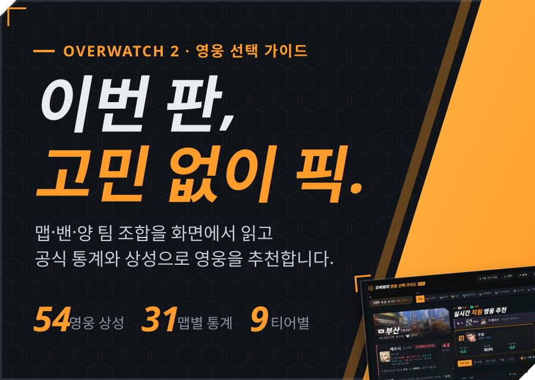
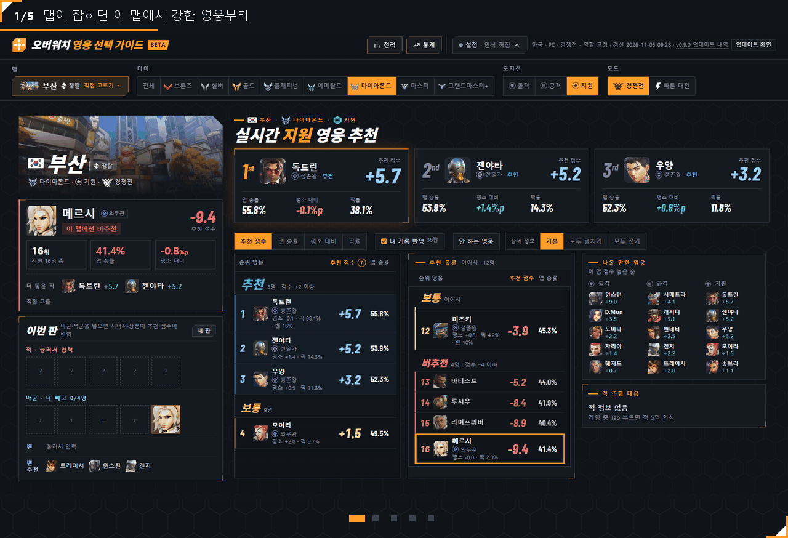
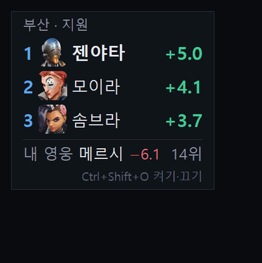
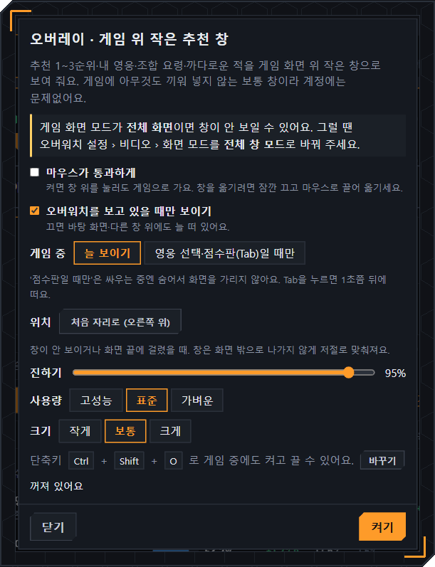
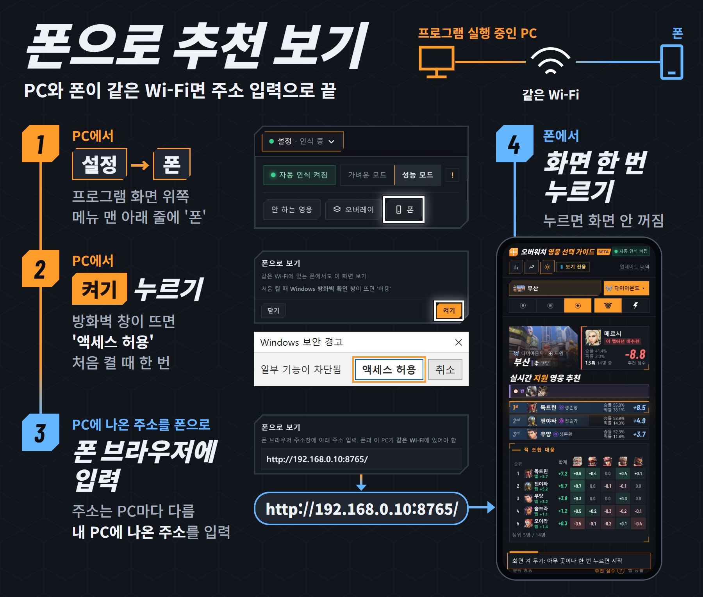
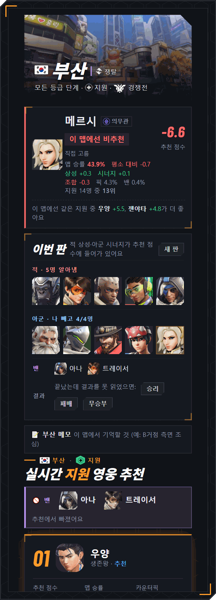
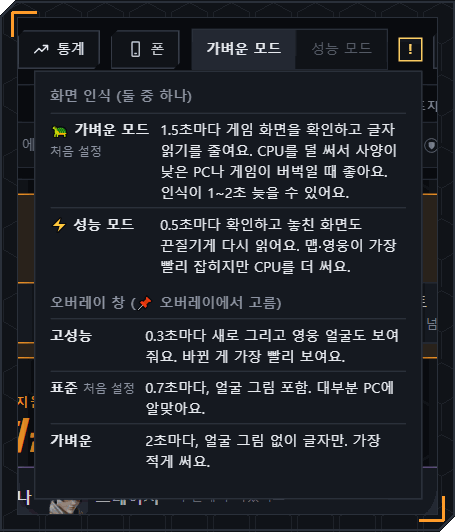
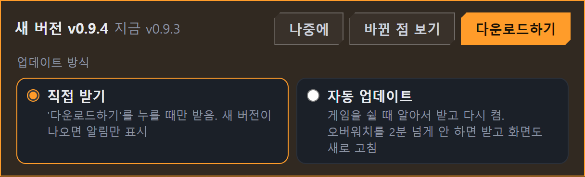

<!-- 글 규칙: 결론 먼저(절차·표·안내 목록은 예외), 패치 노트처럼 짧은 개조식(~요·~니다·~세요로 끝내지 않기), 굵은 글씨는 버튼·메뉴 이름에만, 개발 수치(테스트 개수·ms)는 쓰지 않기. 화면 규칙: 제목은 글자로, 그림 속 글자 대신 본문 글자, 세부는 펼쳐 보기. 표 첫 칸의 &#8288;는 좁은 화면에서 한 글자씩 꺾이지 않게 막는 보이지 않는 문자. -->

&nbsp;&nbsp;

이번 판에 고르기 좋은 영웅을 바로 알려 주는 **무료 Windows 프로그램**. 영웅 선택 화면과 점수판(Tab)에서 맵, 밴, 양 팀 영웅을 읽고 넥슨 공식 통계와 상성으로 계산.

Windows 10, 11 (64비트) | 베타 | 개인이 만든 비공식 도구 | [소개 페이지](https://no2thingmore.github.io/ow-map-picker-release/) | [업데이트 내역](https://no2thingmore.github.io/ow-map-picker-release/releases.html)

## 시작하기

실행기 파일 하나로 설치부터 실행까지.

1. [OW-MapPicker.bat](https://github.com/no2thingmore/ow-map-picker-release/releases/latest/download/OW-MapPicker.bat) 받아서 더블클릭. 처음 한 번은 1~3분, 브라우저에 추천 화면이 열리면 끝
2. 프로그램을 켜 둔 채 오버워치 실행. 영웅 선택 화면에서 맵과 내 영웅이 저절로 들어옴
3. 게임 중 Tab을 1~2초 누르면 밴과 양 팀 영웅을 읽고 카운터픽까지 계산

> [!IMPORTANT]
> 검은 창은 닫지 말고 최소화. 검은 창이나 추천 화면을 모두 닫으면 프로그램이 꺼짐

맵, 밴, 아군, 적군이 들어올 때마다 추천을 다시 계산

## 할 수 있는 것

켜 두기만 하면 판 정보를 읽고 지금 고를 영웅 표시.

- 내 포지션 영웅 순위. 이 맵과 티어의 승률에 상성, 시너지, 조합을 더한 점수. 적을 알면 적 조합 대응 표(합계 = 맵 + 상성)
- 안 하는 영웅을 저장하면 추천에서 빠짐. 다시 켜도 유지, 다시 누르면 돌아옴
- 추천 목록에서 영웅을 누르면 지금 모드와 티어의 영웅 통계로 이동
- 맵, 밴, 양 팀 영웅이 저절로 들어옴. 영웅 선택 화면과 점수판에서 대기실 금지까지 밴 5명, 내 영웅, 등급 범위를 읽음. 처음 보는 얼굴은 한 번 알려 주면 기억
- 게임 위에 1~3순위와 조합 요령을 작게 표시(오버레이). Ctrl+Shift+O로 켜고 끄기
- [폰으로 추천 영웅 확인](#폰으로-추천-영웅-확인). PC와 같은 Wi-Fi면 됨
- 추천대로 골랐을 때 승률. 판마다 결과와 베스트 픽이 남고, 티어별 메타와 맵별 통계도 있음
- 업데이트는 알아서. 새 버전이 나오면 알림, 자동 업데이트를 켜면 게임을 쉴 때 받음

## 화면 구성

### 추천 화면

위쪽 1~3순위만 봐도 충분. 나머지는 그 순위의 근거.

| 어디 | 무엇이 있나 |
|---|---|
| **위&#8288;쪽** | 1st·2nd·3rd 카드. 큰 숫자가 추천 점수, 아래는 맵 승률·픽률·다른 맵보다. 적을 알면 픽률 자리에 카운터픽 |
| **왼&#8288;쪽** | 맵, 이 맵에서 내 영웅 성적, 이번 판 밴과 아군, 적군. 틀리면 눌러서 고치기 |
| **가&#8288;운&#8288;데** | 내 포지션 영웅 전체를 추천, 보통, 비추천으로 나눈 표. 내 영웅 줄은 목록 가운데로 |
| **오&#8288;른&#8288;쪽** | 적 조합 대응(합계 = 맵 + 상성, 5등까지), 나올 만한 영웅. 적을 읽기 전에는 나올 만한 영웅이 위, 읽으면 적 조합 대응이 위. 제목 오른쪽에 지금 OP와 밴 많은 영웅 |

폰은 맵 옆에 내 영웅, 그 아래 1~3순위, 적 조합 대응, 추천 목록 순서. 좁은 창은 한 줄씩 쌓임: 맵, 내 영웅, 1~3순위, 이번 판, 적 조합 대응, 추천 목록 순서.

추천 점수는 통계로 계산한 추정값. 영웅 줄을 누르면 지금 모드·티어의 영웅 통계로 이동, 목록 머리줄 '추천 점수' 옆 **?** 단추에 계산법. '표본 적음'이 붙은 값은 경기 수가 적은 값.

패치 직후 새 통계가 너무 적으면 패치 전 통계를 유지(최대 7일), 머리글에 표시. 패치 전 통계가 없는 맵은 그 맵만 패치 후 판으로 계산하고 맵 이름 아래에 안내.

### 오버레이

게임 위에 1~3순위와 조합 요령을 작게 표시. 화면 위쪽 **설정** → **오버레이** → **켜기**, 게임 중에는 Ctrl+Shift+O로 켜고 끄기. 창 폭 900px 아래에서는 단추 숨김.

<table>
<tr>
<td width="50%"></td>
<td width="50%"></td>
</tr>
</table>

- 오버워치 화면 모드는 **전체 창 모드**로(설정 › 비디오 › 화면 모드). 전체 화면에서는 안 보일 수 있음
- '영웅 선택·점수판일 때만'을 고르면 싸우는 중에는 숨음

<b>오버레이 세부 설정</b>

 

- 단축키는 설정 창의 **바꾸기**에서 변경
- 마우스로 끌어 옮기면 그 자리를 기억. **처음 자리로**를 누르면 오른쪽 위로
- **마우스 통과**를 켜면 창 위를 눌러도 게임으로 감
- 진하기, 크기, 사용량(고성능, 표준, 가벼운) 조절
- 점수판에서 상대가 영웅을 바꾸면 "적 겐지 → 트레이서 교체" 알림
- 게임에 아무것도 끼워 넣지 않는 보통 창

### 폰으로 추천 영웅 확인

게임 화면을 가리지 않고 폰에서 추천 보기(보기 전용). 화면 위쪽 **설정** → **폰** → **켜기**, 나오는 주소를 폰 브라우저에 입력.

<b>안 열릴 때</b>

 

| 이럴 때 | 이렇게 |
|---|---|
| 폰이 LTE나 5G로 연결됨 | 폰 Wi-Fi를 켜고 PC와 같은 공유기에 연결. PC는 유선이어도 됨 |
| 게스트 Wi-Fi에 연결됨 | 기본 Wi-Fi로 변경 |
| 방화벽 창에서 **취소**를 누름 | 시작 메뉴에서 '방화벽을 통해 앱 허용' 검색, Python 줄 체크 |
| 검은 창을 닫음 | PC에서 프로그램 다시 실행 |
| 되던 주소가 안 열림 | **설정** → **폰**에서 바뀐 주소 확인 |

안 쓸 때는 **설정** → **폰** → **끄기**.

<b>폰 화면 전체 보기</b>

 

### 인식 모드

처음 설정은 더 빨리 읽는 **성능 모드**. 게임이 끊기면 **가벼운 모드**. **설정** 안에서 고르기.

### 업데이트

**다운로드하기** 한 번이면 끝. 새 버전이 나오면 화면 위에 알림, 누르면 알아서 바꾸고 다시 켬. 전적, 배운 얼굴, 설정은 그대로.

- **자동 업데이트**를 고르면 오버워치를 2분 넘게 안 할 때 받음. 게임 중에는 받지 않음
- 버전마다 바뀐 점: [업데이트 내역](https://no2thingmore.github.io/ow-map-picker-release/releases.html). 사진으로 보기: [v0.9.4](docs/releases/v0.9.4.md), [v0.9.3](docs/releases/v0.9.3.md), [v0.9.2](docs/releases/v0.9.2.md), [v0.9.0](docs/releases/v0.9.0.md), [v0.8.9](docs/releases/v0.8.9.md), [v0.8.8](docs/releases/v0.8.8.md), [v0.8.7](docs/releases/v0.8.7.md), [v0.8.6](docs/releases/v0.8.6.md), [v0.8.5](docs/releases/v0.8.5.md), [v0.8.4](docs/releases/v0.8.4.md), [v0.8.3](docs/releases/v0.8.3.md), [v0.8.2](docs/releases/v0.8.2.md)

## 설치

[시작하기](#시작하기)의 1번이 간편 설치. 바탕 화면에 **오버워치 영웅 선택 가이드 (베타 버전)** 바로가기가 생기고, 다음부터 이걸로 실행.

처음 실행할 때 뜰 수 있는 창:

| 뜨는 창 | 누를 것 |
|---|---|
| 브라우저의 "흔하지 않은 파일" 경고 | **유지** |
| 파란색 "Windows의 PC 보호" 창 | **추가 정보** → **실행** |
| 관리자 확인 창 (한국어 글자 인식이 없는 PC만) | **예** |

<b>zip으로 직접 설치하기</b>

 

1. [OW-MapPicker.zip](https://github.com/no2thingmore/ow-map-picker-release/releases/latest/download/OW-MapPicker.zip)(약 11MB) 받기. 지난 버전은 [Releases](https://github.com/no2thingmore/ow-map-picker-release/releases)에
2. zip 파일 오른쪽 클릭 → **속성** → **차단 해제** 체크 → 확인. 안 하면 실행할 때마다 보안 경고
3. 원하는 곳에 압축 풀기. `OW-MapPicker` 폴더가 생김
4. 폴더 안의 **start.bat** 더블클릭. 필요한 것은 알아서 설치
   - 파이썬이 없으면 python.org 공식 파일로 지금 계정에만 설치. 관리자 권한 필요 없음
   - 한국어 글자 인식(OCR)이 없으면 같이 설치. 관리자 확인 창이 뜨면 **예**
5. 브라우저에 추천 화면이 열리면 끝

자세한 사용법: [사용법 페이지](https://no2thingmore.github.io/ow-map-picker-release/guide.html), 프로그램 폴더의 `사용법.txt`. 간편 설치를 했다면 프로그램 폴더는 `%LOCALAPPDATA%\OW-MapPicker`.

## 문제 해결

| 이럴 때 | 이렇게 |
|---|---|
| **못&nbsp;읽&#8288;음** | 게임 화면 모드를 **전체 창 모드**로 |
| **게&#8288;임&nbsp;끊&#8288;김** | **가벼운 모드**를 켜고 오버레이 사용량을 **가벼운**으로 |
| **0&#8288;.&#8288;2&#8288;.&#8288;0&nbsp;실&#8288;행&#8288;기** | [OW-MapPicker.bat](https://github.com/no2thingmore/ow-map-picker-release/releases/latest/download/OW-MapPicker.bat)을 다시 받아 한 번 실행. 기록은 그대로 |
| **폰&nbsp;안&nbsp;열&#8288;림** | [폰으로 추천 영웅 확인](#폰으로-추천-영웅-확인)의 '안 열릴 때' |
| **그&nbsp;밖&#8288;의&nbsp;문&#8288;제** | 검은 창 내용과 그때 게임 화면 사진을 [이슈](https://github.com/no2thingmore/ow-map-picker-release/issues)로 보내기 |

## 안내 사항

- 게임 파일을 읽거나 고치지 않고, 게임에 아무것도 끼워 넣지 않음. 화면을 캡처해서 글자와 그림만 읽음
- 개인이 만든 **비공식** 도구. 블리자드, 넥슨과 관련 없음
- 전적과 배운 얼굴은 프로그램 폴더 안에만 저장, 밖으로 보내지 않음. 인터넷은 통계, 영웅 그림, 새 버전을 받을 때만 사용
- 데이터 출처: 영웅 통계는 넥슨 오버워치 공식 영웅 통계, 상성과 시너지는 Counterwatch, 영웅·맵·티어 그림은 블리자드 공식 자료, 나무위키, 게임 화면
