# v0.6.3 통계 페이지, 점수 계산 고르기

[← 릴리스 받기](https://github.com/no2thingmore/ow-map-picker-release/releases/tag/v0.6.3) · [처음 화면(README)](../../README.md)

통계 페이지 추가. 점수 계산을 '맵별 효율'과 '맵별 효율 + 카운터픽' 중에 고르기. 자잘한 화면도 여러 곳 다듬음.

## 통계 페이지

위쪽 '통계'를 누르면 열림. 지금 메타, 맵별 영웅 통계, 영웅별 통계.

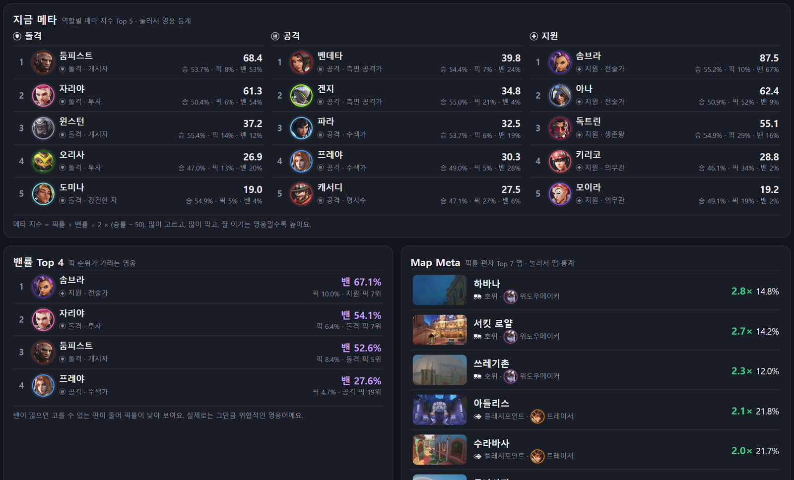

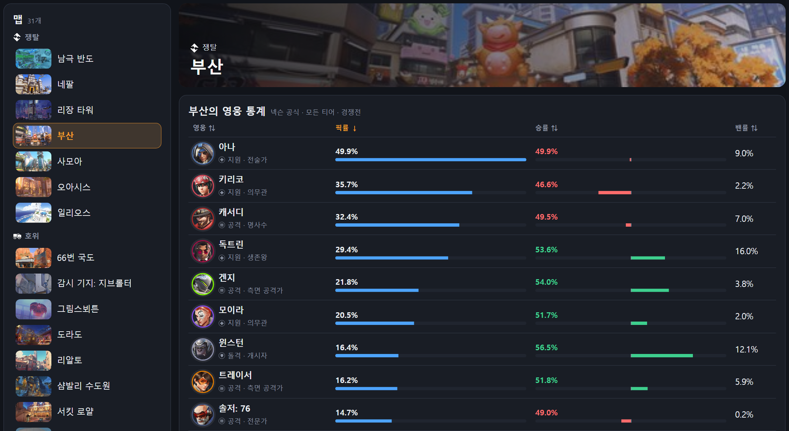

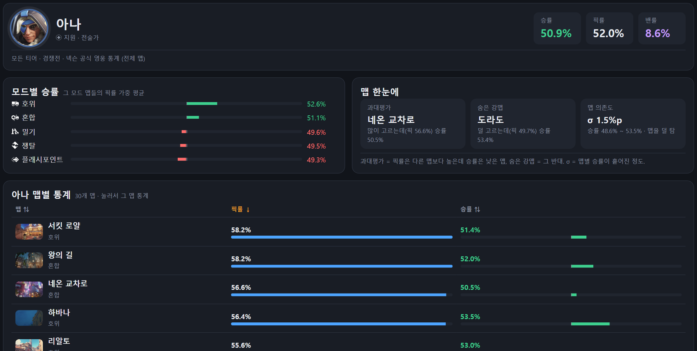

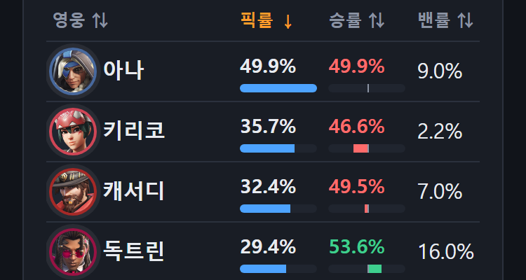

## 점수 계산 고르기

처음엔 맵별 효율로 점수 계산. '맵별 효율 + 카운터픽'을 고르면 이번 판 상성, 시너지, 조합까지 더함.

'내 기록 반영'은 정렬 단추 옆으로. 상세 정보는 기본, 모두 펼치기, 모두 접기 중에 고르기.

## 맵 고르기 칸 사이 간격

| v0.6.2 | v0.6.3 |
| --- | --- |
| 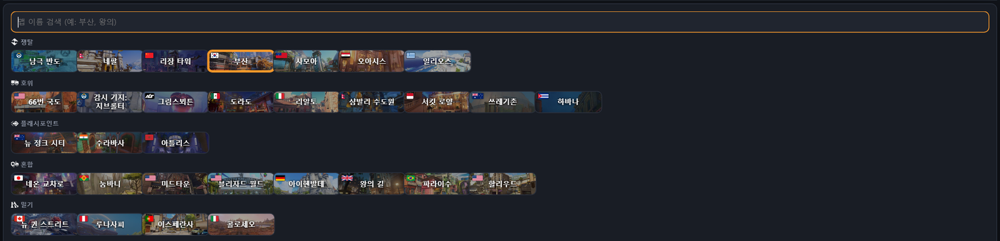 | 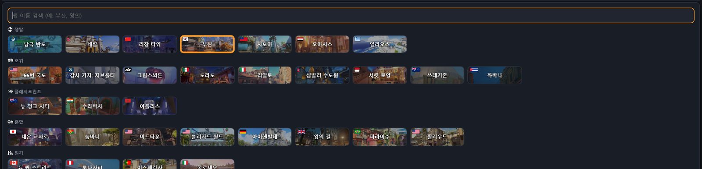 |

## 점수판 빈자리

아직 들어오지 않은 자리를 '죽음'으로 읽던 문제 고침.

| v0.6.2 | v0.6.3 |
| --- | --- |
| 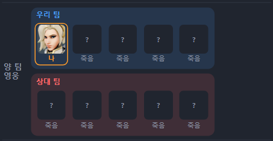 | 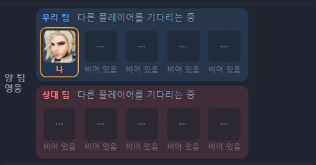 |

## 맵 카드 아이콘

| v0.6.2 | v0.6.3 |
| --- | --- |
|  |  |

## 접힌 영웅 펼치기

한 줄로 접힌 영웅에 마우스를 올리면 숫자가 바로 아래에 펼쳐짐. 폰은 누르기.

| v0.6.2 | v0.6.3 |
| --- | --- |
| 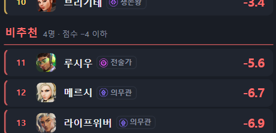 | 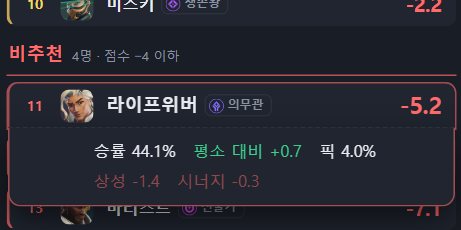 |

## 위쪽 고르기 칸

| v0.6.2 | v0.6.3 |
| --- | --- |
|  |  |

## 업데이트 확인과 꺼짐 알림

버전 옆 '업데이트 확인'에서 최신 버전과 업데이트 방식 보기.

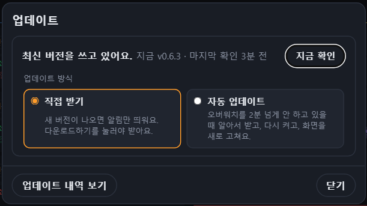

프로그램이 꺼지면 화면 위에 알림, 다시 켜면 사라짐.

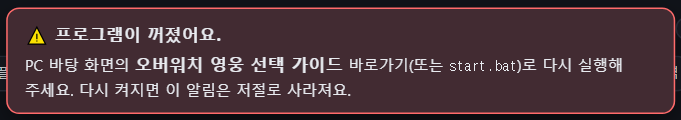
