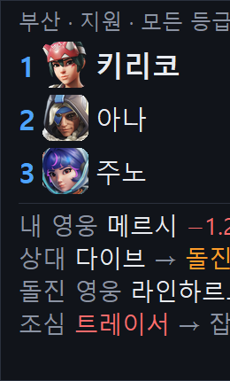
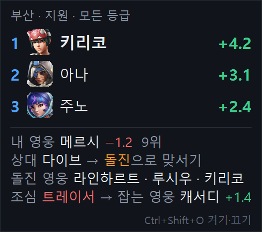
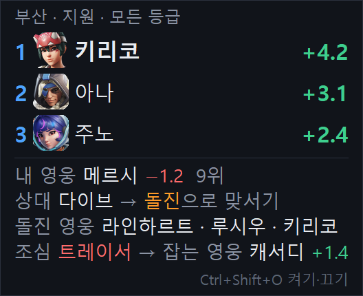
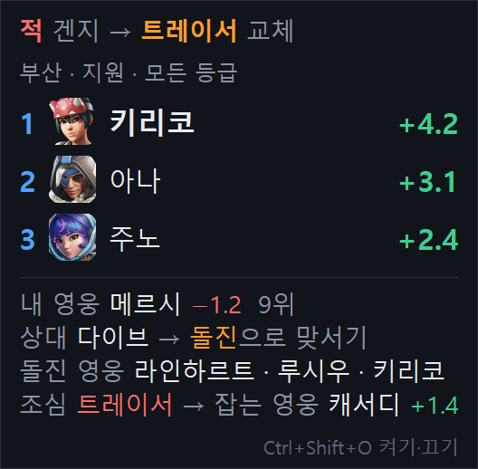
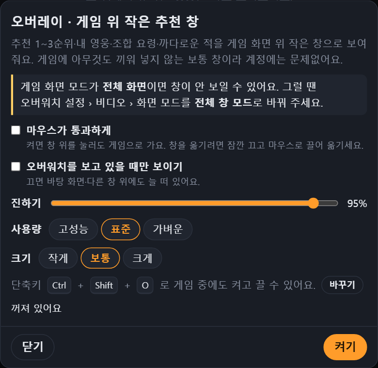
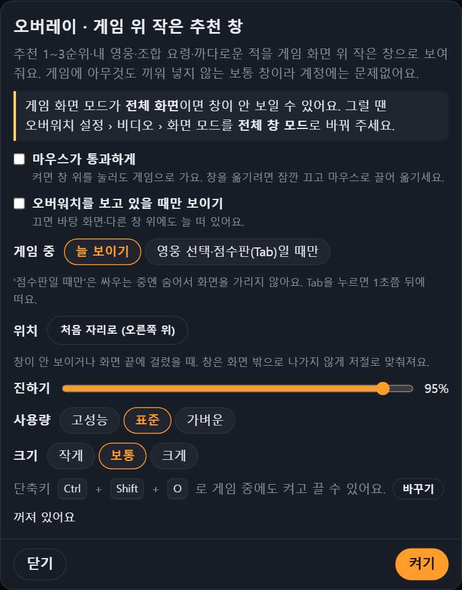

# v0.6.4 · 사진으로 보는 바뀐 점 (오버레이)

[← 릴리스 받기](https://github.com/no2thingmore/ow-map-picker-release/releases/tag/v0.6.4) · [처음 화면(README)](../../README.md) · [지난 버전 v0.6.3 사진](v0.6.3.md)

게임 위 작은 추천 창(오버레이)을 고친 버전이에요. v0.6.3과 v0.6.4에 같은 추천(부산 · 지원)을 띄워 놓고 오버레이 창만 똑같이 찍었어요.

## 개선 전 / 개선 후

### 화면 끝에 둔 창이 잘리지 않게

창을 화면 오른쪽 끝 가까이에 두면, 추천이 들어와 창이 넓어질 때 오른쪽이 화면 밖으로 잘렸어요. 이제 창은 어디에 두어도 화면 안으로 맞춰지고, 처음 자리(오른쪽 위)에서는 넓어지면 왼쪽으로 자라요.

| 개선 전 (v0.6.3): 점수·요령 끝이 잘림 | 개선 후 (v0.6.4): 창 전체가 화면 안에 |
| --- | --- |
|  |  |

### 영웅 교체 알림

점수판(Tab)에서 다른 플레이어가 영웅을 바꾼 걸 보면 맨 위에 **"적 겐지 → 트레이서 교체"** 가 10초 동안 떠요. 카운터픽 점수도 바뀐 적 조합으로 다시 계산돼요. 얼굴을 한 번 잘못 알아본 것으로는 뜨지 않게, 같은 새 영웅을 두 번 연속 봤을 때만 띄워요.

| 개선 전 (v0.6.3) | 개선 후 (v0.6.4): 교체 알림 |
| --- | --- |
|  |  |

### 오버레이 설정: '게임 중'과 '위치'

- **게임 중:** *늘 보이기* / *영웅 선택·점수판(Tab)일 때만*. '점수판일 때만'을 고르면 싸우는 중엔 숨어서 화면을 가리지 않고, Tab을 누르면 1초쯤 뒤에 떠요.
- **위치:** *처음 자리로 (오른쪽 위)*. 창이 안 보이거나 화면 끝에 걸렸을 때 눌러요.

| 개선 전 (v0.6.3) | 개선 후 (v0.6.4) |
| --- | --- |
|  |  |

## 사진에 안 나온 것

- 오버레이가 혼자 꺼지면(PC 절전에서 깨어날 때 등) 저절로 다시 켜요. 예전엔 설정은 '켜짐'인데 창이 없어서 단축키를 두 번 눌러야 했어요. 계속 꺼지면 고장일 수 있어서 2분에 3번까지만 다시 켜요.
- 오버레이가 그리다 오류가 나도 멈춘 채로 남지 않고, 다음 추천이 오면 다시 그려요.
- 화면 배율 125~200%에서 줄 간격이 글자 크기에 맞게 넓어졌어요 (그래서 개선 후 창이 조금 더 길어요).

사진의 추천 내용은 설명용 시험 데이터예요. 오버레이는 게임에 아무것도 끼워 넣지 않는 보통 창이고, 게임 화면 모드가 **전체 창 모드**일 때 보여요.
