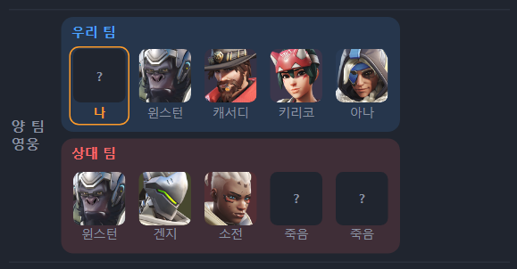
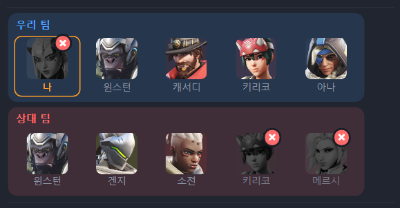
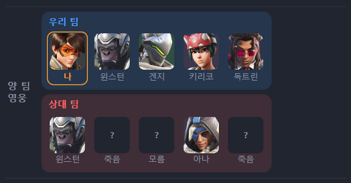
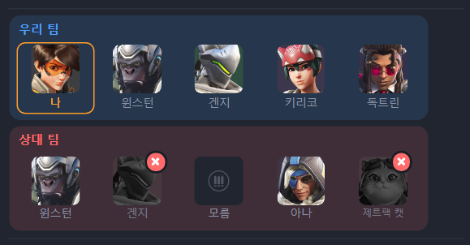
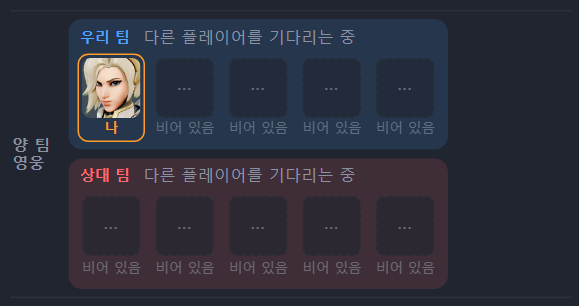
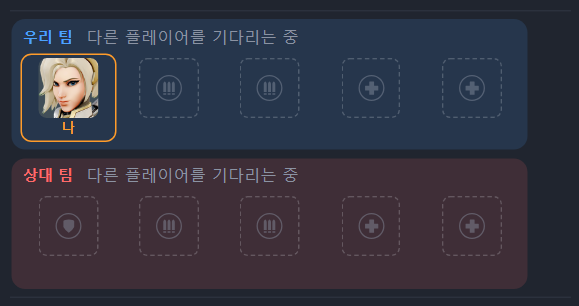

# v0.6.5 죽은 영웅 얼굴도 알아봄

[← 릴리스 받기](https://github.com/no2thingmore/ow-map-picker-release/releases/tag/v0.6.5) · [처음 화면(README)](../../README.md) · [지난 버전 v0.6.4](v0.6.4.md)

점수판에서 죽어 있는 영웅도 처음 보는 영웅까지 알아봄. 빈자리는 역할 아이콘으로. 사진은 실제 게임 점수판을 두 버전으로 읽은 결과.

## 죽은 영웅

어둡게 덮인 얼굴도 알아보고 흑백 얼굴에 빨간 ✕로 표시. 확실하지 않으면 틀린 이름 대신 '죽음'으로 둠. 전에는 그 판에서 살아 있는 모습을 본 영웅만 알아봤음.

| v0.6.4 | v0.6.5 |
| --- | --- |
|  |  |
|  |  |

## 빈자리

아직 들어오지 않은 자리는 그 자리 역할 아이콘만 흐리게. 팀이 모두 비어 있으면 팀 이름 옆에 한 번만 알림. 왼쪽 이름표를 빼서 얼굴 칸이 넓어짐.

| v0.6.4 | v0.6.5 |
| --- | --- |
|  |  |

## 그 밖에

- [개선] 낮은 해상도에서도 점수판 '?' 칸을 알아봄
- [고침] 죽은 얼굴을 알려 주면 다른 영웅까지 그 영웅으로 읽던 문제
