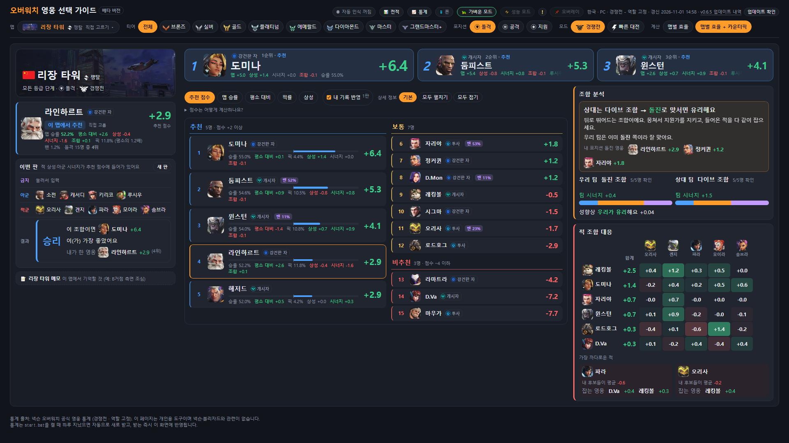
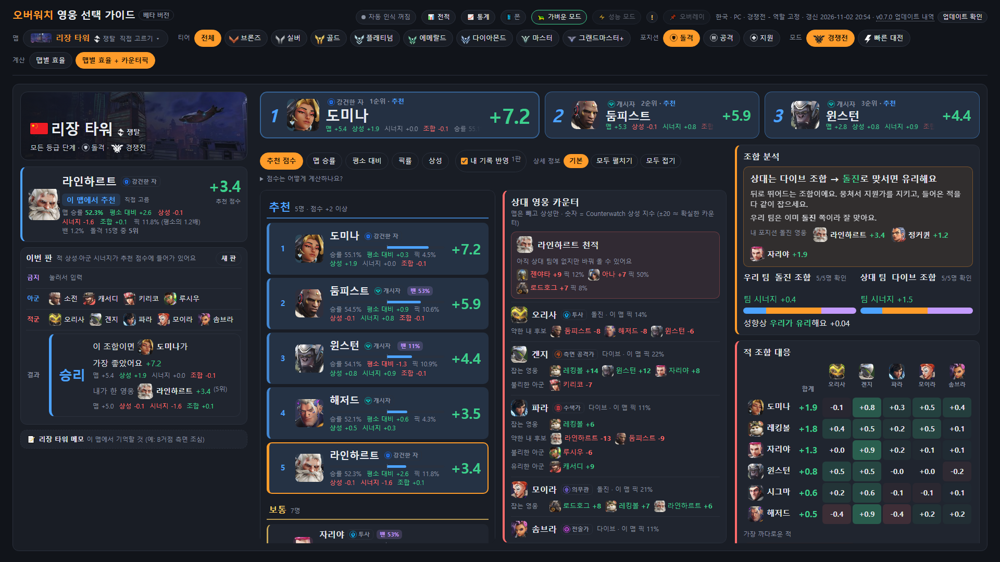
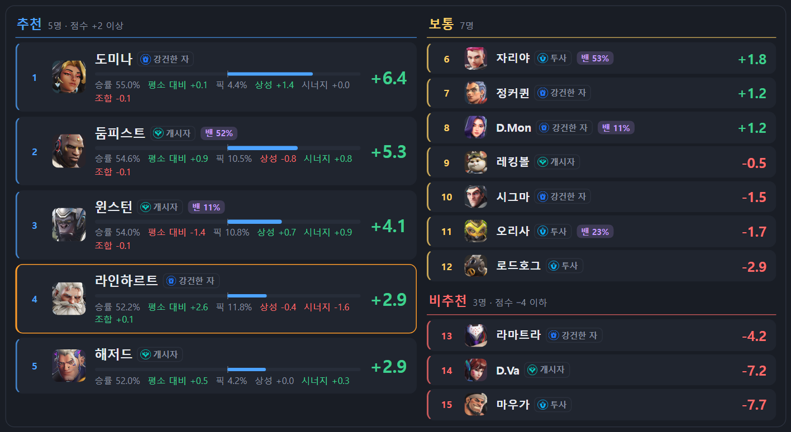
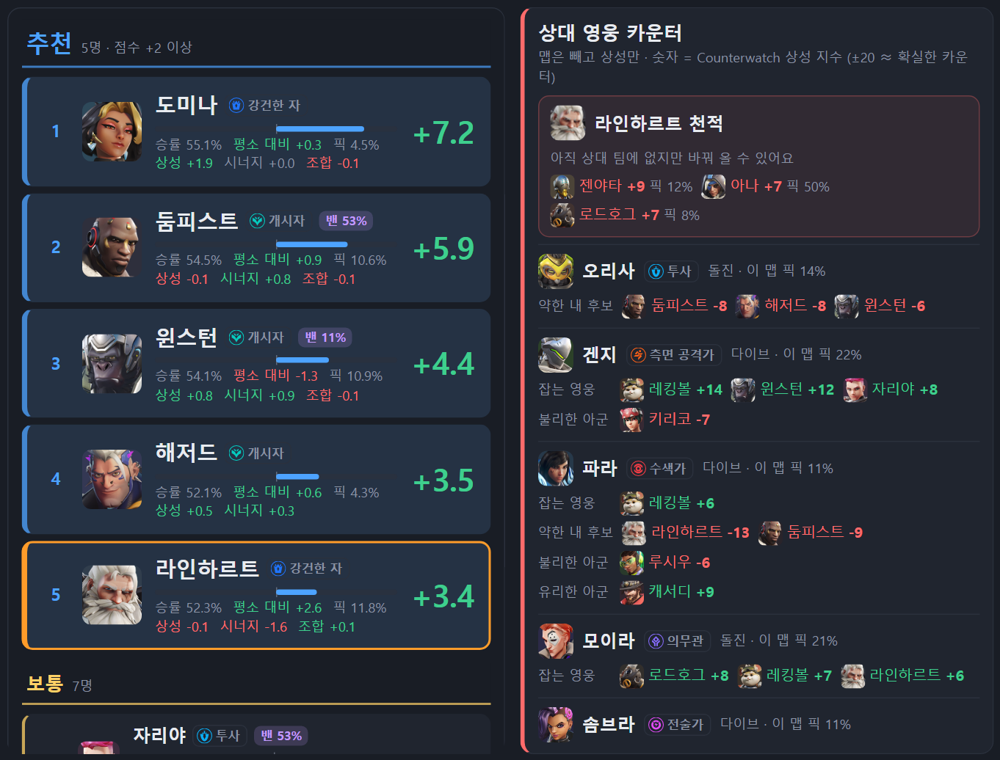
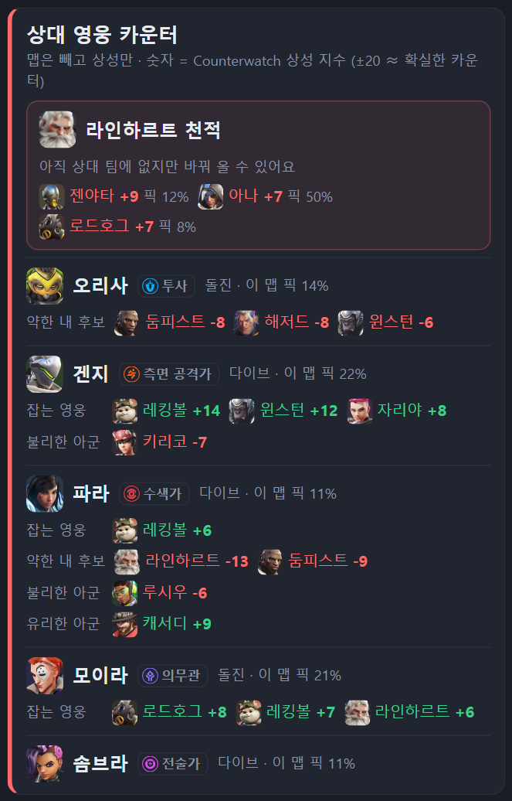
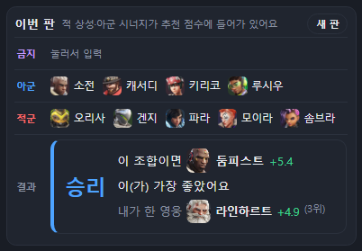
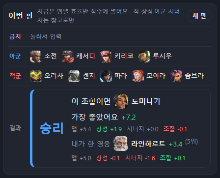

# v0.7.0 상대 영웅 카운터 칸과 새 상성 계산

[← 릴리스 받기](https://github.com/no2thingmore/ow-map-picker-release/releases/tag/v0.7.0) · [처음 화면(README)](../../README.md) · [지난 버전 v0.6.5](v0.6.5.md)

적 영웅마다 카운터 픽을 보여 주는 칸이 생겼고, 상성 계산을 새로 만들었어요. 판 결과의 베스트 픽도 상성까지 넣어 골라요.

사진은 친구가 해 본 판이에요. 리장 타워에서 우리 팀은 소전, 캐서디, 키리코, 루시우, 상대는 오리사, 겐지, 파라, 모이라, 솜브라였어요.

## 한눈에

| v0.6.5 | v0.7.0 |
| --- | --- |
|  |  |

## 추천 목록과 상대 영웅 카운터

추천, 보통, 비추천을 한 칸에 모았어요. 추천은 크게, 비추천은 작게 보여요.

옆에 '상대 영웅 카운터' 칸이 생겼어요. 적 영웅마다 그 적을 잡는 영웅과 피할 영웅을 보여 줘요. 상대를 모르면 추천 영웅마다 이 맵에서 자주 나오는 카운터를 보여 줘요.

| v0.6.5 | v0.7.0 |
| --- | --- |
|  |  |

## 판 결과의 베스트 픽

전에는 계산이 '맵별 효율'이면 맵 점수만 보고 베스트 픽을 골랐어요. 그래서 상대가 파라와 오리사여도 그 맵에서 강한 영웅을 골랐어요. 이제는 상성, 시너지, 조합까지 넣어 고르고 근거도 보여 줘요.

| v0.6.5 | v0.7.0 |
| --- | --- |
|  |  |

## 새 상성 계산

내 자리에 그 영웅을 넣었을 때 이길 확률이 얼마나 바뀌는지 계산해요. 우리 팀이 이미 그 적을 잡고 있는지, 상대가 나를 잡는 영웅으로 바꿔 올지까지 따져요. 점수 크기는 예전과 같아서 맵 점수와의 균형은 그대로예요.

## 그 밖에

- 같은 초에 새 판이 두 번 시작되면 앞 판 기록이 지워지던 문제를 고쳤어요.
- '젠야타이(가)', '바티스트과'처럼 어색한 조사를 고쳤어요.
- 같은 계산을 여러 번 하지 않게 해서 화면이 가벼워졌어요.
