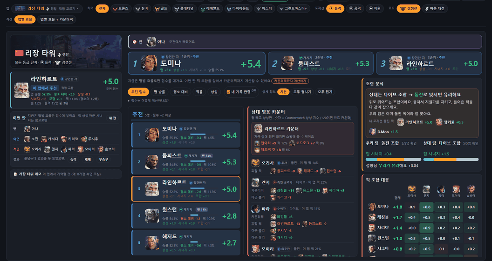
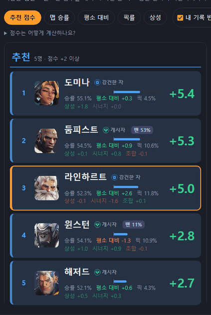
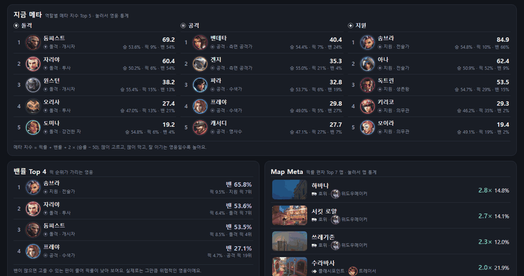
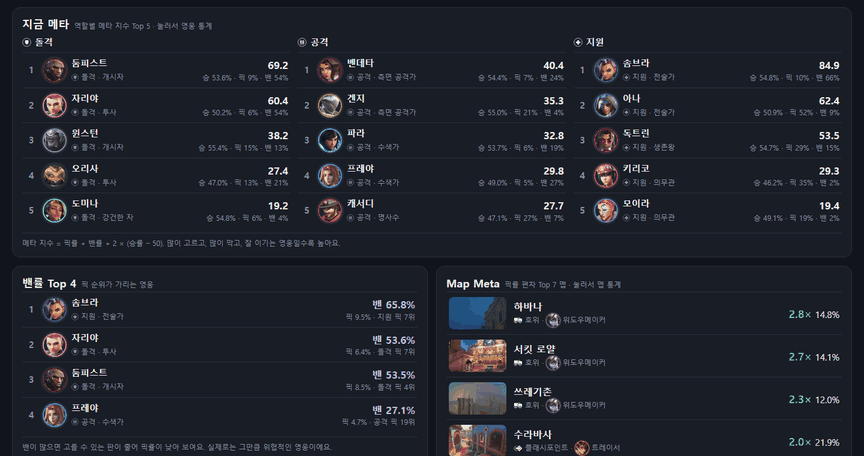

# v0.7.2 · 움짤로 보는 바뀐 점 (화면 움직임)

[← 릴리스 받기](https://github.com/no2thingmore/ow-map-picker-release/releases/tag/v0.7.2) · [처음 화면(README)](../../README.md) · [지난 버전 v0.7.0 사진](v0.7.0.md)

화면에 움직임을 넣은 버전이에요. 정보를 보러 들어온 화면이라 화려하게 하지 않았어요. 대부분 0.2초 안에 끝나요. 오버워치 메뉴 같은 느낌은 '살짝 기울어져 들어오기'로만 냈어요.

움짤은 v0.7.1과 v0.7.2에 **같은 판**을 넣고 같은 크기로 찍었어요. 움직임을 40ms 간격으로 멈춰 가며 찍은 뒤 실제 속도로 이어 붙였어요. 각 움짤은 누르기 전 모습 → 누른 뒤 1초 → 끝난 모습 순서예요.

## 개선 전 / 개선 후

### 티어·맵·포지션을 바꾸면: 칸이 들어오고 그래프가 차오름

- **칸:** 큰 칸들이 살짝 비스듬히 들어와요.
- **그래프:** 점수 막대와 팀 성향 막대가 왼쪽(또는 가운데 기준선)에서 쭉 차요.
- **칩:** 방금 누른 칩만 주황이 사선으로 채워져요.

| 개선 전 (v0.7.1) | 개선 후 (v0.7.2) |
| --- | --- |
|  |  |

### 정렬을 바꾸면: 영웅 행이 새 자리로 옮겨 감

'맵 승률'로 정렬하면 윈스턴이 라인하르트 위로 올라가요. 예전에는 순서가 한 번에 바뀌어서 누가 어디로 갔는지 놓치기 쉬웠어요.

| 개선 전 (v0.7.1) | 개선 후 (v0.7.2) |
| --- | --- |
|  |  |

### 통계: 탭을 열면 픽률·승률 막대가 차오름

| 개선 전 (v0.7.1) | 개선 후 (v0.7.2) |
| --- | --- |
|  |  |

전적 화면의 승률 막대도 같은 방식으로 차올라요.

## 움짤에 안 나온 것

- **페이지 이동:** 추천 ↔ 전적 ↔ 통계 ↔ 바뀐 점으로 옮길 때 새 화면이 사선으로 빠르게(0.24초) 넘어와요.
- **창·알림·펼치기:** 설정·폰·메모 창은 아래에서 살짝 올라오고, 알림은 아래에서 떠올라요. '점수는 어떻게 계산하나요?'는 높이가 부드럽게 펼쳐져요.
- **게임 중에는 움직이지 않음:** 추천 화면은 게임 중 자주 다시 그려지는데, 움직임은 화면이 바뀐 첫 1초만이에요. 1초 안에 다시 그려져도 처음부터 다시 하지 않고 이어서 끝나요.
- **끄는 방법:** Windows 설정 › 접근성 › 시각 효과에서 '애니메이션 효과'를 끄면 모든 움직임이 꺼져요. 그래프도 처음부터 다 찬 채로 보여요.

## 가볍게 만든 방법

- **GPU에서만:** 모든 움직임을 GPU에서만 도는 방식(transform·opacity)으로 만들었어요. 메인 스레드에서 도는 애니메이션은 0개예요. 브라우저 기록(trace)으로 확인했어요.
- **정렬 전환:** 화면 전체를 사진 찍어 바꾸는 방식(View Transition) 대신, 보이는 행만 위치를 옮겨요.
- **GPU로 못 가는 효과:** 막대를 잘라 보이기(clip-path)나 배경 위치처럼 GPU로 못 가는 효과는 덮개를 얹고 그 덮개를 밀어내서 같은 모습을 냈어요.
- **끝나면 저절로 사라짐:** 효과가 끝나면 스스로 사라져서, 표시를 지우느라 화면 전체를 다시 계산하지 않아요.

**측정 결과:** 같은 판으로 쟀어요. 33ms를 넘는 프레임은 화면이 끊겨 보이는 프레임이에요.
- **개발 중 첫 버전 대비:** 티어를 바꿀 때 33ms 넘는 프레임이 8번에서 0번으로 줄었어요.
- **v0.7.1 대비 (보통 PC):** 티어·정렬·계산을 바꿀 때 33ms 넘는 프레임이 없는 것도, 가장 긴 프레임(17ms)도 v0.7.1과 같아요.
- **v0.7.1 대비 (느린 PC, CPU 4배 느리게):** 티어를 바꾸는 첫 프레임만 약간 길어요(50ms → 67ms). 애니메이션 30여 개를 시작하는 비용이에요.
- **끝난 모습:** 움직임이 끝난 화면은 움직임을 끈 화면과 픽셀 단위로 같아요(추천·통계·전적·바뀐 점 화면).

움짤의 판은 시험용이에요.
