# v0.8.0 · 사진으로 보는 바뀐 점 (새 HUD 디자인)

[← 릴리스 받기](https://github.com/no2thingmore/ow-map-picker-release/releases/tag/v0.8.0) · [처음 화면(README)](../../README.md) · [지난 버전 v0.7.2 움짤](v0.7.2.md)

화면 전체를 새로 디자인한 버전이에요. 추천 화면 · 전적 · 통계 · 업데이트 내역이 모두 같은 모양이에요. 기능과 점수 계산은 그대로예요.

- **바탕:** 거의 검정인 남색에 아주 옅은 육각 무늬예요.
- **강조색:** 주황 한 가지만 써요.
- **모양:** 둥근 모서리 대신 각진 칸이에요. 중요한 칸은 모서리에 주황 꺾쇠가 있어요.
- **큰 글씨:** 제목·숫자는 기울인 좁은 글꼴이에요. 본문은 그대로 읽기 쉽게 뒀어요.

사진은 v0.7.3(개발판)과 v0.8.0에 **같은 판**(부산 · 다이아몬드 · 지원, 적 5명, 밴 솜브라)을 넣고 같은 크기로 찍었어요.

## 개선 전 / 개선 후

### 추천 화면 (1920×1080)

- **맨 위 제목:** '실시간 지원 영웅 추천' 제목이 생겼어요. 그 위 한 줄에 맵 국기 · 티어 · 포지션 아이콘이 있어요.
- **1~3순위 카드:** 01·02·03 큰 순위 숫자를 달았어요. 1순위 카드는 주황 테두리로 은은하게 빛나요.
- **조건 선택:** 맵·티어·포지션·모드·계산이 한 칸에 붙은 단추 묶음이에요. 고른 칸만 주황이에요.
- **추천 · 보통 · 비추천:** 표처럼 보여요. 구역 이름이 크고, 줄 왼쪽에 구역 색 띠가 있어요.

| 개선 전 (v0.7.3) | 개선 후 (v0.8.0) |
| --- | --- |
|  | 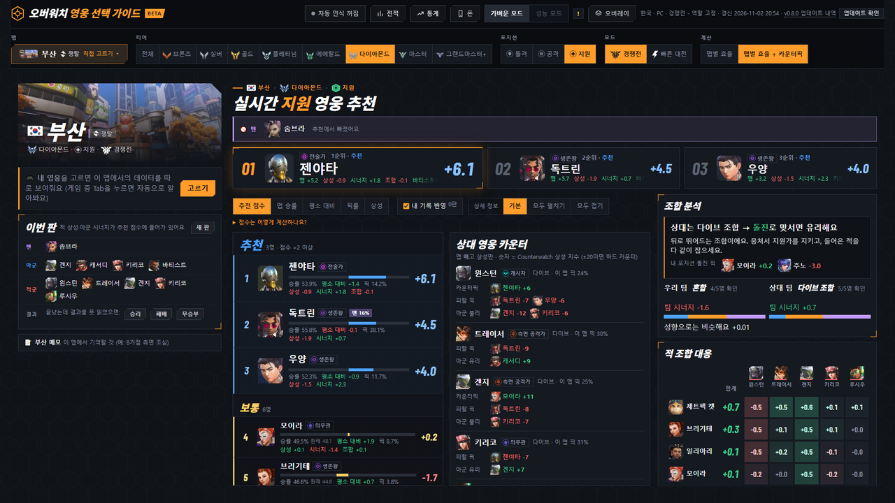 |

### 적 조합 대응

적 5명 × 내 포지션 후보를 한 표로 봐요.

- **합계:** 큰 숫자로 보여요.
- **칸 색:** 그 적에게 강하면 초록, 약하면 빨강이에요. 진할수록 확실해요.
- **가장 까다로운 적:** 표 아래에 있어요.

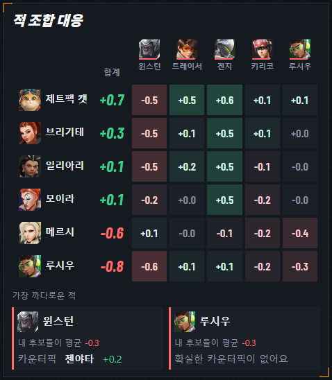

### 포지션 바꾸기 (움짤)

지원 → 돌격 → 공격 → 지원 순서로 눌렀어요. 화면이 다 그려진 모습만 1.3초씩 이어 붙였어요.

| 개선 전 (v0.7.3) | 개선 후 (v0.8.0) |
| --- | --- |
| 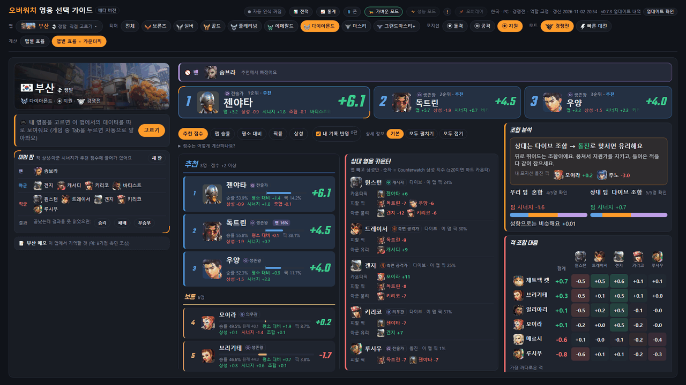 | 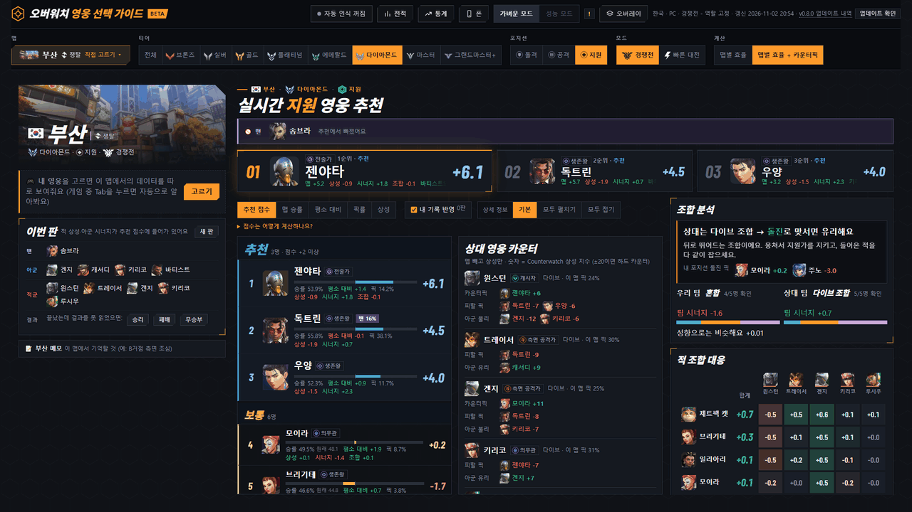 |

### 정렬 바꾸기 (움짤)

맵 승률 → 픽률 → 추천 점수 순서로 눌렀어요.

| 개선 전 (v0.7.3) | 개선 후 (v0.8.0) |
| --- | --- |
| 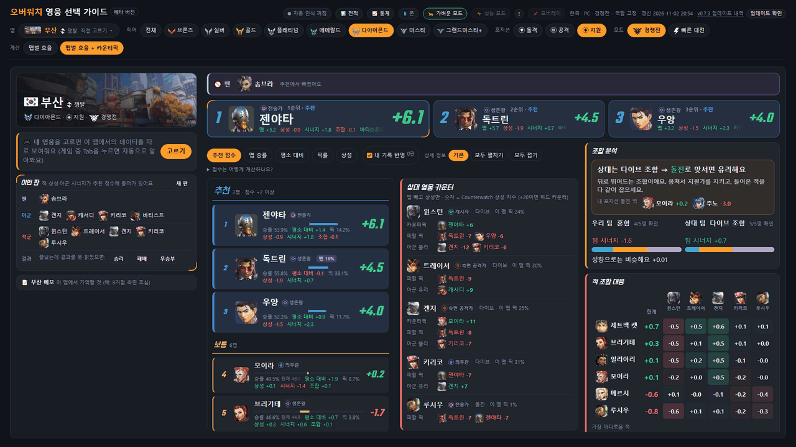 |  |

### 통계 · 전적

로고 머리글, 붙은 탭 단추, 각진 칸·꺾쇠, 큰 숫자 글꼴로 바꿨어요.

| 개선 전 (v0.7.3) | 개선 후 (v0.8.0) |
| --- | --- |
| 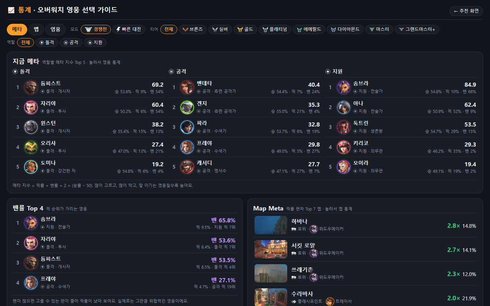 | 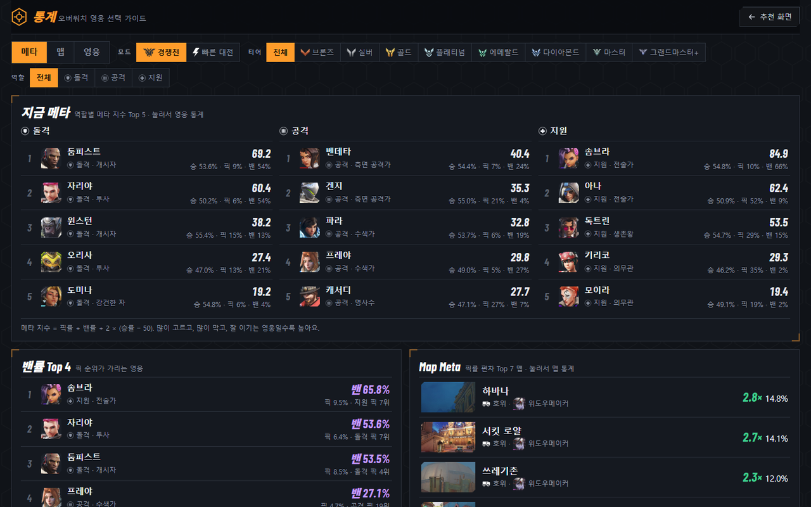 |
| 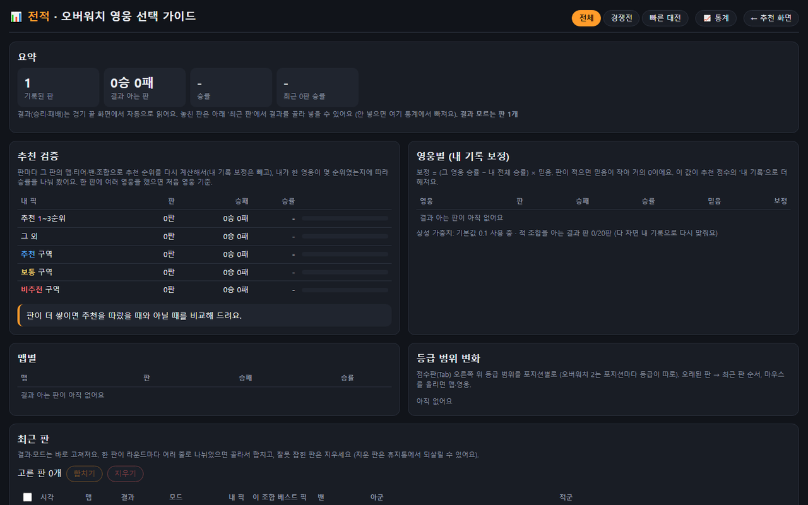 | 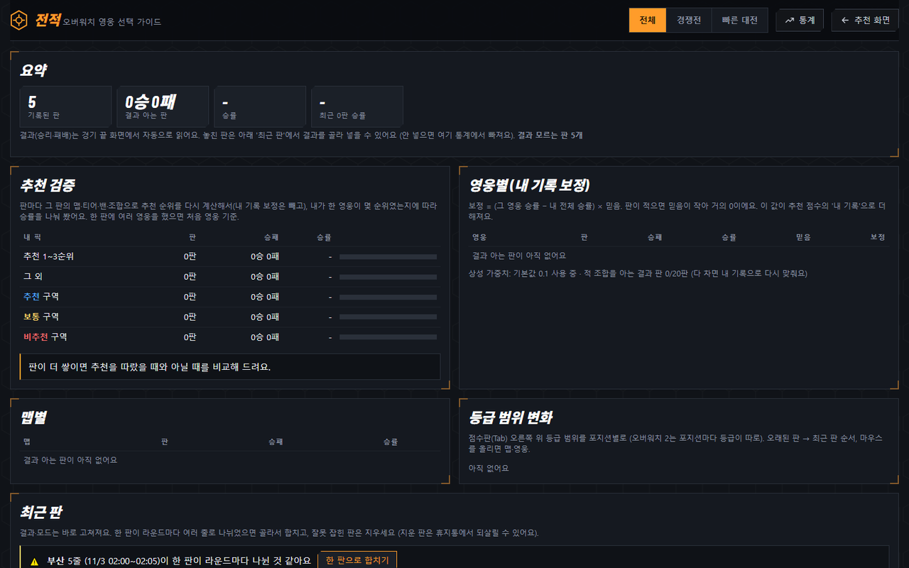 |

### 폰 (390px)

| 개선 전 (v0.7.3) | 개선 후 (v0.8.0) |
| --- | --- |
| 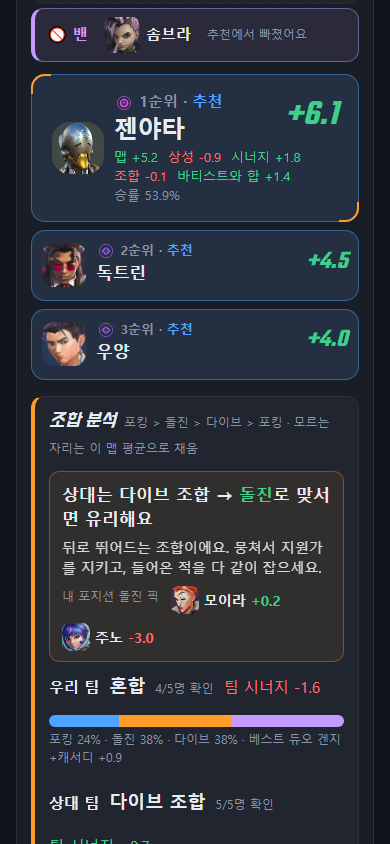 | 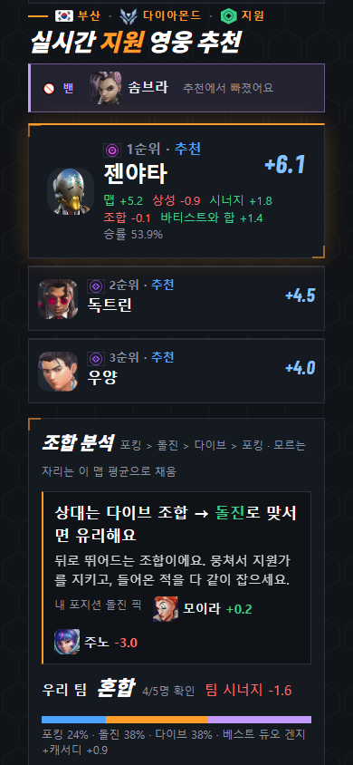 |

## 화면 크기 점검 (360~2560px)

13가지 화면 크기에서 가로로 넘치는 곳, 글자가 잘리거나 겹치는 곳을 찾아 고쳤어요.

- **폰 티어 단추:** 화면 밖으로 잘리던 것을 다음 줄로 내렸어요.
- **폰 적 조합 대응:** 표가 옆으로 넘치던 것을 한 화면에 들어오게 했어요.
- **통계 메타:** 하위 역할 글이 수치와 겹치던 것을 고쳤어요.
- **왼쪽 칸 위치:** 머리글이 두 줄로 꺾여도 맵·이번 판 칸이 그 바로 아래에 붙어요.
- **아래쪽 바탕:** 내용이 짧은 화면에서 아래쪽 바탕이 다른 색으로 남던 것을 고쳤어요.

## 성능

같은 판, 1920×1080에서 티어·정렬·상세 보기를 20번 바꾸며 쟀어요.

- **한 번 바꿀 때:** v0.7.3은 10~11ms, v0.8.0은 12~14ms예요. 둘 다 한 프레임(16ms) 안이에요.
- **긴 작업:** 50ms 넘는 작업은 둘 다 0번이에요.
- **가만히 있을 때:** 10초 동안 스크립트·스타일 계산 시간은 개선 전과 같아요. 디자인 효과가 계속 돌지 않아요.
- **글꼴:** 쓰는 글자만 남겨 네 개 합쳐 58KB예요. 인터넷 없이도 보여요.

사진의 판은 시험용이에요.
