# v0.8.1 추천 목록을 표로, 이번 판을 얼굴 칸으로

[← 릴리스 받기](https://github.com/no2thingmore/ow-map-picker-release/releases/tag/v0.8.1) · [처음 화면(README)](../../README.md) · [지난 버전 v0.8.0](v0.8.0.md)

추천 화면 칸 구성 변경. 목록은 열이 맞는 표, 이번 판은 얼굴 칸. 점수 계산은 그대로.

## 추천 화면

목록 맨 위에 머리줄, 그 아래로 열 정렬. 이번 판 적과 아군은 얼굴 칸, 칸을 누르면 바로 고치기. 조합 분석은 오른쪽 위로.

| v0.8.0 | v0.8.1 |
| --- | --- |
| 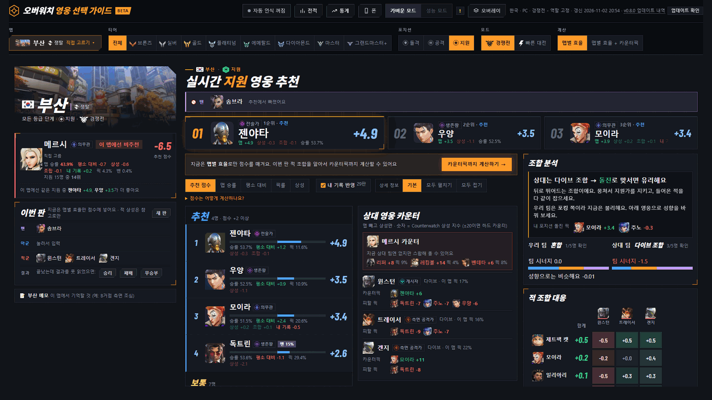 | 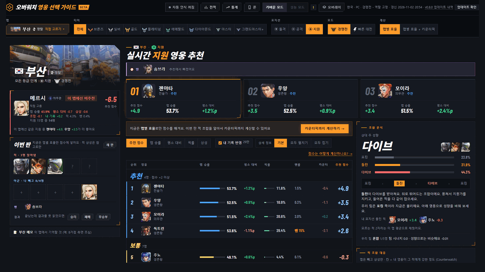 |

## 1~3순위 카드

카드마다 추천 점수, 맵 승률, 평소 대비. 적을 알면 평소 대비 대신 카운터픽 점수.

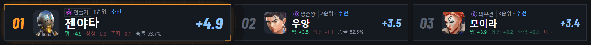

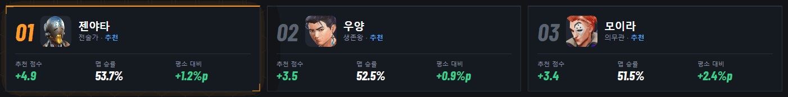

## 조합 분석

상대 주 성향을 크게, 그 성향인 적 얼굴과 함께. 포킹, 돌진, 다이브 막대와 어느 성향으로 받아칠지 한 줄 요령.

| v0.8.0 | v0.8.1 |
| --- | --- |
| 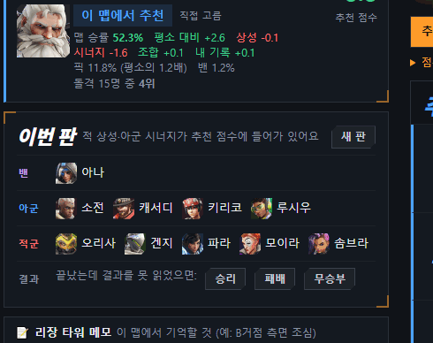 | 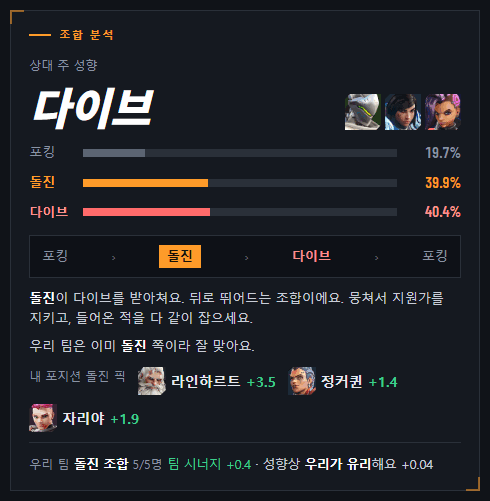 |

## 적 조합 대응

후보마다 추천 순위 표시.

| v0.8.0 | v0.8.1 |
| --- | --- |
| 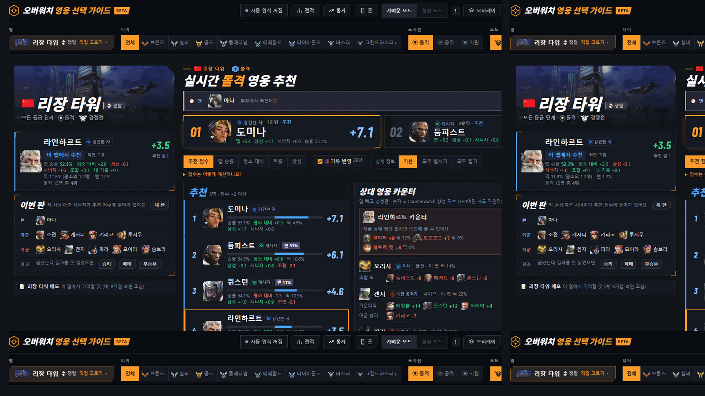 | 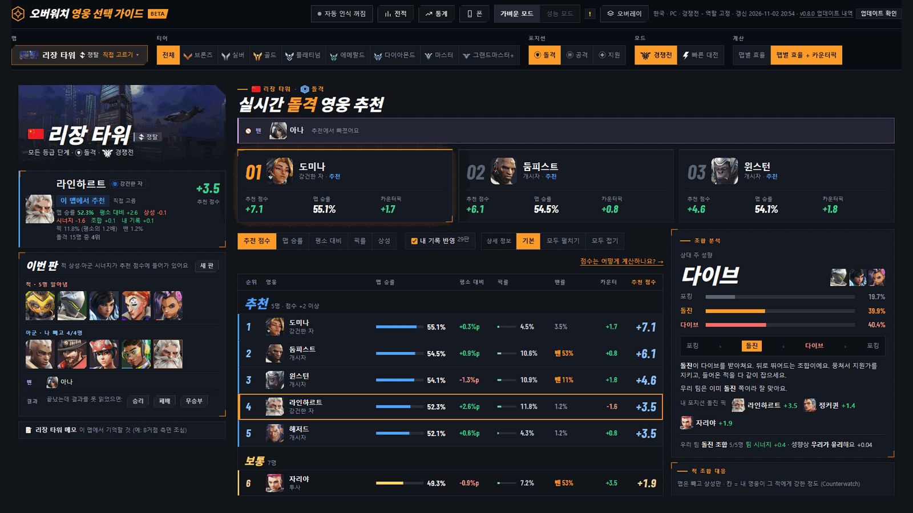 |

## 폰

좁은 화면에서는 숫자를 영웅 이름 아래 한 줄로. 글자가 세로로 꺾이던 문제도 고침.

| v0.8.0 | v0.8.1 |
| --- | --- |
| 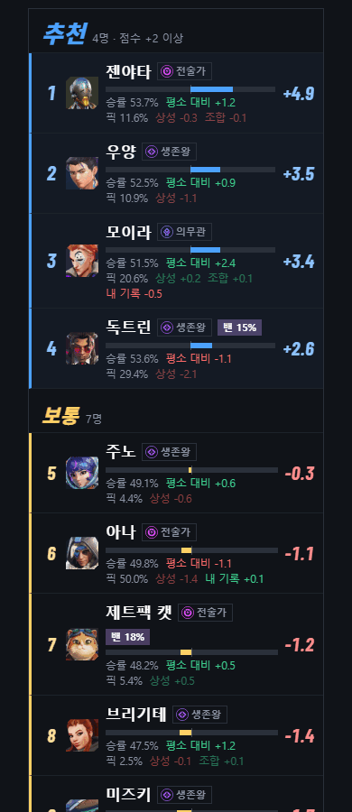 | 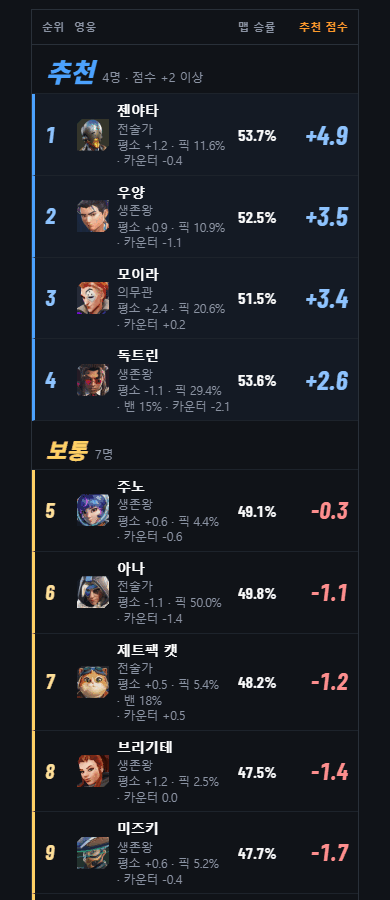 |
| 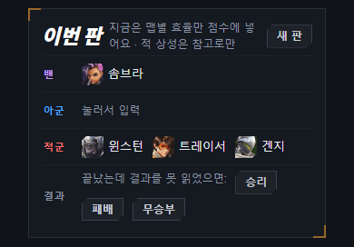 | 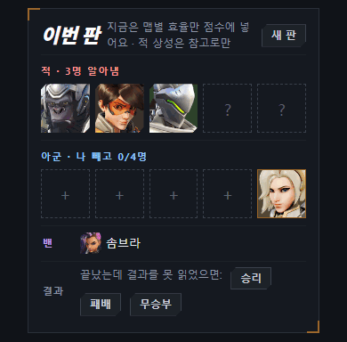 |

## 그 밖에

- [추가] '추천 점수 계산법' 칸에 지금 계산식을 한 줄로. 정렬 줄 오른쪽 '점수 계산법 →'을 누르면 바로 이동
- [고침] 태블릿에서 추천 점수가 줄 밖으로 밀려나던 문제
