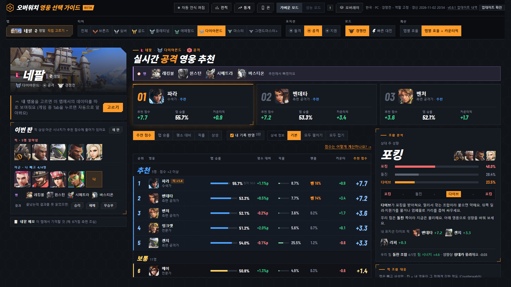
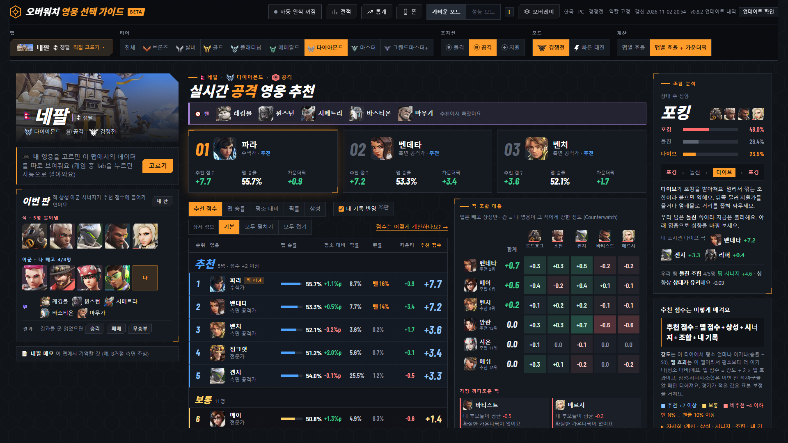
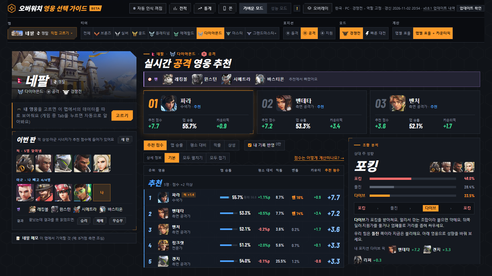
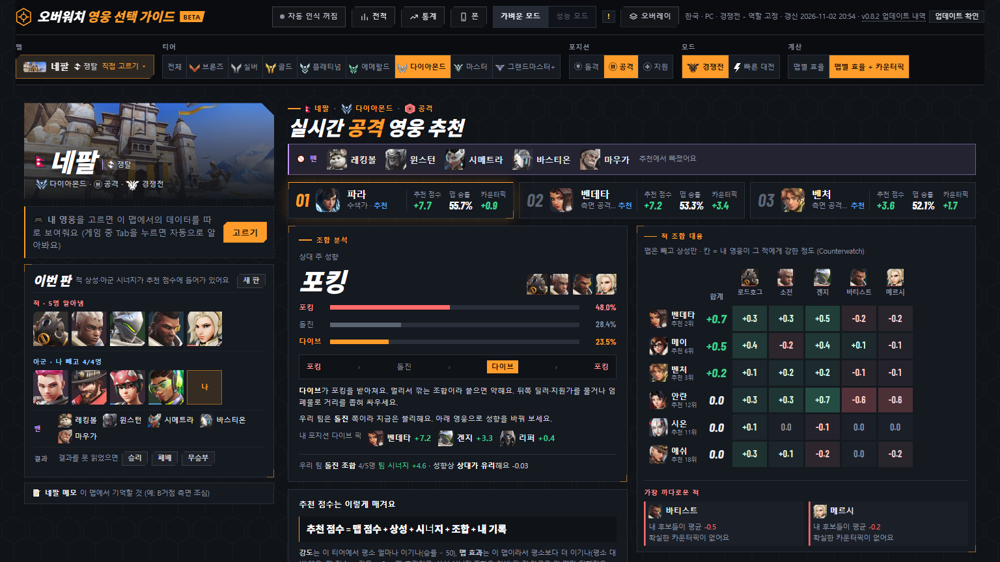
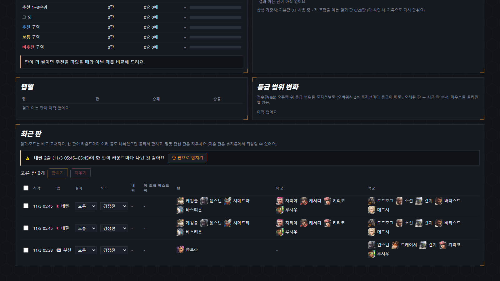
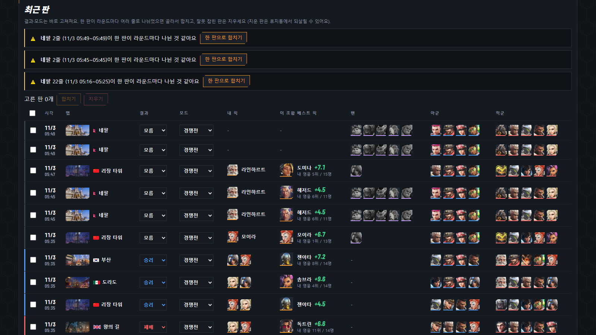
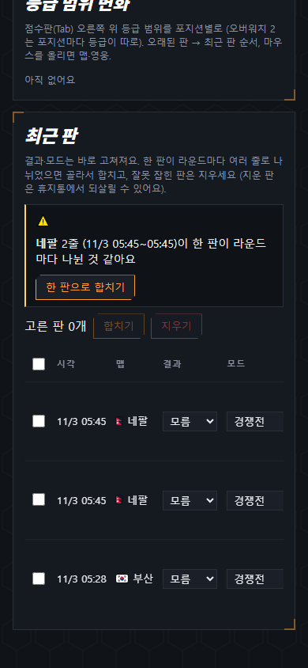
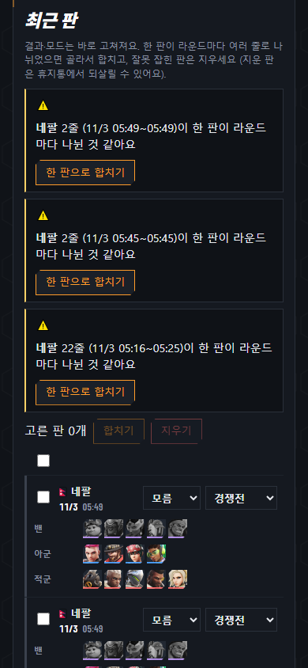

# v0.8.2 추천 화면을 중요한 순서대로, 밴은 5명까지

[← 릴리스 받기](https://github.com/no2thingmore/ow-map-picker-release/releases/tag/v0.8.2) · [처음 화면(README)](../../README.md) · [지난 버전 v0.8.1](v0.8.1.md)

1~3순위, 적 조합 대응, 추천 목록 순서로 칸을 다시 놓았어요. 대기실 금지가 생겨서 밴도 5명까지 받아요. 점수 계산은 그대로예요.

## 넓은 화면

목록과 적 조합 대응이 가운데에 나란히 있고, 조합 분석은 오른쪽에 세로로 있어요. 1~3순위 카드는 가운데 두 칸 폭에 맞췄어요.

| v0.8.1 | v0.8.2 |
| --- | --- |
|  |  |

## 확대했을 때

브라우저 폭이 1880px보다 좁으면 1~3순위를 작은 카드로 줄여요. 그 아래 조합 분석과 적 조합 대응이 한 화면에 들어와요. 목록은 아래로 내리면 있어요.

| v0.8.1 | v0.8.2 |
| --- | --- |
|  |  |

## 전적 '최근 판'

추천 화면의 '이번 판'처럼 영웅을 얼굴 칸으로 보여 줘요. 줄 왼쪽 색이 결과이고, 밴은 흑백이에요. 폰에서는 판마다 카드 한 장이에요.

| v0.8.1 | v0.8.2 |
| --- | --- |
|  |  |
|  |  |

## 대기실 금지

2026년 6월 17일 패치로 다섯 번째 금지가 생겼어요. 금지 결과 화면을 영웅 그림으로 읽어서 5명 모두 알아봐요. 글자로 읽을 때보다 정확해요. 칸이 늦게 열려도 8초 동안 다시 읽어요.

점수판과 VS 화면의 밴 칸도 5칸까지 읽어요. 다만 실제 5칸 점수판 사진으로는 아직 확인하지 못했어요.

## 그 밖에

- 작은 카드에서 '추천' 글자가 잘리던 문제를 고쳤어요.
- 좁은 목록에서 글자가 승률 막대를 누르던 문제를 고쳤어요.
- 폰에서 적 조합 대응 표가 옆으로 넘치던 문제를 고쳤어요.
