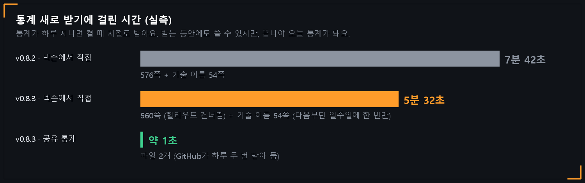
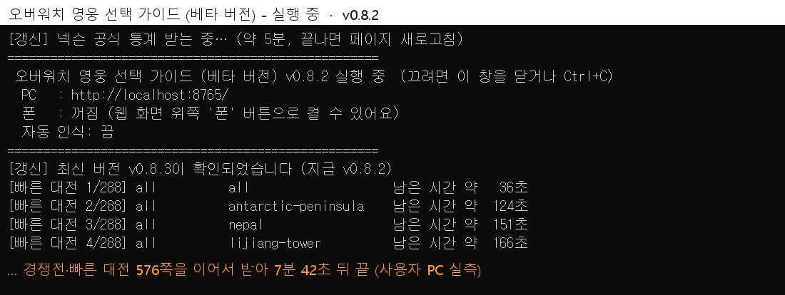
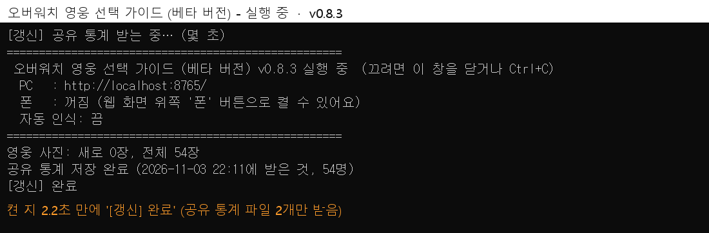
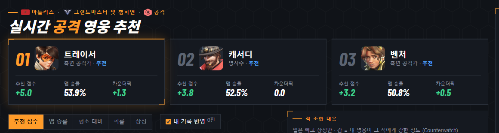
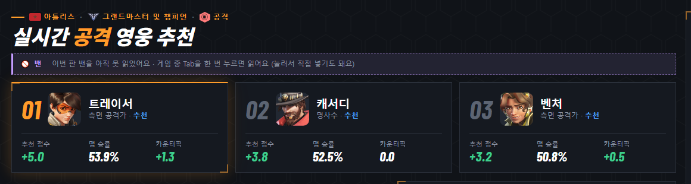

# v0.8.3 통계 받기가 7분에서 1초로

[← 릴리스 받기](https://github.com/no2thingmore/ow-map-picker-release/releases/tag/v0.8.3) · [처음 화면(README)](../../README.md) · [지난 버전 v0.8.2](v0.8.2.md)

하루에 한 번 받는 통계가 거의 바로 끝나요. 추천 점수 계산은 그대로예요.

## 통계 받기

v0.8.2는 넥슨에서 576쪽을 하나씩 받느라 7분 42초가 걸렸어요. v0.8.3은 GitHub가 하루 두 번 미리 받아 둔 통계 파일 두 개만 받아서 1초쯤이면 끝나요.

미리 받아 둔 통계가 없거나 30시간 넘게 지났으면 예전처럼 넥슨에서 직접 받아요. 이때도 5분 32초로 줄었고, 경쟁전 '전체'부터 받아서 1분쯤 뒤면 화면에 들어와요.

## 프로그램 창

| v0.8.2 | v0.8.3 |
| --- | --- |
|  |  |

v0.8.2는 '약 5분'이라고 나왔지만 실제로는 7분 넘게 걸렸어요. v0.8.3은 켠 지 2초쯤 지나 '[갱신] 완료'가 나와요.

## 밴 안내

적과 아군을 화면에서 직접 넣으면 '이번 판 밴을 아직 못 읽었어요' 안내가 사라지던 문제를 고쳤어요.

| v0.8.2 | v0.8.3 |
| --- | --- |
|  |  |
