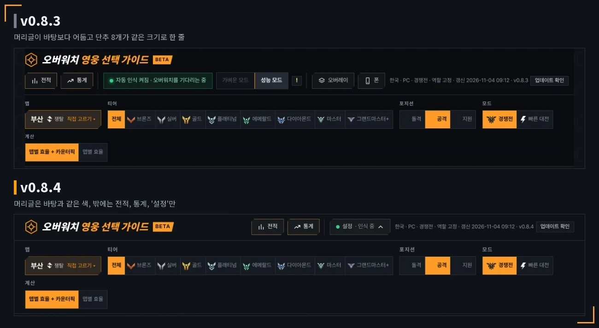
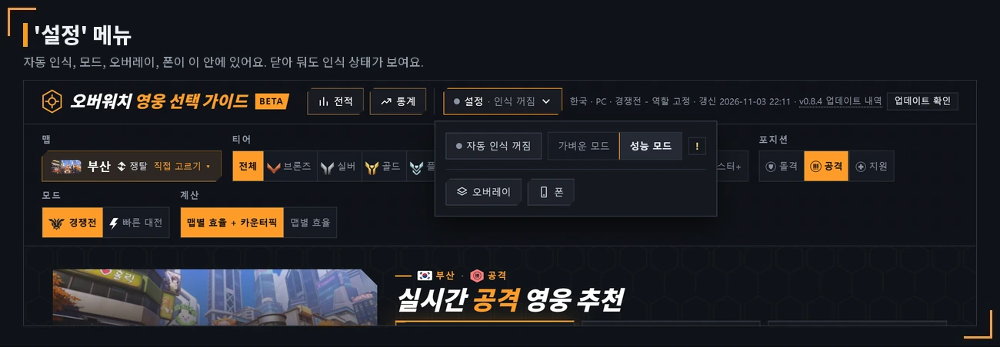
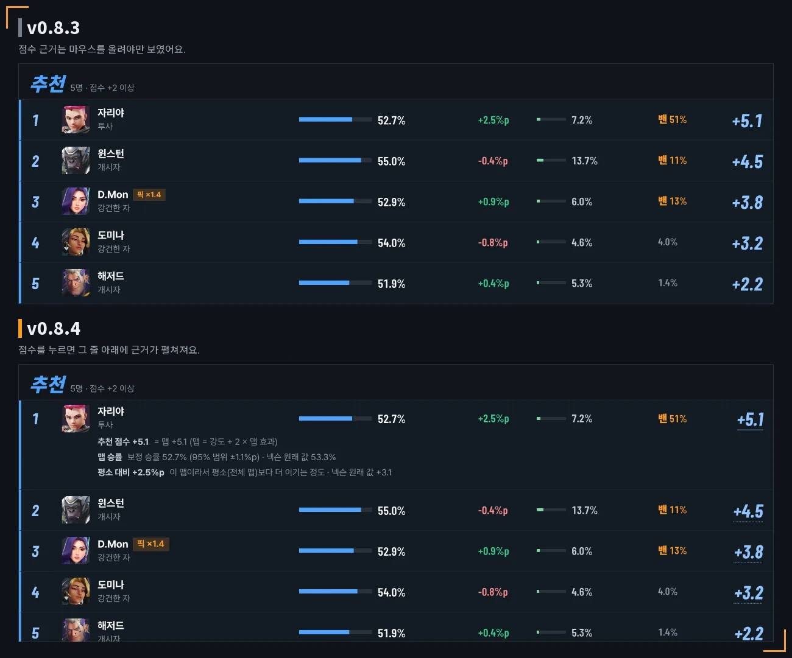
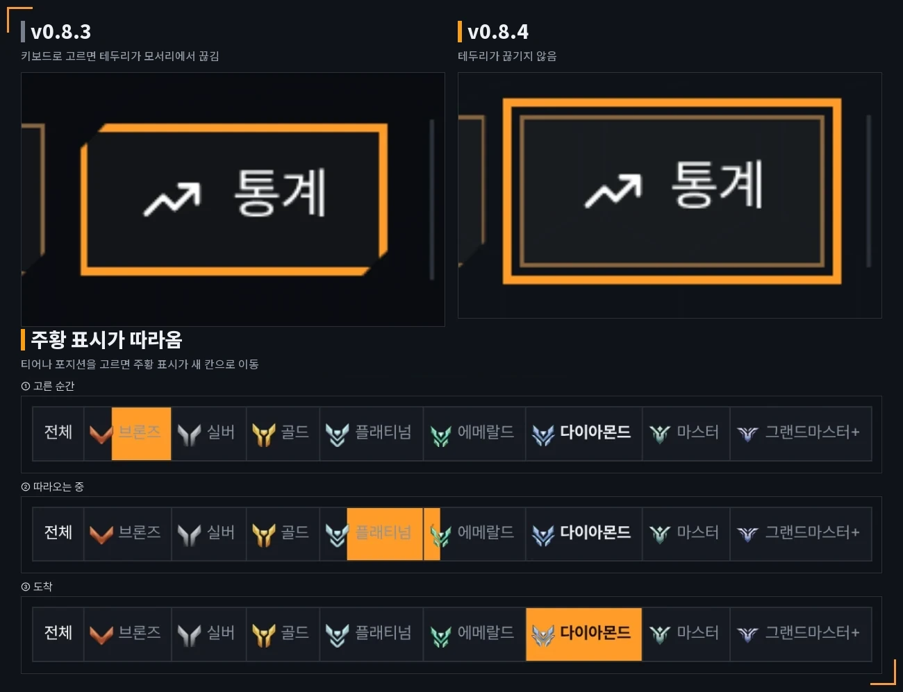
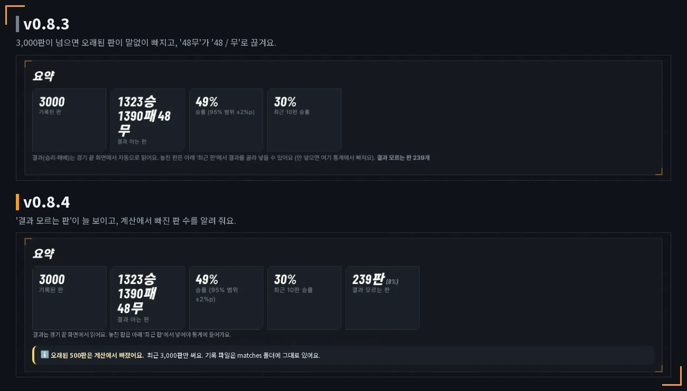

# v0.8.4 머리글 단추 8개 → 3개, 점수를 누르면 근거 표시

[← 릴리스 받기](https://github.com/no2thingmore/ow-map-picker-release/releases/tag/v0.8.4) · [처음 화면(README)](../../README.md) · [지난 버전 v0.8.3](v0.8.3.md)

머리글 밖에는 전적, 통계, '설정'만. 추천 점수를 누르면 근거가 펼쳐지고, 내 기록 보정은 같은 포지션끼리 비교.

## 머리글

단추 8개 → 3개. 머리글 색은 바탕과 같게.

## '설정' 메뉴

자동 인식, 모드, 오버레이, 폰이 이 안에. 메뉴를 닫아도 인식 상태 표시.

## 점수 근거

추천 점수를 누르면 그 줄 아래에 근거가 펼쳐짐. 전에는 마우스를 올려야만 보여서 폰에서는 볼 수 없었음.

## 키보드 테두리와 주황 표시

키보드로 단추를 고를 때 주황 테두리가 모서리에서 끊기지 않음. 티어나 포지션을 바꾸면 주황 표시가 새 칸으로 이동.

## 전적

'결과 모르는 판' 늘 표시, 15% 넘으면 알림. 기록이 3,000판을 넘으면 계산에서 빠진 판 수 표시. '포지션별' 표 추가.

## 그 밖에

- [개선] 내 기록 보정을 같은 포지션끼리 비교
- [개선] 작은 글자와 단추 키움. 한국어가 낱말 중간에서 줄바꿈되지 않음
- [개선] 폰 '보기 전용' 옆에 '고치기는 PC 화면에서' 안내
- [개선] 처음 설치 3초쯤 빨라짐. 업데이트 중 구성요소를 못 받아도 지금 버전으로 실행
- [고침] 지원을 잘하면 지원 영웅이 모두 '잘하는 영웅'으로 나오던 문제
- [고침] 자동 실행(autostart.bat)을 켜도 아무것도 안 하던 문제
