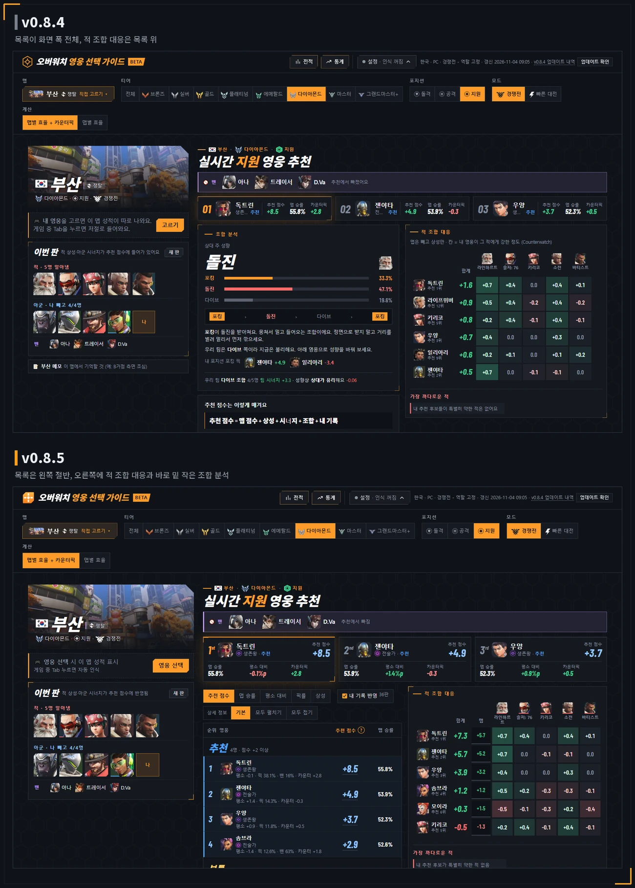
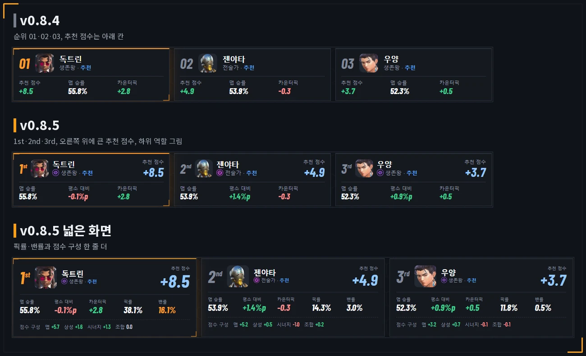
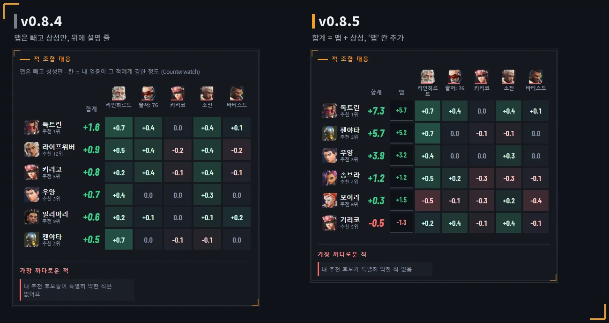
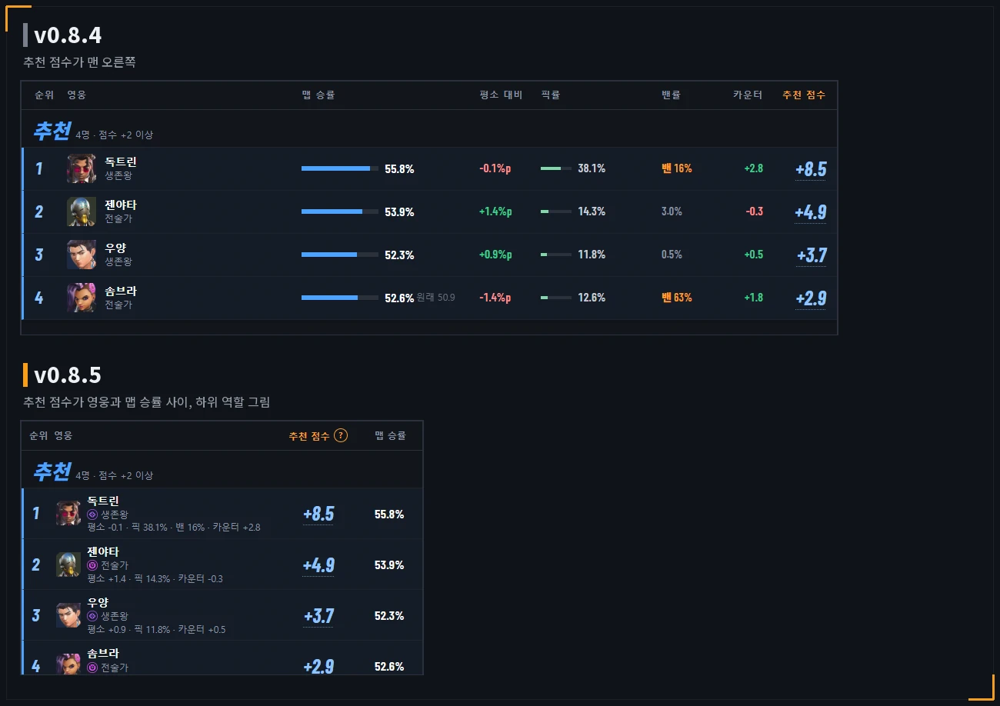
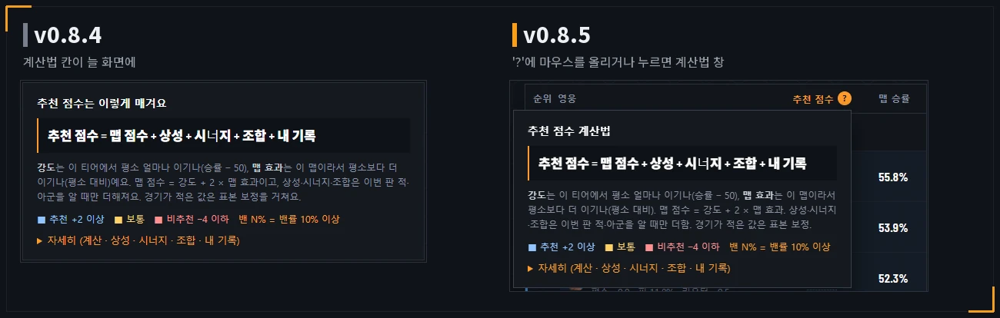
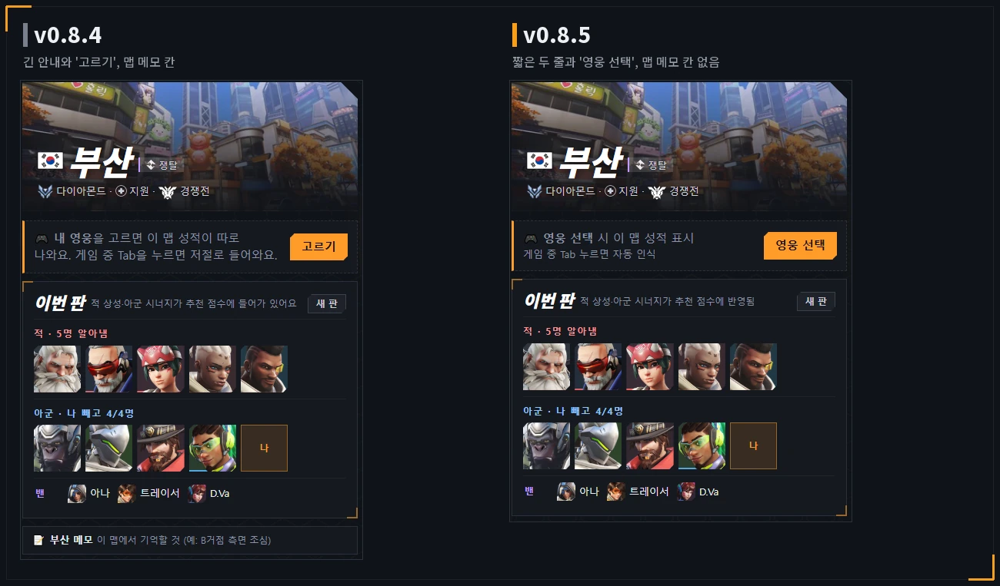
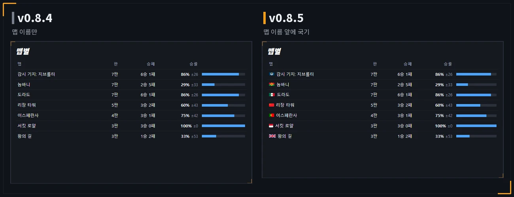
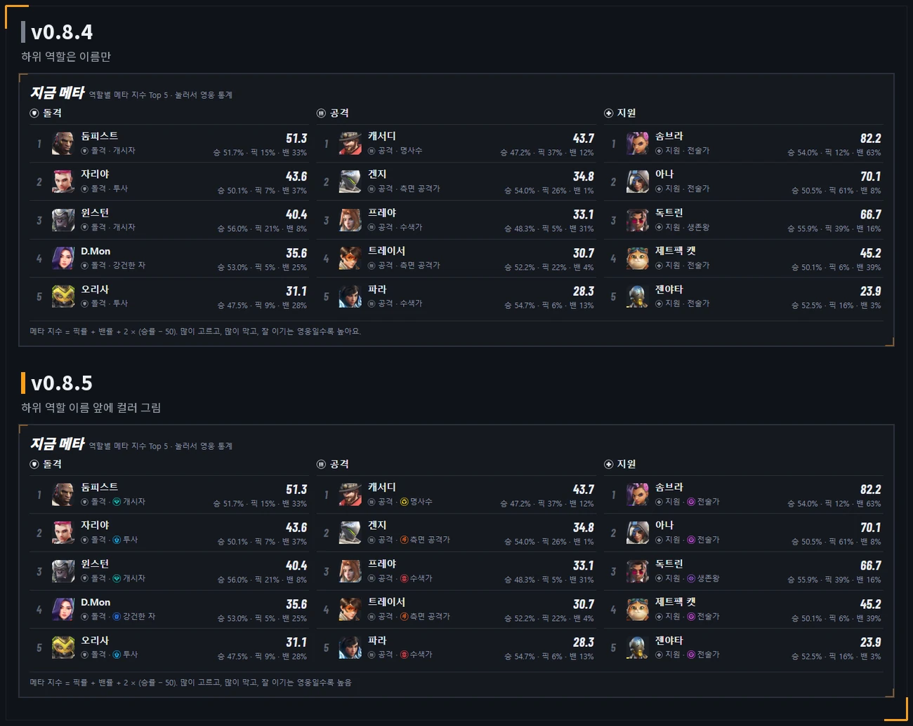

# v0.8.5 추천 목록 옆에 적 조합 대응, 1~3순위 카드에 큰 추천 점수

[← 릴리스 받기](https://github.com/no2thingmore/ow-map-picker-release/releases/tag/v0.8.5) · [처음 화면(README)](../../README.md) · [지난 버전 v0.8.4](v0.8.4.md)

추천 목록은 왼쪽 절반, 오른쪽에 적 조합 대응과 조합 분석. 1~3순위 카드는 1st·2nd·3rd와 큰 추천 점수. 추천 점수 계산은 그대로, 적 조합 대응만 맵 점수를 더해 줄 세움.

## 추천 화면 배치

목록은 왼쪽 절반, 오른쪽 위 적 조합 대응, 바로 밑 작은 조합 분석. 좁은 화면은 적 조합 대응 → 조합 분석 → 목록 순서. 판 정보가 바뀔 때 화면 다시 그리기 5배쯤 빨라짐.

## 1~3순위 카드

순위는 1st·2nd·3rd, 추천 점수는 오른쪽 위에 크게. 아래 칸은 맵 승률·평소 대비·픽률, 적·아군을 알면 픽률 자리에 카운터픽. 넓은 화면은 픽률·밴률과 점수 구성 한 줄 더.

## 적 조합 대응

합계 = 맵 점수 + 상성, 줄 순서도 이 합계로. '맵' 칸 추가, 위 설명 줄은 뺌. 적 영웅별 칸은 그대로 상성.

## 추천 목록

추천 점수가 영웅과 맵 승률 사이 가운데. 하위 역할 이름 앞에 컬러 그림.

## 계산법

늘 보이던 계산법 칸 대신 목록 머리줄 '추천 점수' 옆 '?'. 마우스를 올리면 열리고 떼면 닫힘, 누르면 고정, Esc나 바깥을 누르면 닫힘.

## 왼쪽 칸

내 영웅 안내는 짧은 두 줄, 단추 이름 '영웅 선택'. 맵 메모 칸은 뺌. 적어 둔 메모는 memos.json에 그대로.

## 전적과 통계

전적 '맵별' 표의 맵 이름 앞에 국기. 통계의 하위 역할 이름 앞에 컬러 그림.

## 그 밖에

- [추가] 업데이트 내역에 버전마다 요약 한 줄과 [추가]·[개선]·[고침] 표시
- [개선] 새 아이콘: 모서리 깎은 주황 칸 + 각진 조준선. 머리글, 브라우저 탭, 바탕 화면 바로가기 모두 같은 그림
- [개선] 화면, 검은 창, 사용법 글을 짧은 개조식으로
- [개선] 상대 영웅 카운터 칸은 화면에서 뺌
