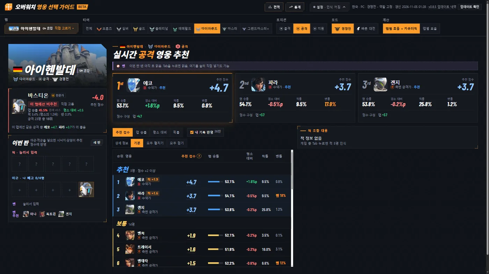
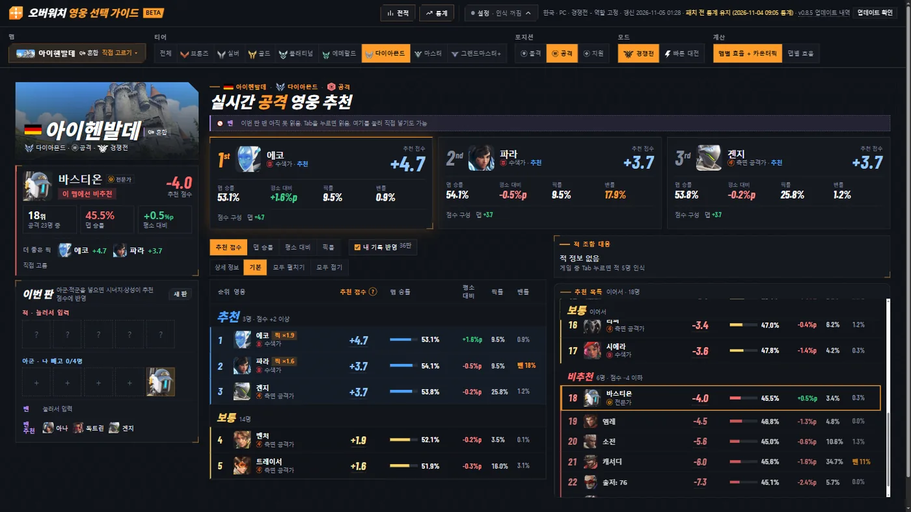
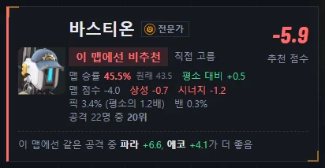
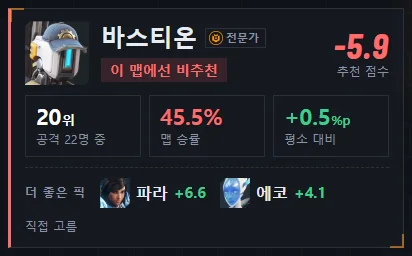
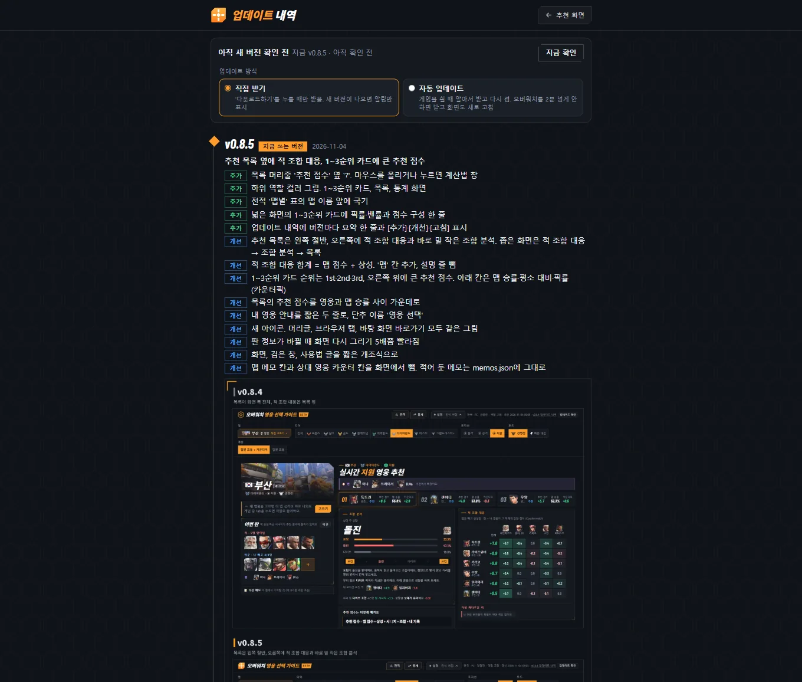
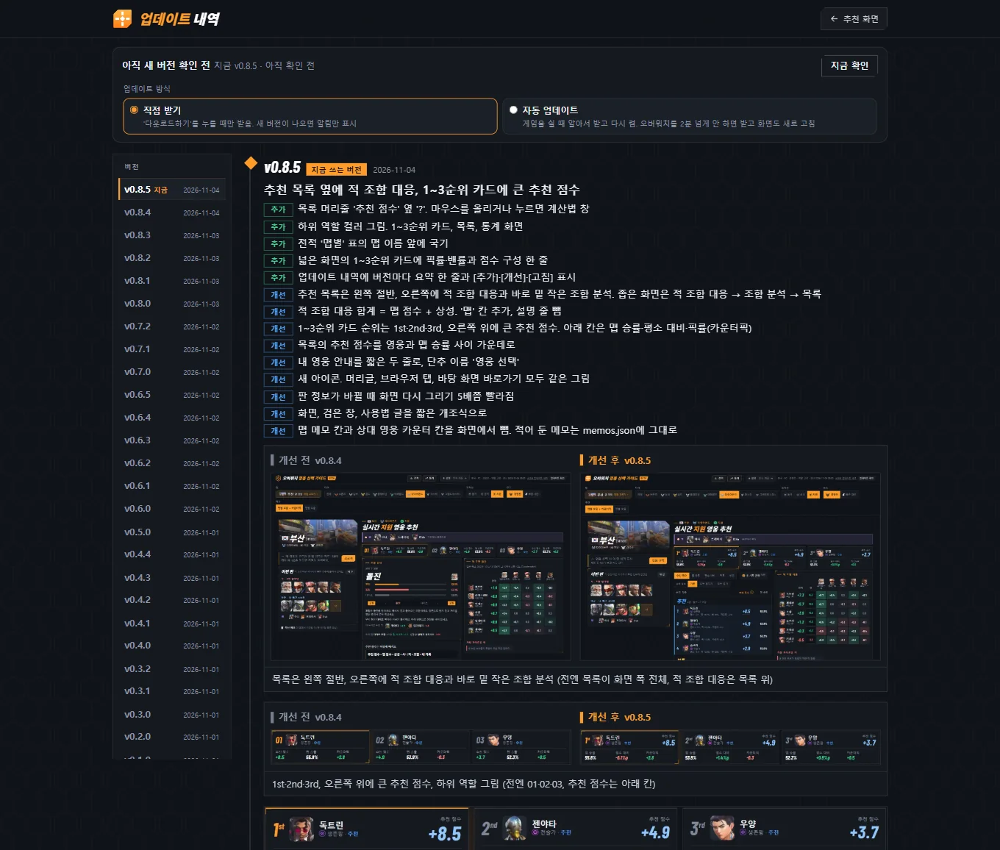
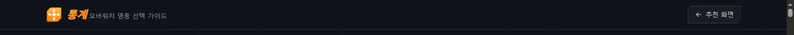
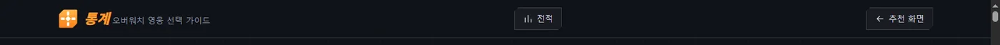
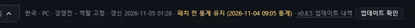
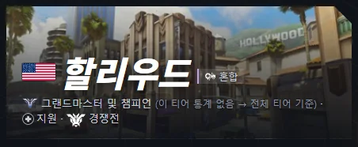

# v0.8.6 넓은 화면은 목록 이어서, 내 영웅 칸은 핵심만 크게, 패치 직후엔 이전 통계 유지

[← 릴리스 받기](https://github.com/no2thingmore/ow-map-picker-release/releases/tag/v0.8.6) · [처음 화면(README)](../../README.md) · [지난 버전 v0.8.5](v0.8.5.md)

큰 화면에서 왼쪽 목록이 넘치면 나머지 줄은 오른쪽 아래 '추천 목록 이어서' 칸에. 내 영웅 칸은 판정·추천 점수·순위·맵 승률·평소 대비·더 좋은 픽만 크게. 게임 패치 직후 새 통계가 너무 적으면 패치 전 통계를 그대로 씀.

## 큰 화면 추천 화면

왼쪽 목록은 화면에 들어오는 줄까지, 나머지는 오른쪽 아래 '추천 목록 이어서' 칸에서 스크롤. 내 영웅 줄은 그 칸 가운데에 오고, 위로 갈수록 추천, 아래로 갈수록 비추천. 오른쪽 칸이 적 조합 대응과 조합 분석으로 꽉 차면 전처럼 왼쪽 목록이 스크롤.

| 개선 전 v0.8.5 | 개선 후 v0.8.6 |
|---|---|
|  |  |

## 내 영웅 칸

핵심만 크게: 이름과 판정, 큰 추천 점수, 큰 숫자 세 칸(역할 안 순위 · 맵 승률 · 평소 대비), 더 좋은 픽. 맵 점수·상성·시너지·픽률·밴률은 점수에 마우스를 올리면.

| 개선 전 v0.8.5 | 개선 후 v0.8.6 |
|---|---|
|  |  |

## 업데이트 내역 화면

왼쪽에 버전 목록(누르면 그 버전으로), 개선 전은 왼쪽·개선 후는 오른쪽에 크게, 누르면 확대. 요약과 사진 설명 글자도 크게.

| 개선 전 v0.8.5 | 개선 후 v0.8.6 |
|---|---|
|  |  |

## 통계 화면 머리글

'전적' 단추 추가. 모든 화면의 왼쪽 위 아이콘을 누르면 추천 화면.

| 개선 전 v0.8.5 | 개선 후 v0.8.6 |
|---|---|
|  |  |

## 패치 직후 이전 통계 유지

넥슨 공식 통계는 게임 패치마다 0부터 다시 쌓여서 패치 직후 며칠은 판 수가 아주 적음. 새 통계 판 수가 지금 통계의 1/6 미만이면 지금 통계를 그대로 두고(최대 7일) 머리글에 표시. 새 통계가 쌓이면 저절로 바뀜.

## 티어에 맵 통계가 없을 때

고른 티어에 그 맵 통계가 없으면(예: 그랜드마스터 할리우드) 빈 화면 대신 전체 티어 기준으로 추천하고 안내.

