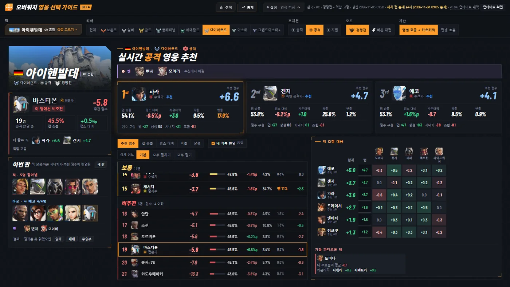
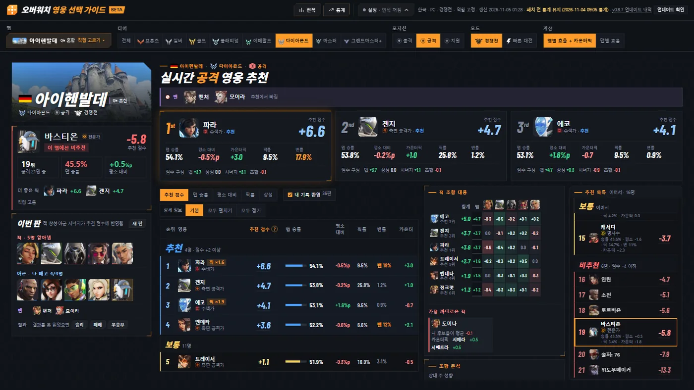
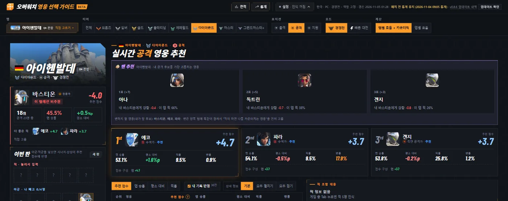
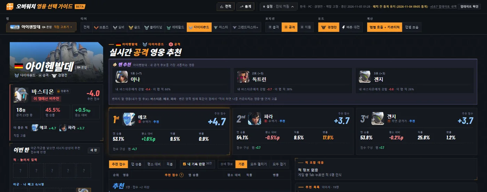
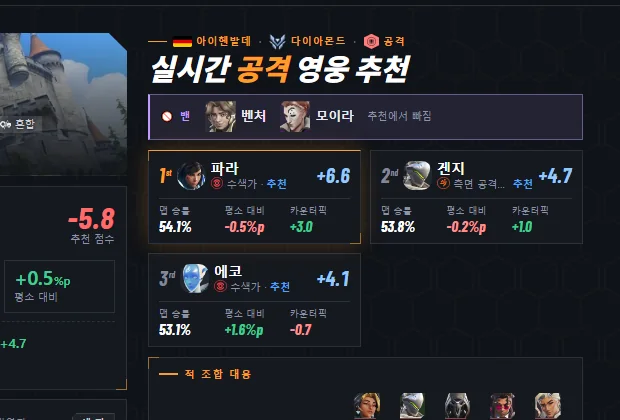
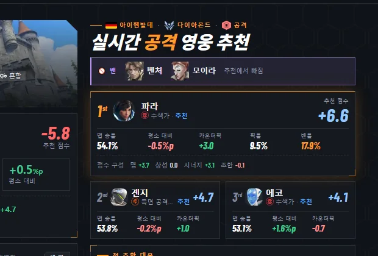
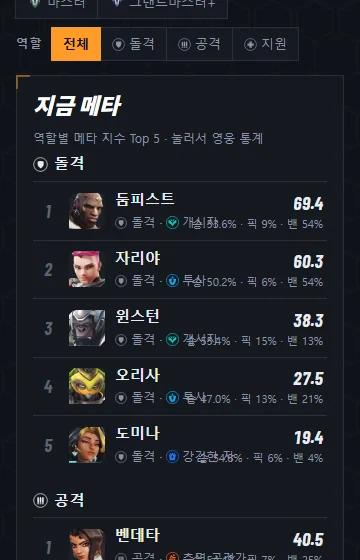
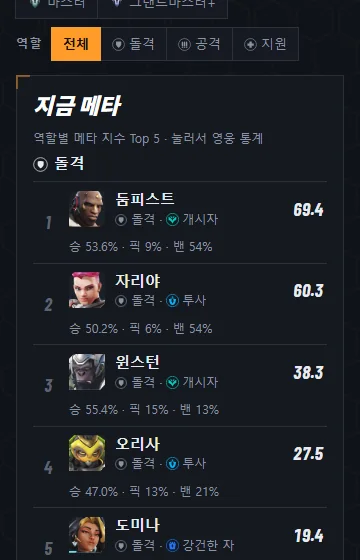

# v0.8.7 적을 아는 판에도 추천 목록 이어서, 밴 추천 카드 정리, 폰 통계 겹침 고침

[← 릴리스 받기](https://github.com/no2thingmore/ow-map-picker-release/releases/tag/v0.8.7) · [처음 화면(README)](../../README.md) · [지난 버전 v0.8.6](v0.8.6.md)

적을 아는 판에서도 큰 화면의 '추천 목록 이어서' 칸이 생김(적 조합 대응 표 옆에 세로로). 밴 추천 카드는 얼굴 옆에 표 수와 이름. 정렬·상세 보기를 바꿀 때 화면이 바로 바뀜.

## 큰 화면 추천 화면 (적을 아는 판)

적 조합 대응과 조합 분석을 왼쪽 묶음으로 세우고(표는 얼굴만 보이는 좁은 모양), 오른쪽 남는 폭에 '추천 목록 이어서'. 두 칸 다 따로 스크롤. 내 영웅 줄이 그 칸 가운데.

| 개선 전 v0.8.6 | 개선 후 v0.8.7 |
|---|---|
|  |  |

## 밴 추천 카드

얼굴 옆에 표 수와 이름, 아래 이유 한 줄. 전에는 얼굴만 가운데 홀로 있고 글은 맨 아래.

| 개선 전 v0.8.6 | 개선 후 v0.8.7 |
|---|---|
|  |  |

## 결과 칸이 좁을 때 1~3순위

900px쯤 되는 창: 1순위는 한 줄 전체, 2·3순위는 그 아래 나란히. 전에는 3순위만 다음 줄에 반 폭으로.

| 개선 전 v0.8.6 | 개선 후 v0.8.7 |
|---|---|
|  |  |

## 폰 통계 화면

'지금 메타' 줄의 역할 이름이 오른쪽 수치와 겹치던 문제. 좁은 화면에서는 수치 줄을 이름 아래로.

| 개선 전 v0.8.6 | 개선 후 v0.8.7 |
|---|---|
|  |  |

## 그 밖에

- [개선] 정렬·상세 보기를 바꿀 때 화면이 바로 바뀜 (900~1600px 창)
- [개선] 적 조합 대응 표의 '추천 N위' 글자 조금 크게
- [고침] 폰에서 내 영웅 칸 순위 설명이 '공격 21…'로 잘리던 문제
- [고침] 1240px 창에서 전적 '최근 판' 표가 옆으로 넘치던 문제
