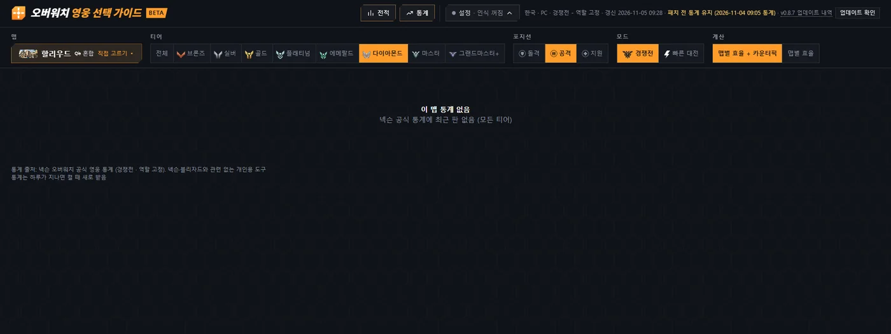
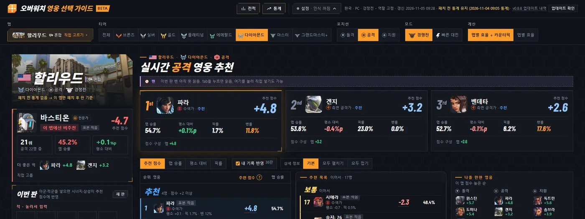
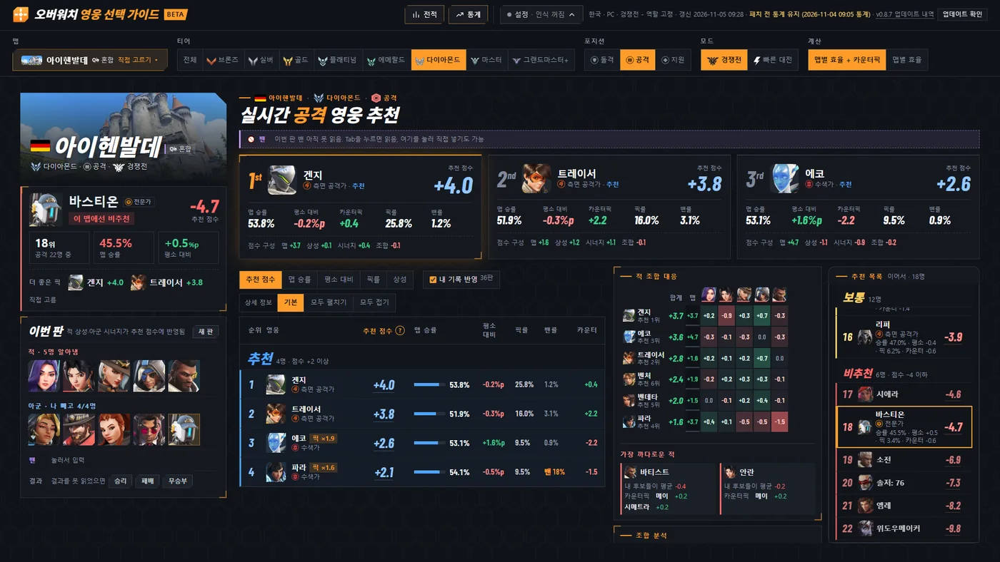
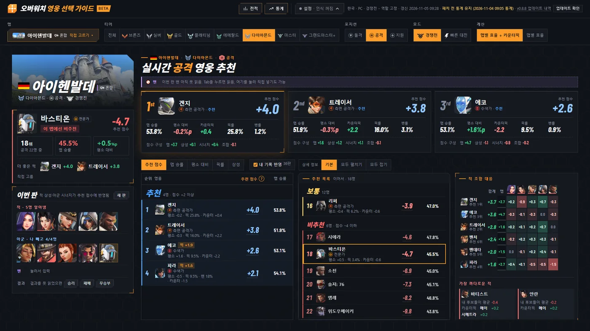
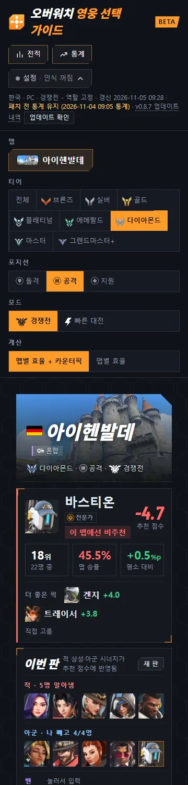
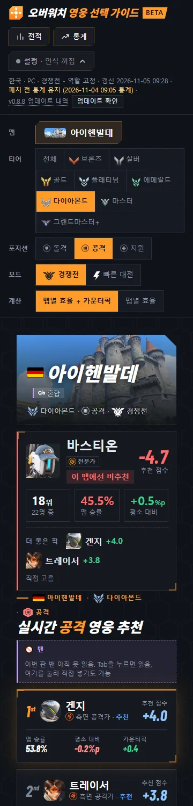
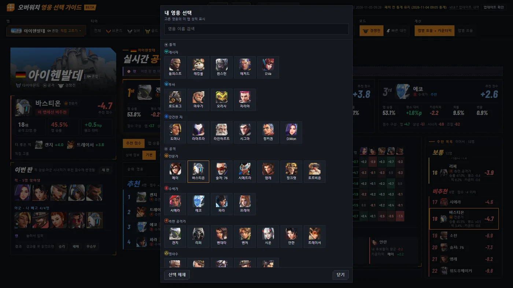
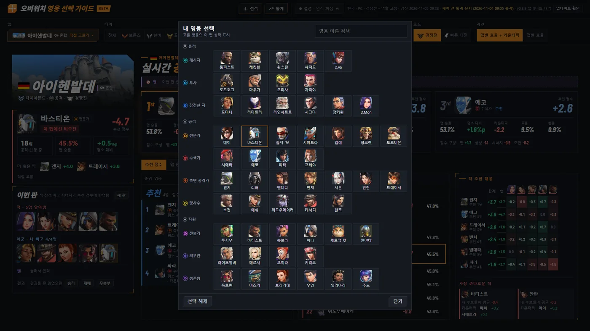

# v0.8.8 할리우드 추천 복귀, 큰 화면 추천 목록 반반, 폰에서 추천을 더 위로

[← 릴리스 받기](https://github.com/no2thingmore/ow-map-picker-release/releases/tag/v0.8.8) · [처음 화면(README)](../../README.md) · [지난 버전 v0.8.7](v0.8.7.md)

할리우드에서 다시 추천 표시. 창 폭 1400px부터 추천 목록이 반반 두 칸. 폰에서는 첫 추천이 더 위로.

## 할리우드 추천

패치 전 통계가 없는 맵은 패치 후 판으로 추천. 맵 이름 아래에 '패치 전 통계 없음 → 이 맵만 패치 후 판 기준'. 새 통계가 쌓이면 자동으로 바뀜.

| 개선 전 v0.8.7 | 개선 후 v0.8.8 |
|---|---|
|  |  |

## 큰 화면 추천 목록 반반

왼쪽 목록은 화면에 들어가는 줄까지, 잘리는 줄부터 가운데 '추천 목록 이어서'. 맨 오른쪽은 적 조합 대응. 적을 아직 모르면 맨 오른쪽 위에 '나올 만한 영웅'.

| 개선 전 v0.8.7 | 개선 후 v0.8.8 |
|---|---|
|  |  |

## 폰 추천 화면

조건 칸의 항목 이름을 왼쪽으로 옮겨 칸을 줄임. '이번 판'은 1~3순위 아래로.

| 개선 전 v0.8.7 | 개선 후 v0.8.8 |
|---|---|
|  |  |

## 영웅 선택 창

하위 역할 이름을 왼쪽으로 옮겨 큰 화면에서는 모든 영웅이 스크롤 없이 한 화면에.

| 개선 전 v0.8.7 | 개선 후 v0.8.8 |
|---|---|
|  |  |

## 그 밖에

- [추가] 오른쪽 칸에 '나올 만한 영웅': 역할별 이 맵 점수 높은 순 5명
- [개선] 정렬과 상세 정보 단추를 나뉜 목록 위 한 줄로
- [개선] 태블릿 폭에서 1순위는 한 줄 전체, 2·3순위는 그 아래 나란히
- [개선] 첫 맵을 고를 때 더 빠름. 시작할 때 전적을 두 번 받지 않음
- [고침] 목록 위에서 휠을 굴려도 페이지가 스크롤되지 않던 문제
- [고침] 1400px대 창의 목록에서 '위도우메이커'가 잘리던 문제
- [고침] 통계 화면의 1100px 창과 폰에서 역할과 영웅 이름이 잘리던 문제
- [고침] 360px 폰에서 제목이 두 줄로 꺾이던 문제
