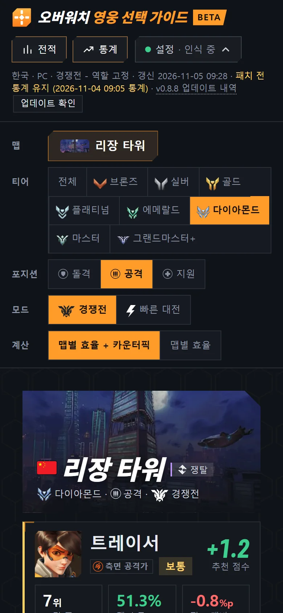
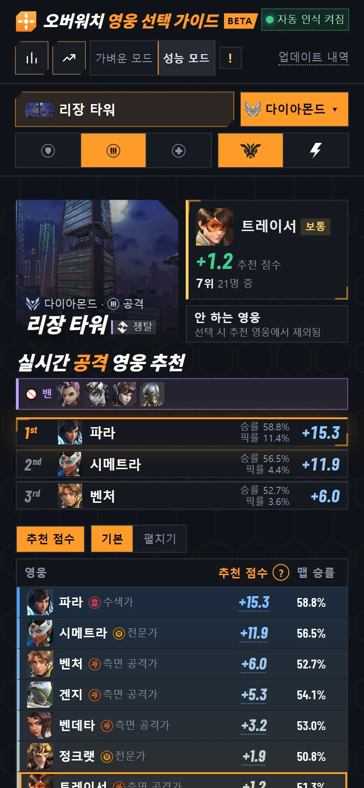
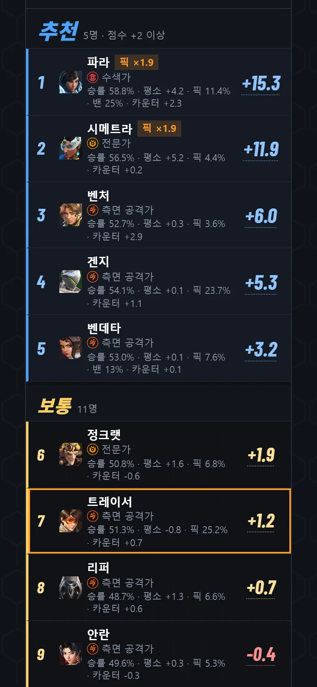
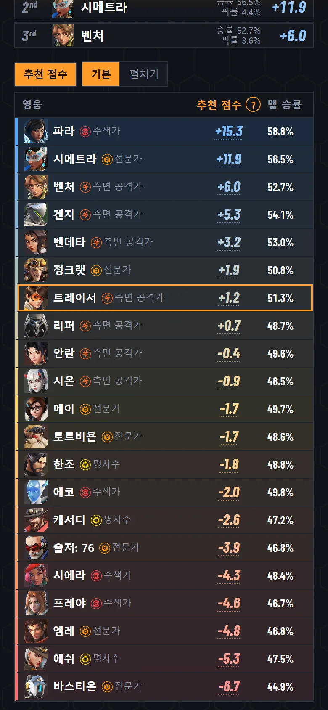
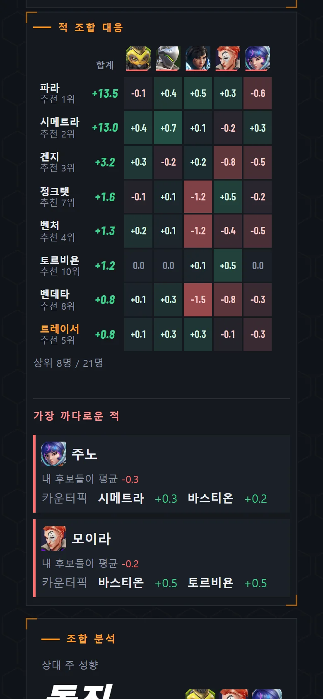
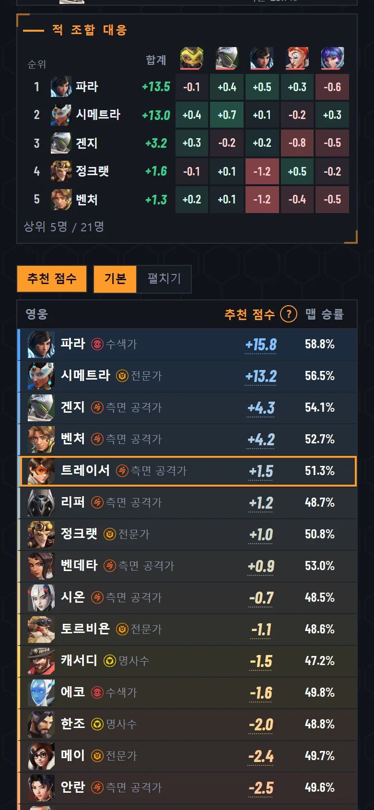
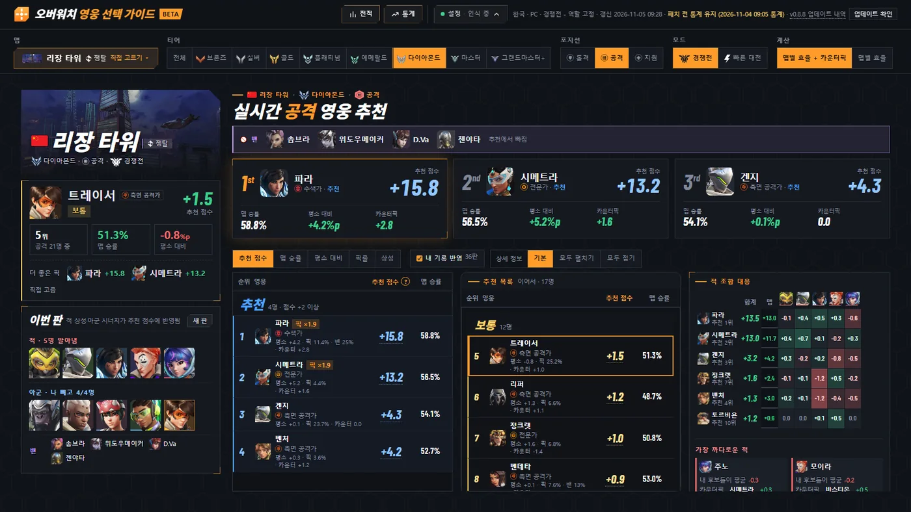
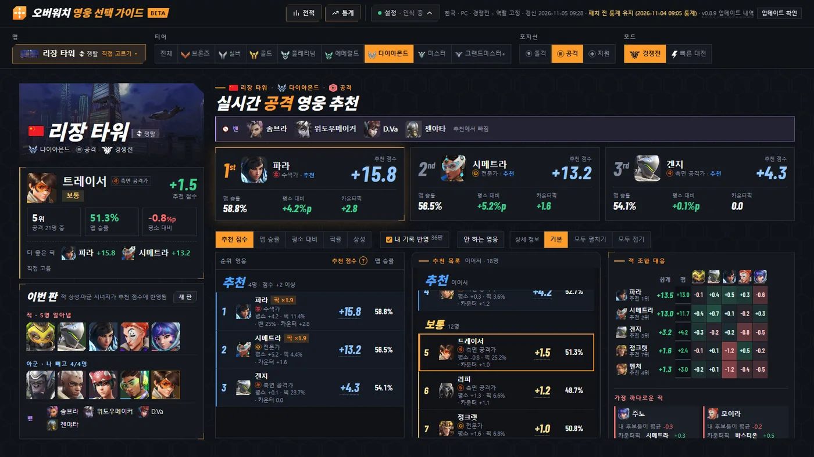
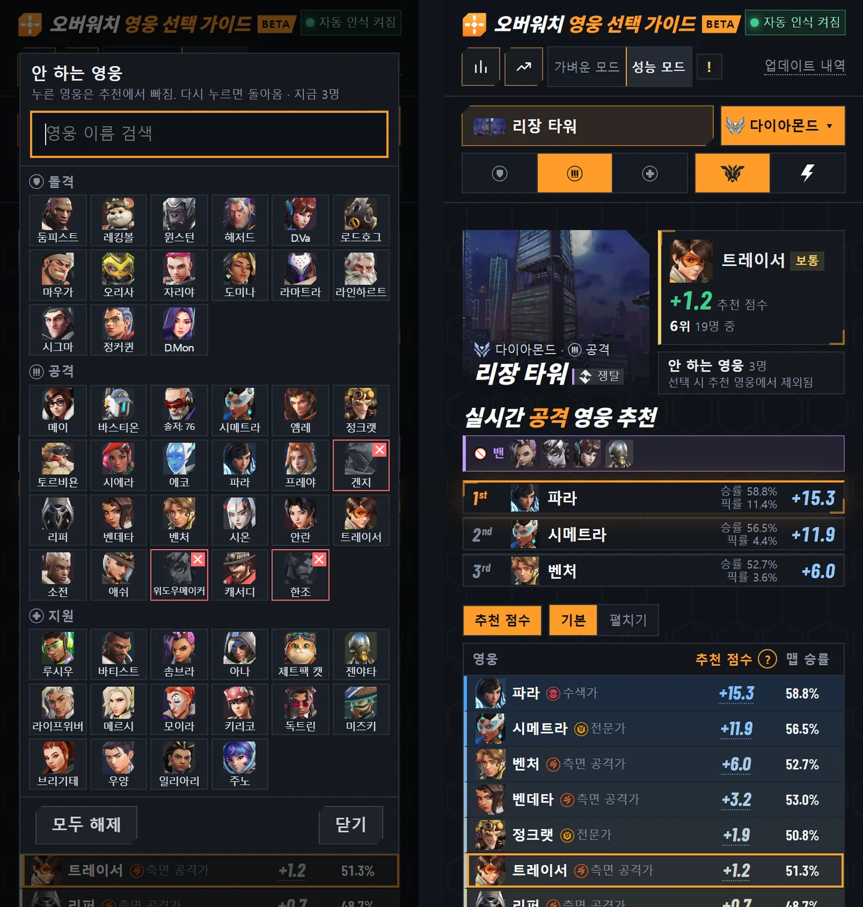

# v0.8.9 폰 화면을 한 손에 맞게 다시 짬, 안 하는 영웅 저장

[← 릴리스 받기](https://github.com/no2thingmore/ow-map-picker-release/releases/tag/v0.8.9) · [처음 화면(README)](../../README.md) · [지난 버전 v0.8.8](v0.8.8.md)

폰에서 추천이 첫 화면에 바로 표시. 안 하는 영웅을 저장하면 추천에서 빠짐. 처음 설치하면 성능 모드로 시작.

## 폰 첫 화면

머리글은 아이콘 위주로, 맵과 티어, 포지션은 두 줄로. 맵 칸 옆에 내 영웅. 1~3순위는 영웅마다 한 줄에 승률과 픽률.

| 개선 전 v0.8.8 | 개선 후 v0.8.9 |
|---|---|
|  |  |

## 폰 추천 목록

추천, 보통, 비추천 구역 없이 한 목록. 순위대로 파랑, 노랑, 빨강이 이어짐. 한 줄에 영웅, 역할, 점수, 맵 승률. '펼치기'를 누르면 픽률과 밴률도 표시.

| 개선 전 v0.8.8 | 개선 후 v0.8.9 |
|---|---|
|  |  |

## 폰 적 조합 대응

화면 폭에 맞춘 표에 순위와 초상화. 5등까지만 표시.

| 개선 전 v0.8.8 | 개선 후 v0.8.9 |
|---|---|
|  |  |

## 큰 화면

추천 점수는 항상 맵별 효율 + 카운터픽. '계산' 줄이 빠져 추천이 더 위로. 적 조합 대응은 5등까지, 조합 분석 칸은 없앰.

| 개선 전 v0.8.8 | 개선 후 v0.8.9 |
|---|---|
|  |  |

## 안 하는 영웅

영웅을 누르면 추천에서 빠짐. 다시 켜도 유지, 다시 누르면 돌아옴. 왼쪽은 고르는 창, 오른쪽은 3명을 뺀 폰 화면.

## 그 밖에

- [추가] 폰과 태블릿으로 보는 동안 화면이 안 꺼짐. 화면을 한 번 눌러야 시작
- [개선] 처음 설치하면 성능 모드로 시작
- [개선] 오버레이는 PC 화면에서만 표시
- [개선] 화면을 다시 열 때 더 빠름. 가만히 있을 때 CPU를 덜 씀
- [고침] 내 영웅이 바뀌면 화면이 맨 위로 올라가던 문제
