# v0.9.0 영웅을 누르면 영웅 통계로, 목록 숫자를 줄 높이에 맞춰 크게

[← 릴리스 받기](https://github.com/no2thingmore/ow-map-picker-release/releases/tag/v0.9.0) · [처음 화면(README)](../../README.md) · [지난 버전 v0.8.9](v0.8.9.md)

추천 목록에서 영웅을 누르면 그 영웅 통계로 이동. 추천 점수와 맵 승률이 더 크게 보이고, 스크롤바는 어두운 각진 막대로 통일.

## 영웅을 누르면 영웅 통계로

지금 고른 모드와 티어로 열림. 폰은 영웅 칸이 바로 보이고, 위로 올리면 모드와 티어 칸. 점수 근거 칸은 없앰. 계산법은 '추천 점수' 옆 ? 단추.

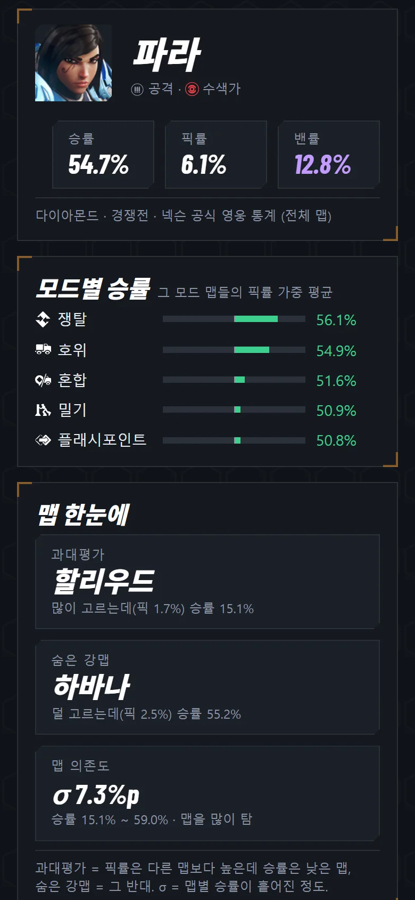

## 폰 첫 화면

내 영웅 칸 오른쪽 아래에 큰 추천 점수, 순위 위에 승률과 픽률. 1~3순위는 이름 옆에 하위 역할, 배경 막대로 1순위와의 점수 차이 표시. 적 조합 표는 이름 아래에 맵 점수.

| 개선 전 v0.8.9 | 개선 후 v0.9.0 |
|---|---|
| 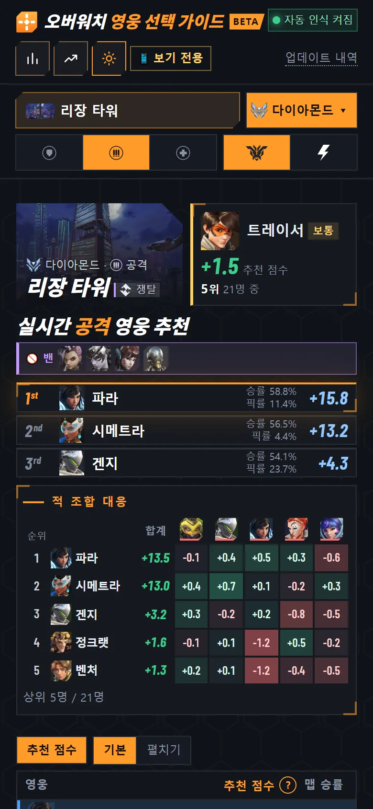 | 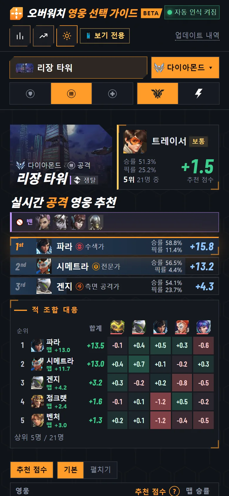 |

## 추천 목록 숫자

추천 점수와 맵 승률 글자를 줄 높이에 맞춤. 언제나 세로 가운데. 모든 화면에 적용.

| 개선 전 v0.8.9 | 개선 후 v0.9.0 |
|---|---|
| 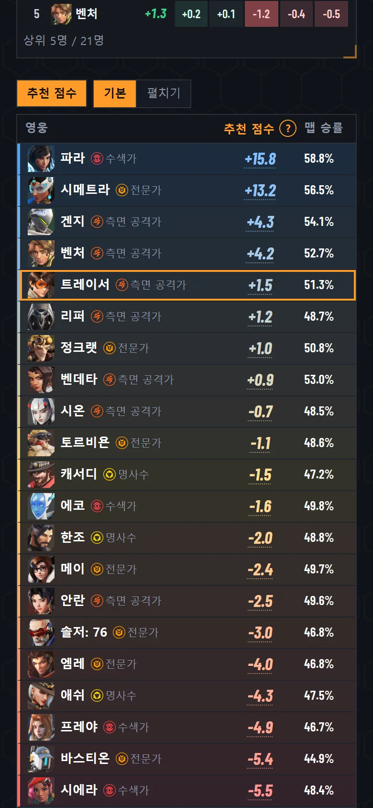 | 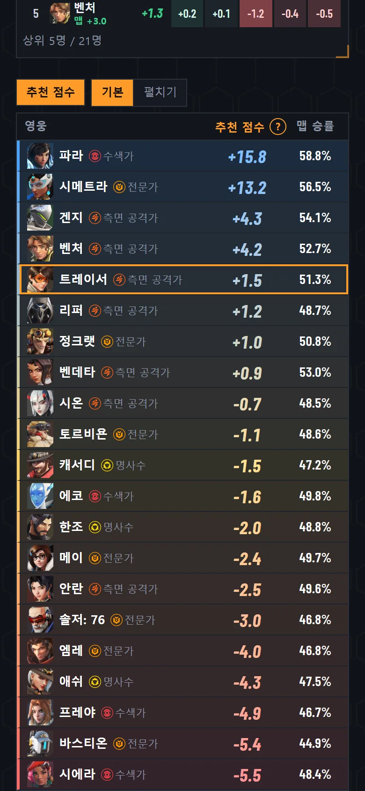 |

'펼치기'를 누르면 줄이 길어진 만큼 숫자도 커짐.

| 개선 전 v0.8.9 | 개선 후 v0.9.0 |
|---|---|
| 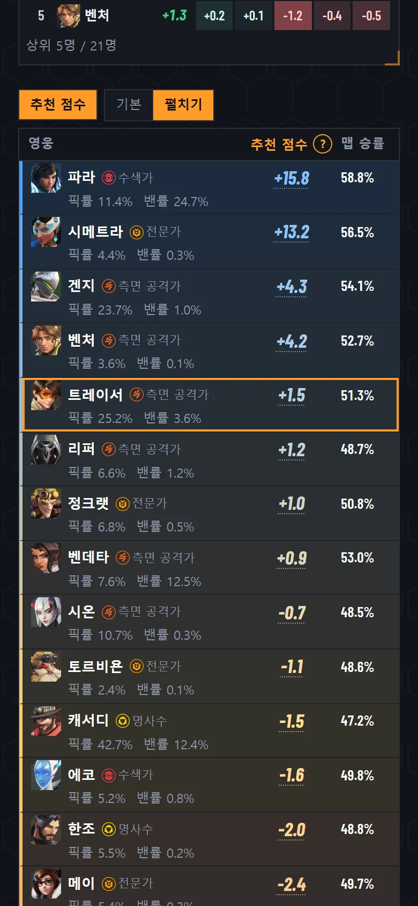 | 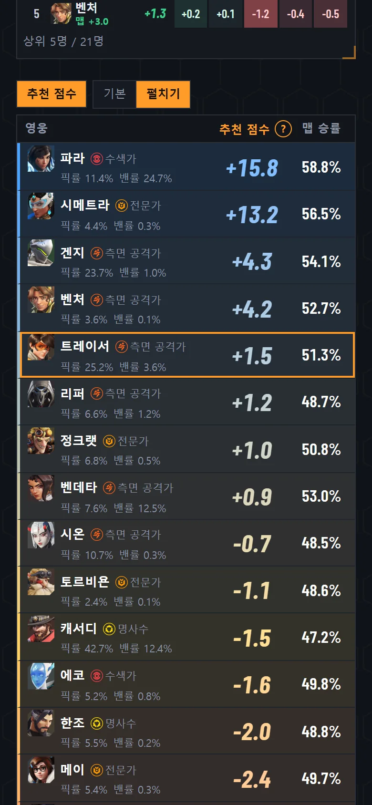 |

## 스크롤

스크롤바는 어두운 각진 막대로 통일. 목록 머리줄은 위에 고정, 아래에 줄이 더 있으면 끝이 흐려짐. 1400px 화면의 목록 가로 스크롤과 ? 단추 잘림 없앰. 추천 목록 이어서 칸도 다른 칸처럼 각지게.

| 개선 전 v0.8.9 | 개선 후 v0.9.0 |
|---|---|
| 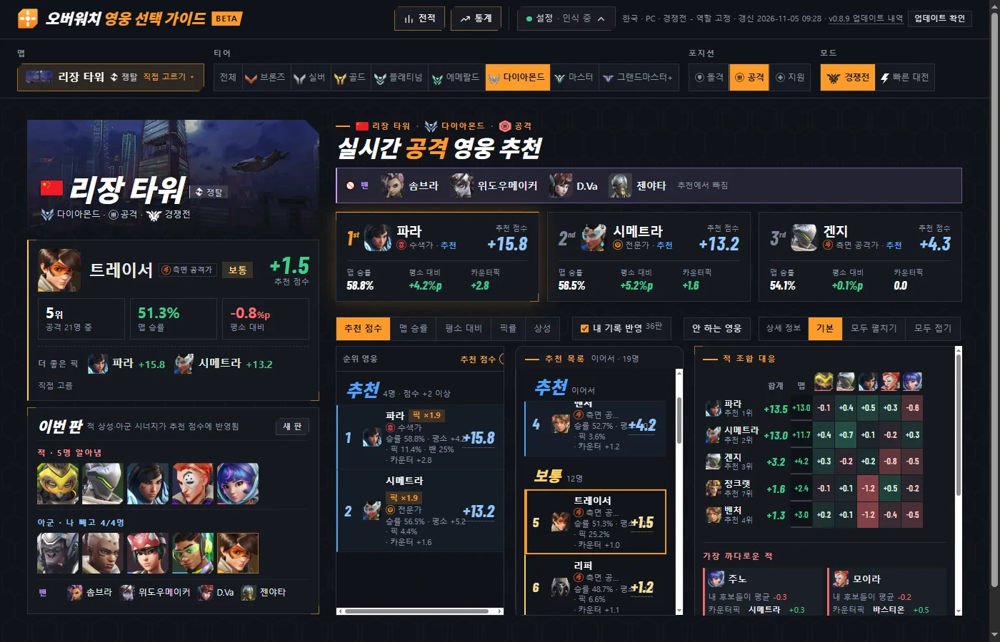 | 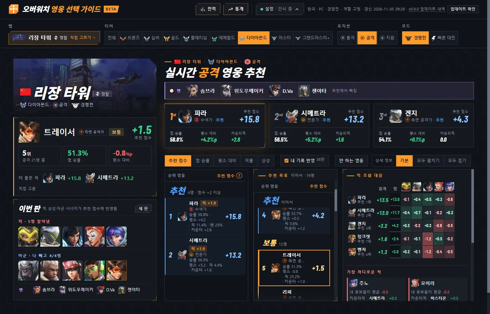 |

## 폰 알림

화면 폭의 절반으로 좁아져 글이 여러 줄로 늘어나던 문제 고침.

| 개선 전 v0.8.9 | 개선 후 v0.9.0 |
|---|---|
| 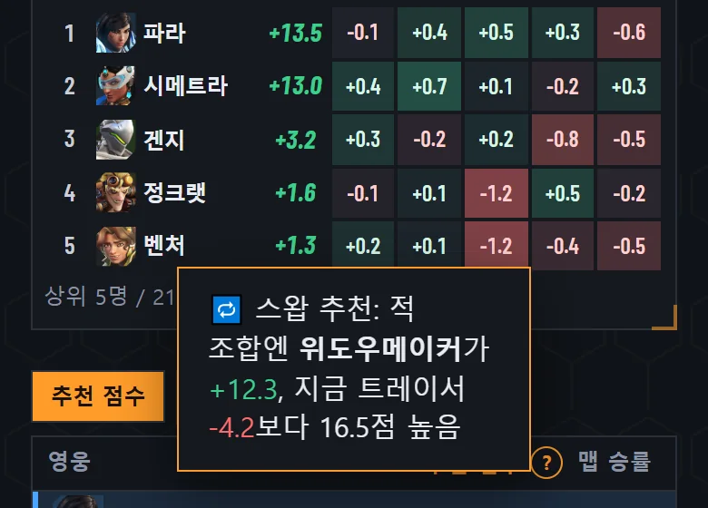 | 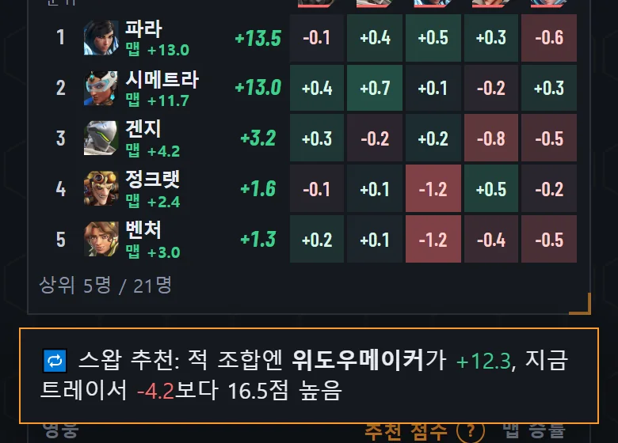 |

## 그 밖에

- [개선] 통계 갱신을 하루 1번(오전 9시쯤)으로. 새 통계가 없으면 넥슨에서 다시 받지 않음
- [개선] 새 버전 알림도 다른 칸처럼 각지게
- [고침] 태블릿 알림이 화면 폭의 절반으로 좁아지던 문제
- [고침] 좁은 목록에서 글자가 추천 점수와 겹치던 문제
- [고침] 320px 폰에서 제목이 자동 인식 칸과 겹치던 문제
