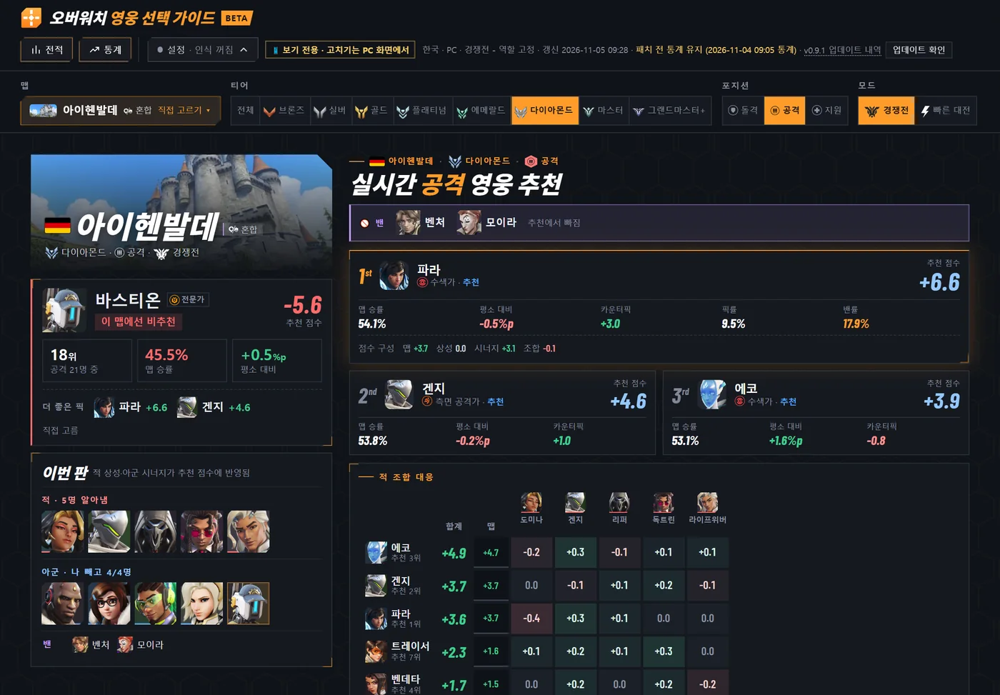
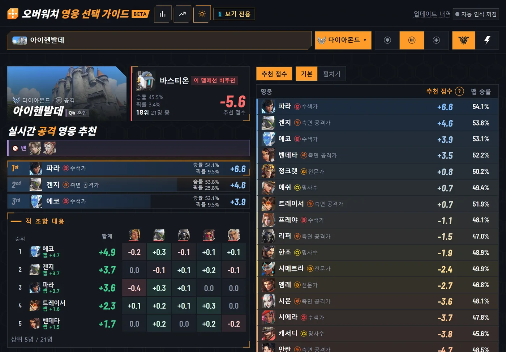
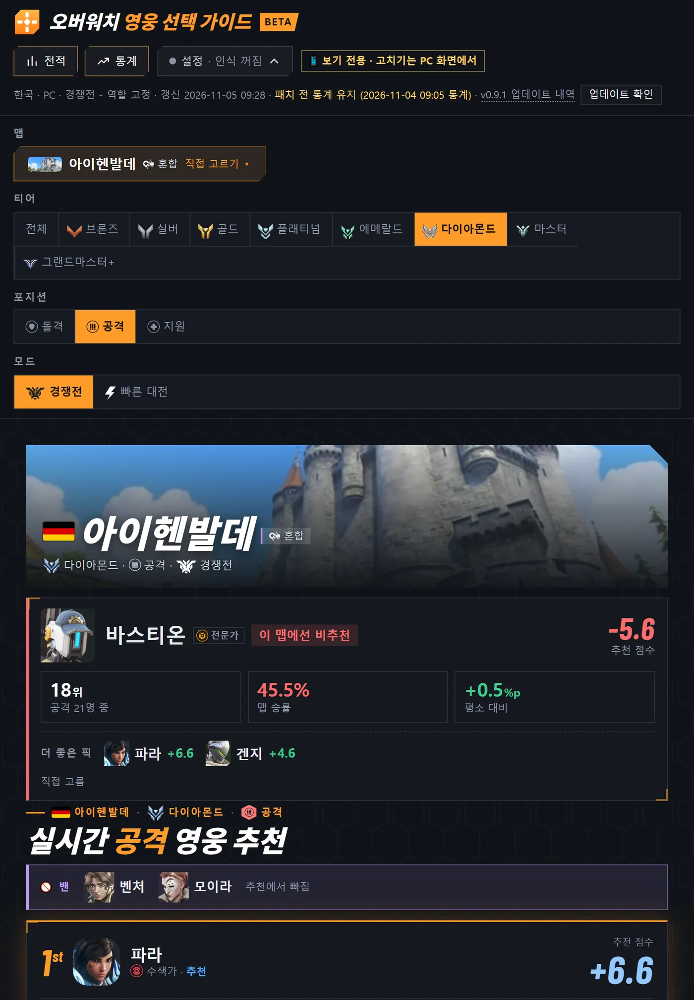
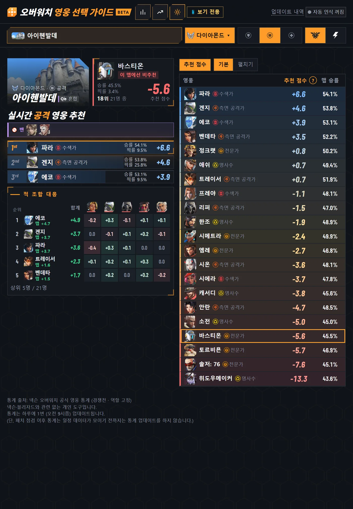

# v0.9.2 태블릿 화면을 폰처럼 간단하게, 세로는 추천 목록까지 한 화면에

[← 릴리스 받기](https://github.com/no2thingmore/ow-map-picker-release/releases/tag/v0.9.2) · [처음 화면(README)](../../README.md) · [지난 사진 v0.9.0](v0.9.0.md)

터치 태블릿이 폰과 같은 구성으로 바뀜. 왼쪽에 맵, 내 영웅, 1~3순위, 적 조합 대응, 오른쪽에 추천 목록. PC 화면과 폰 화면은 그대로.

## 태블릿 가로

화면을 줄이지 않아 글자가 커짐. 적 조합 대응의 카운터 숫자와 합계 숫자도 크게.

| 개선 전 v0.9.1 | 개선 후 v0.9.2 |
|---|---|
|  |  |

## 태블릿 세로

두 화면 아래에 있던 추천 목록이 첫 화면 오른쪽에. 스크롤 없이 한 화면에 다 보임.

| 개선 전 v0.9.1 | 개선 후 v0.9.2 |
|---|---|
|  |  |
