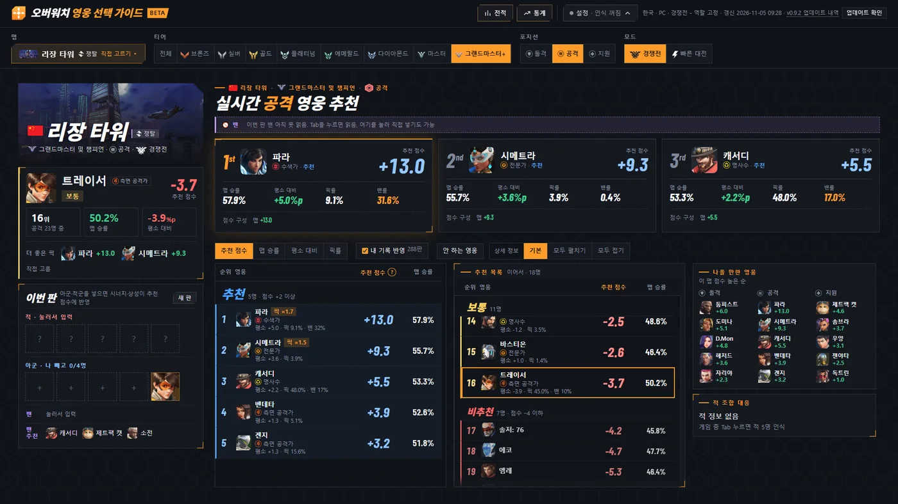
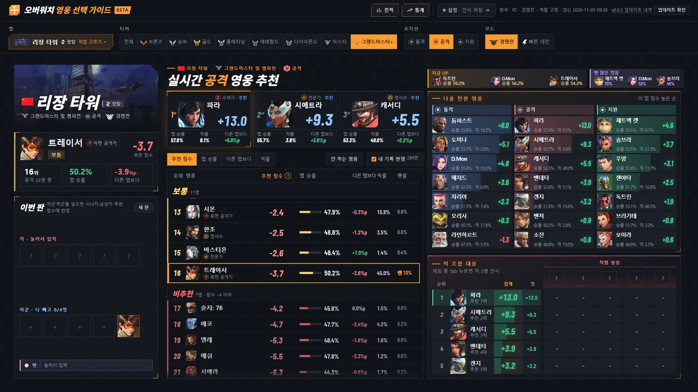
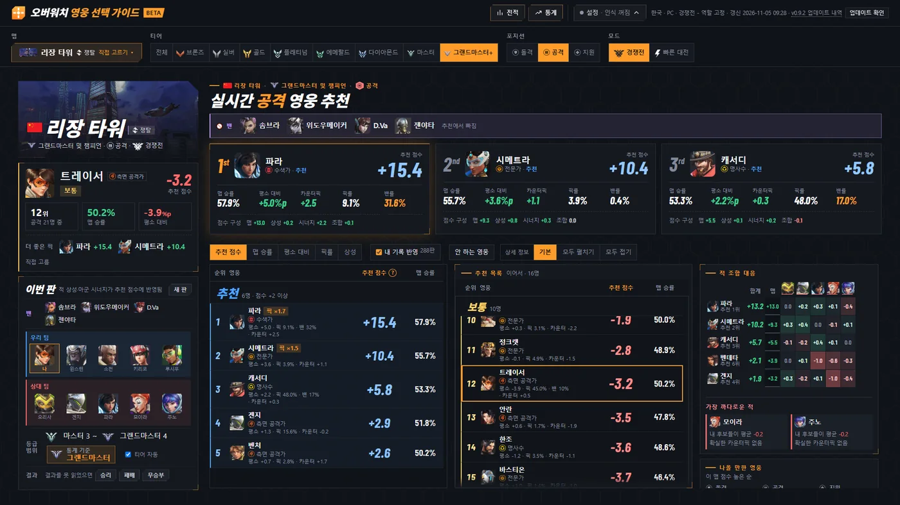
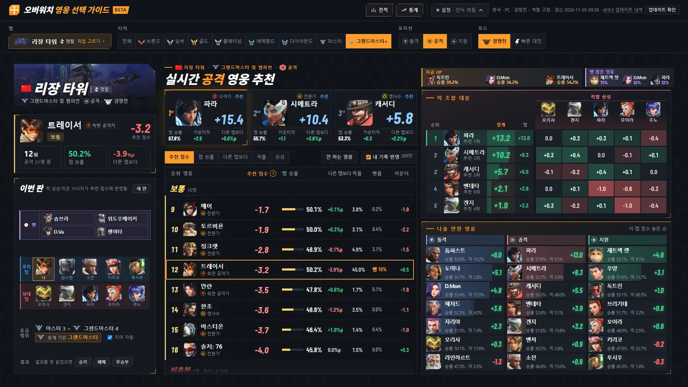
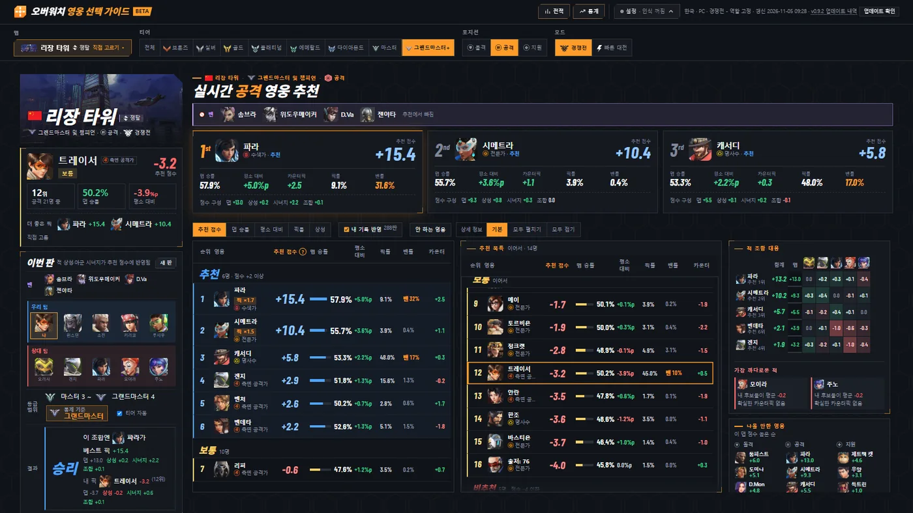
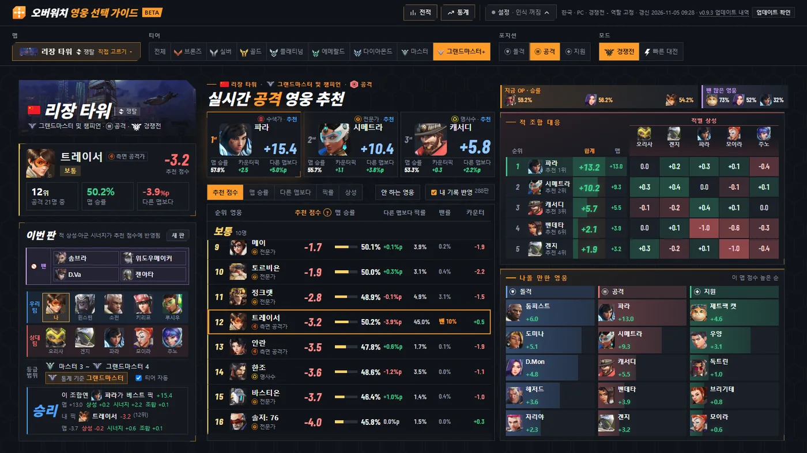

# v0.9.3 넓은 화면 추천 화면 개편, 게임 중에도 글자가 크게

[← 릴리스 받기](https://github.com/no2thingmore/ow-map-picker-release/releases/tag/v0.9.3) · [처음 화면(README)](../../README.md) · [지난 사진 v0.9.2](v0.9.2.md)

넓은 화면의 칸 구성이 바뀜. 왼쪽에 1~3순위와 추천 목록, 오른쪽에 나올 만한 영웅과 적 조합 대응. 폰과 태블릿은 추천 목록에 등수 칸이 생김.

## 추천 화면

1~3순위 카드는 사진과 점수를 크게. 제목 오른쪽에 지금 OP 영웅과 이 맵 밴 많은 영웅. 적을 읽기 전에도 적 조합 대응 칸에 내 후보 5명.

| 개선 전 v0.9.2 | 개선 후 v0.9.3 |
|---|---|
|  |  |

## 점수판을 읽은 뒤

적 조합 대응이 위로 올라오고 나올 만한 영웅은 아래로. 밴은 이번 판 칸에 영웅마다 사각형으로.

| 개선 전 v0.9.2 | 개선 후 v0.9.3 |
|---|---|
|  |  |

## 결과 화면

왼쪽 칸을 줄여서 화면이 덜 작아짐. 1600×900 같은 창에서 글자가 커짐. 결과 때 작아진 화면이 다음 판에도 그대로이던 문제도 고침.

| 개선 전 v0.9.2 | 개선 후 v0.9.3 |
|---|---|
|  |  |
