# v0.9.4 게임 FPS 덜 깎음, 전체 화면에서 더 잘 읽음

[← 릴리스 받기](https://github.com/no2thingmore/ow-map-picker-release/releases/tag/v0.9.4) · [처음 화면(README)](../../README.md) · [지난 사진 v0.9.3](v0.9.3.md)

게임 중 FPS를 덜 깎음. 볼 화면이 없으면 확인 횟수도 줄이고, Tab을 누르면 바로 읽음. 어둡거나 작은 화면에서 맵, 영웅, 금지 아이콘을 더 잘 읽음.

## 1~3순위 카드

큰 사진 옆에 순위, 이름, 점수. 사진과 이름이 커짐.

| 개선 전 v0.9.3 | 개선 후 v0.9.4 |
|---|---|
| 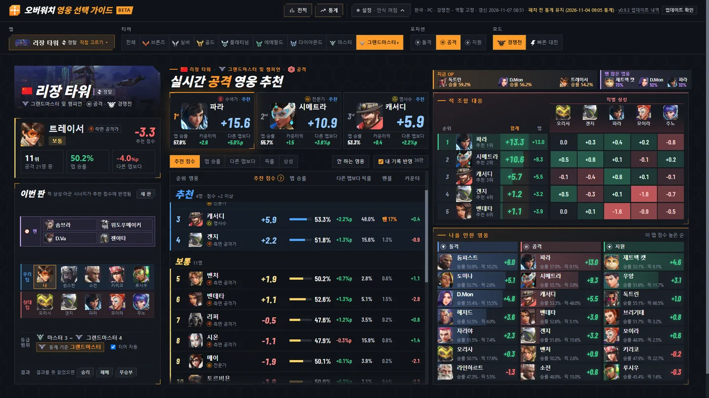 | 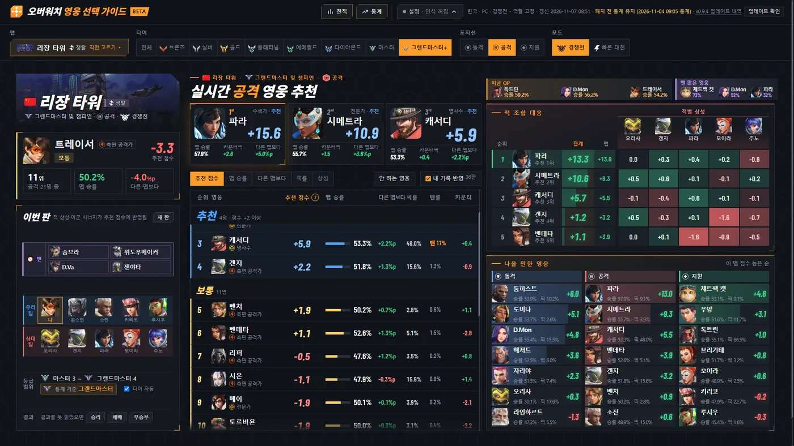 |

## 21:9 화면

브라우저를 확대해도 아래 칸이 안 잘림. 사진은 3440×1440 화면을 250%로 확대한 모습.

| 개선 전 v0.9.3 | 개선 후 v0.9.4 |
|---|---|
| 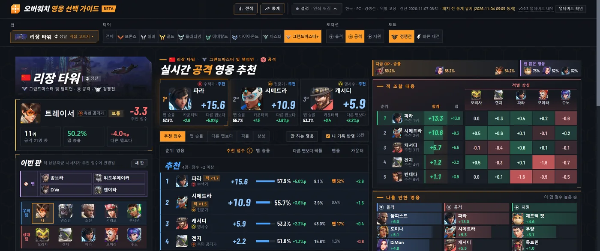 | 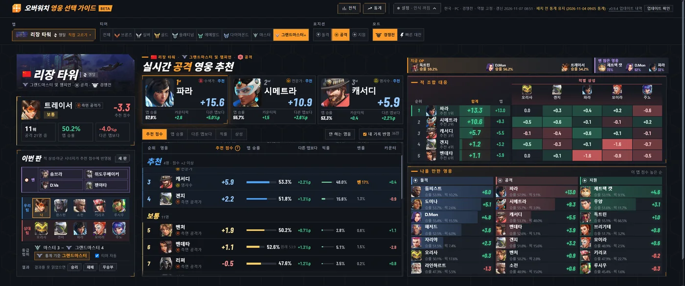 |

## 스크롤바

가늘게, 끝은 비스듬히. 올리거나 끌면 주황색. 파이어폭스의 위아래 화살표도 없어짐.

| 개선 전 v0.9.3 | 개선 후 v0.9.4 |
|---|---|
| 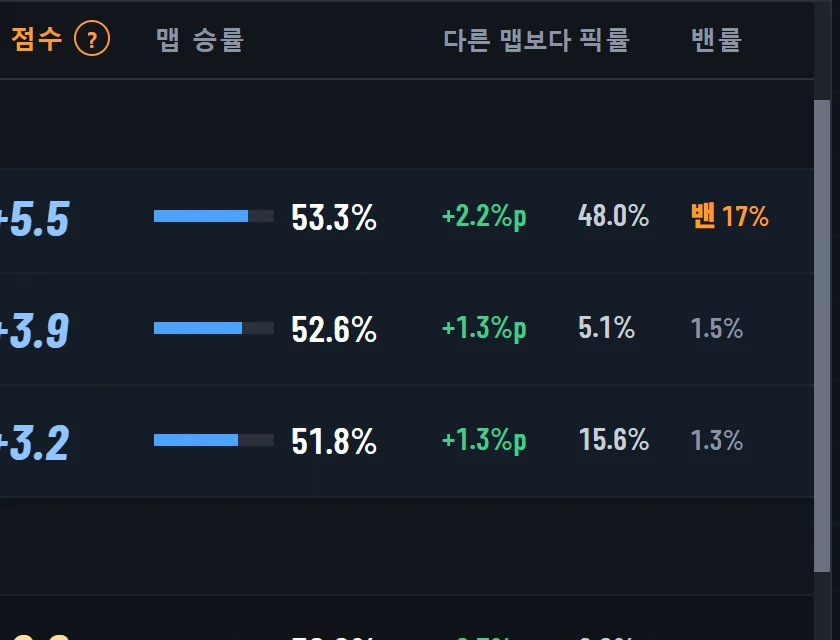 | 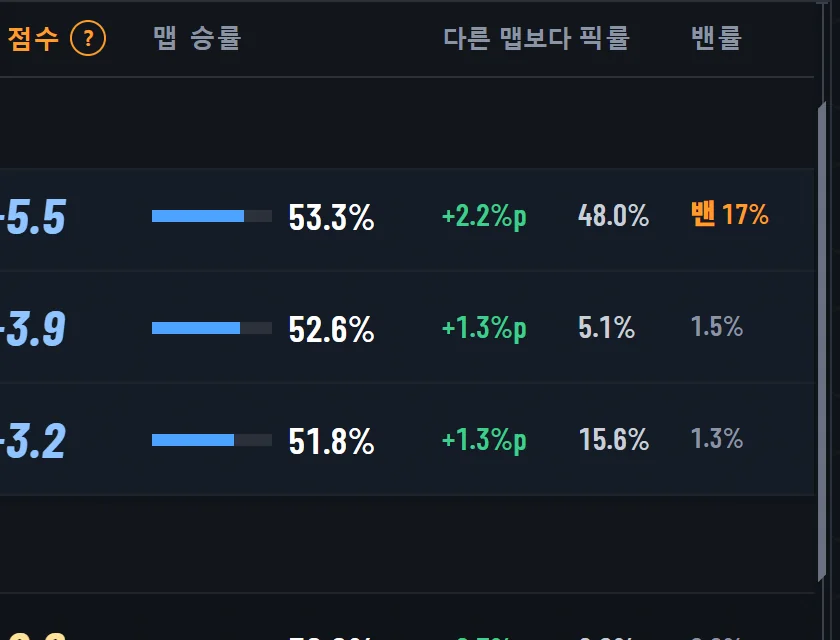 |

## 통계 영웅 화면

맨 위 얼굴 줄로 영웅을 바로 바꿈. 머리 칸은 영웅 색.

| 개선 전 v0.9.3 | 개선 후 v0.9.4 |
|---|---|
| 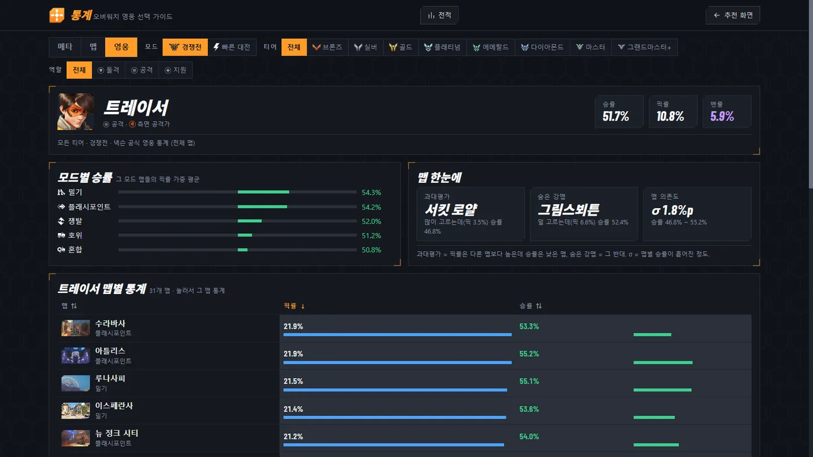 | 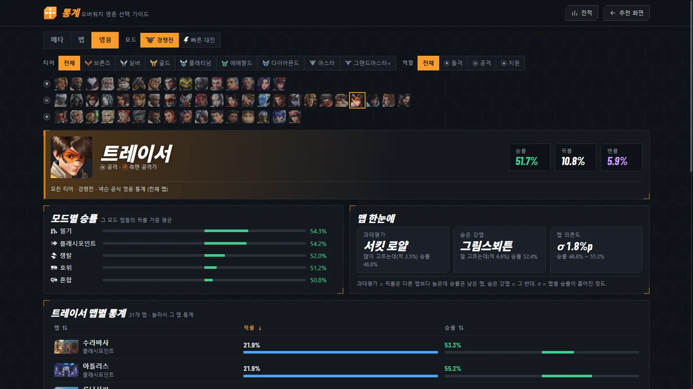 |

## 폰 통계 화면

조건 줄은 아이콘으로, 맵 목록은 옆으로 미는 한 줄로. 표까지 바로 내려옴.

| 개선 전 v0.9.3 | 개선 후 v0.9.4 |
|---|---|
| 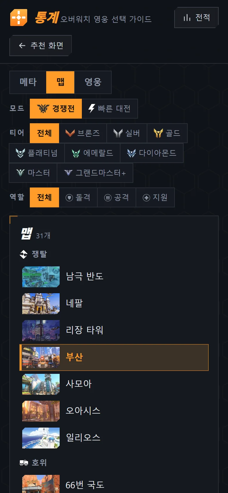 | 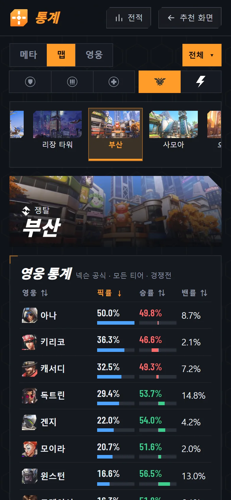 |

영웅 이름이 한 글자씩 끊기지 않고 한 줄로.

| 개선 전 v0.9.3 | 개선 후 v0.9.4 |
|---|---|
| 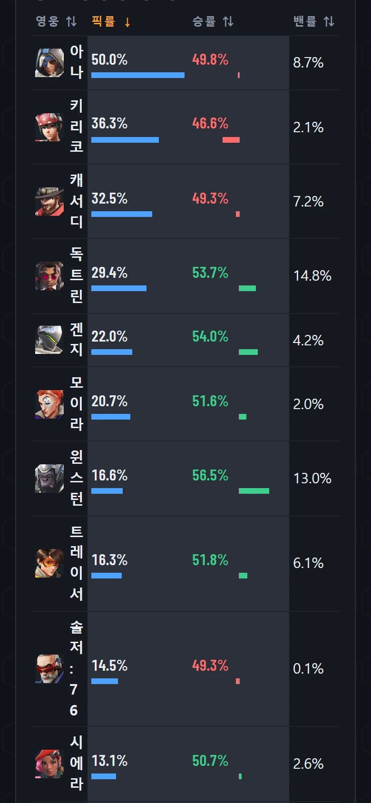 | 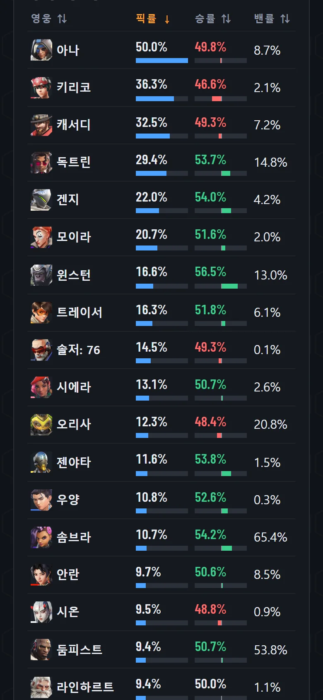 |

## 그 밖에

- [개선] 화면 열기와 전적 화면 빨라짐
- [개선] 통계 메타: 밴률 Top 4 → Top 7
- [고침] 결과 화면에서 내가 한 영웅을 못 읽던 문제
- [고침] 프로그램이 게임에 CPU를 양보하지 못하던 문제
- [고침] 통계 화면에 표본 적음 표시가 없던 문제
