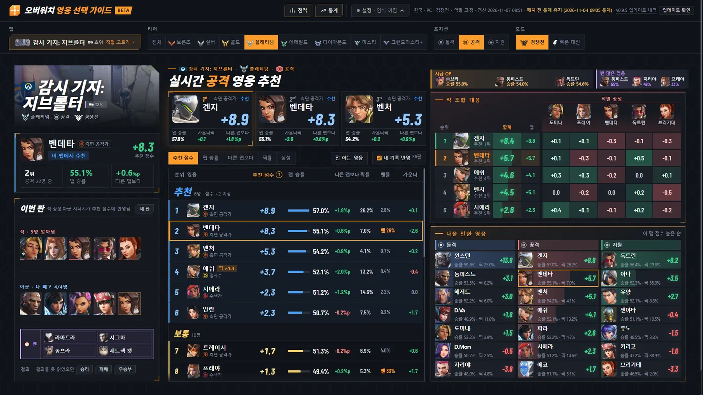
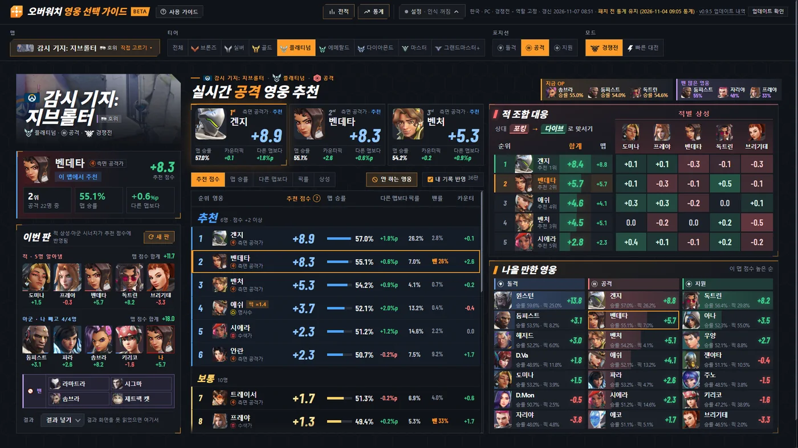
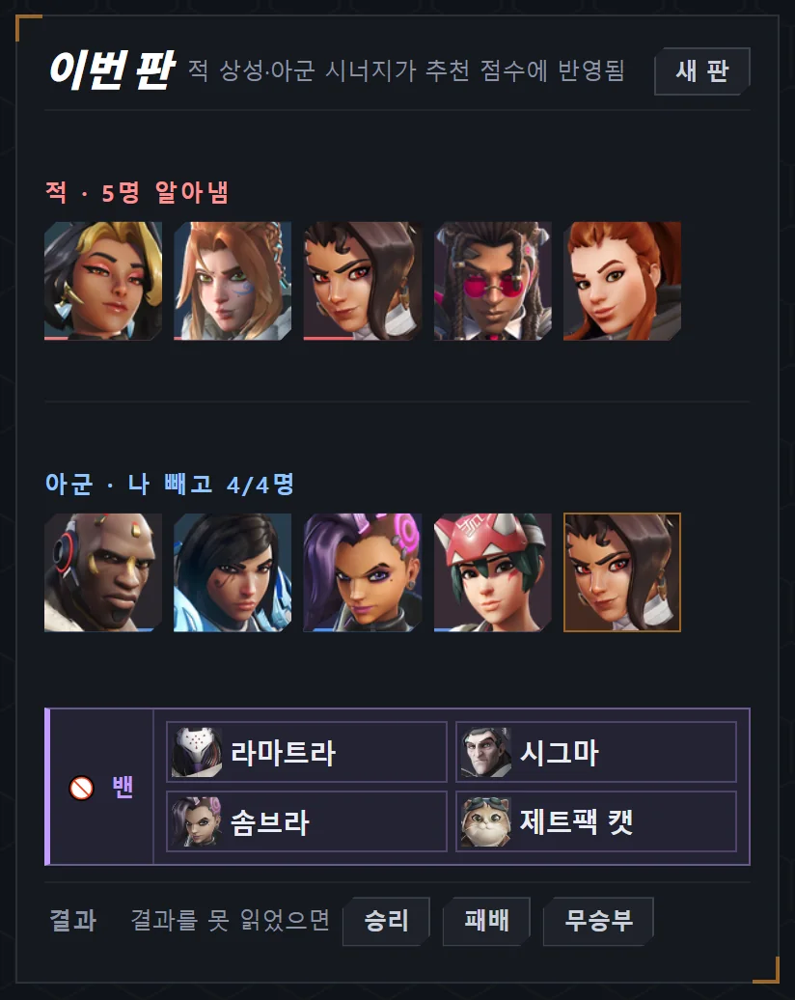
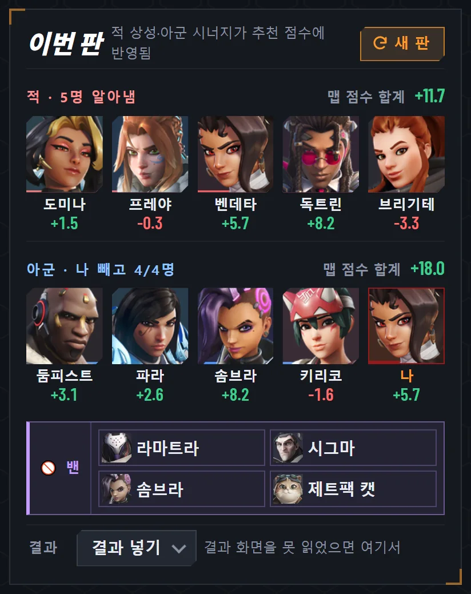
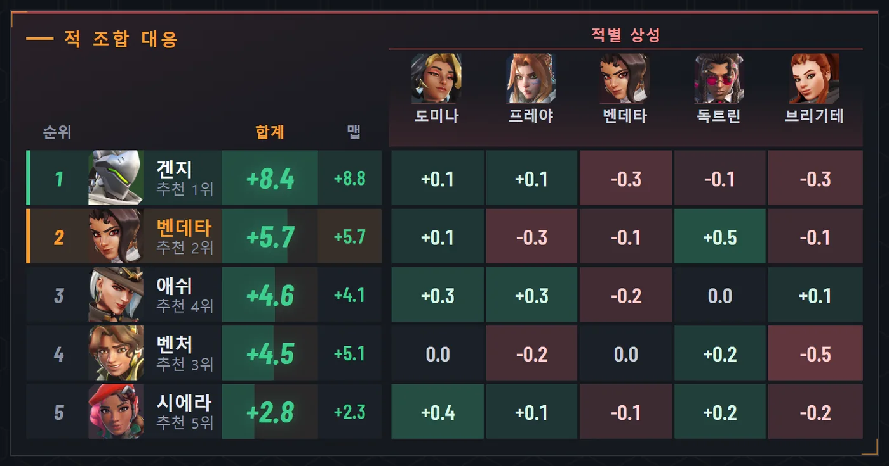
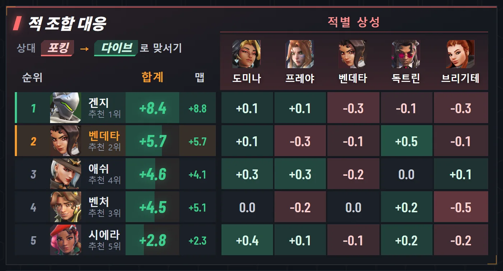
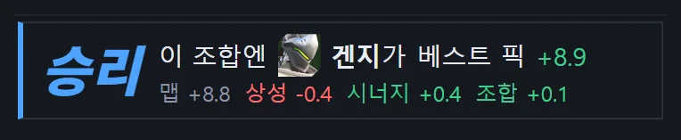
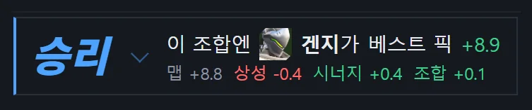
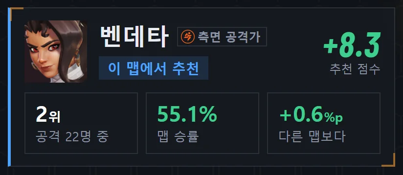
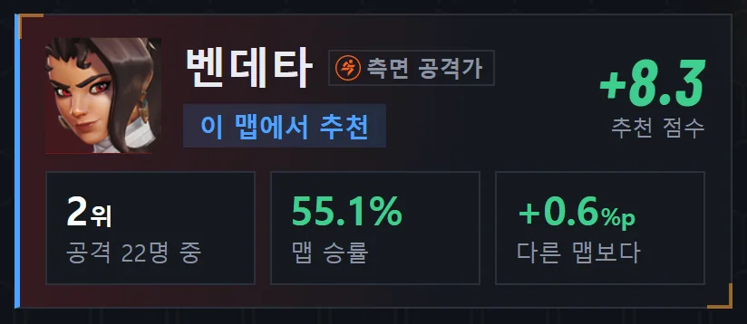

# v0.9.6 이번 판에 맵 점수와 합계, 결과를 한 칸에서 고치기

[← 릴리스 받기](https://github.com/no2thingmore/ow-map-picker-release/releases/tag/v0.9.6) · [처음 화면(README)](../../README.md) · [지난 사진 v0.9.4](v0.9.4.md)

이번 판 칸에 영웅마다 이 맵 점수와 팀 합계. 적 조합 대응은 제목과 글자를 키우고 상대 성향을 한 줄로. '새 판'이 지난 판 정보를 지우지 못하던 문제도 고침.

## 추천 화면

| 개선 전 v0.9.5 | 개선 후 v0.9.6 |
|---|---|
|  |  |

## 이번 판

얼굴 아래에 이름과 이 맵 점수, 줄 오른쪽에 팀 맵 점수 합계. '새 판' 단추는 주황 테두리로.

| 개선 전 v0.9.5 | 개선 후 v0.9.6 |
|---|---|
|  |  |

## 적 조합 대응

제목과 머리줄(순위, 합계, 맵), 적별 상성 점수를 크게. 왼쪽 위에 상대 성향과 맞설 성향.

| 개선 전 v0.9.5 | 개선 후 v0.9.6 |
|---|---|
|  |  |

## 결과

단추 셋 대신 한 칸. 큰 결과 글자를 눌러 바꾸거나 '결과 지우기'.

| 개선 전 v0.9.5 | 개선 후 v0.9.6 |
|---|---|
|  |  |

## 내 영웅

영웅 색이 은은하게.

| 개선 전 v0.9.5 | 개선 후 v0.9.6 |
|---|---|
|  |  |

## 그 밖에

- [개선] 지금 OP 영웅 간격 좁힘
- [고침] '새 판'을 눌러도 지난 판의 밴, 조합, 결과가 남던 문제
