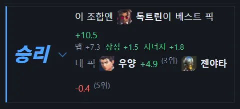
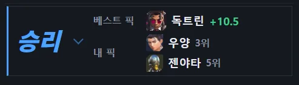
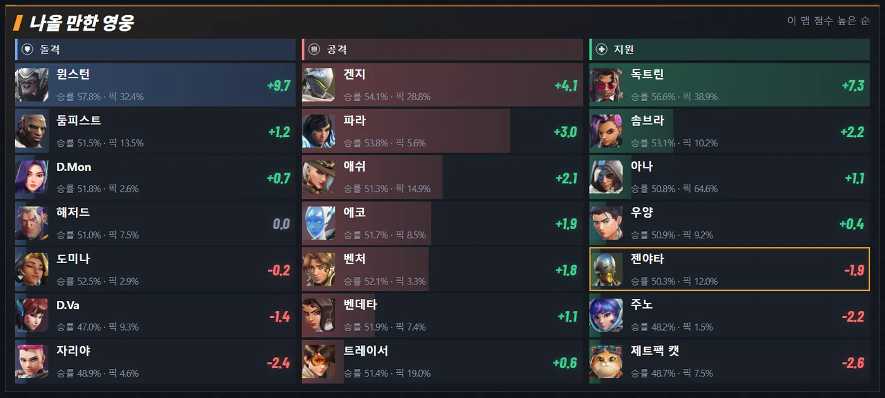
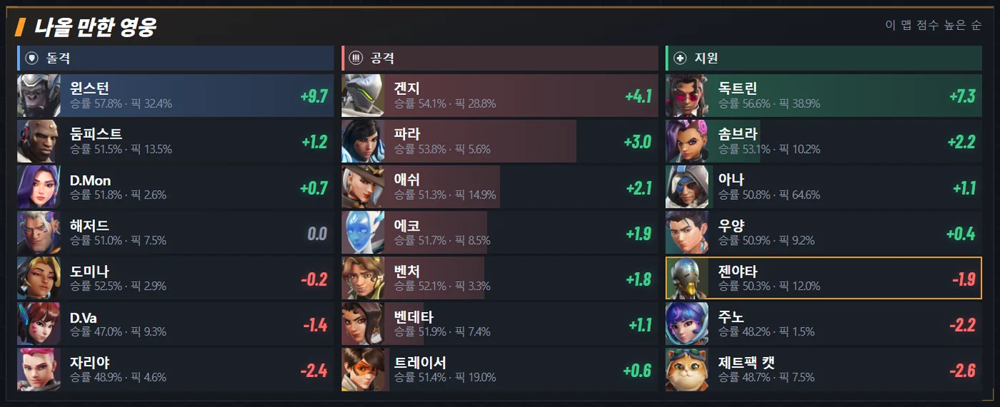
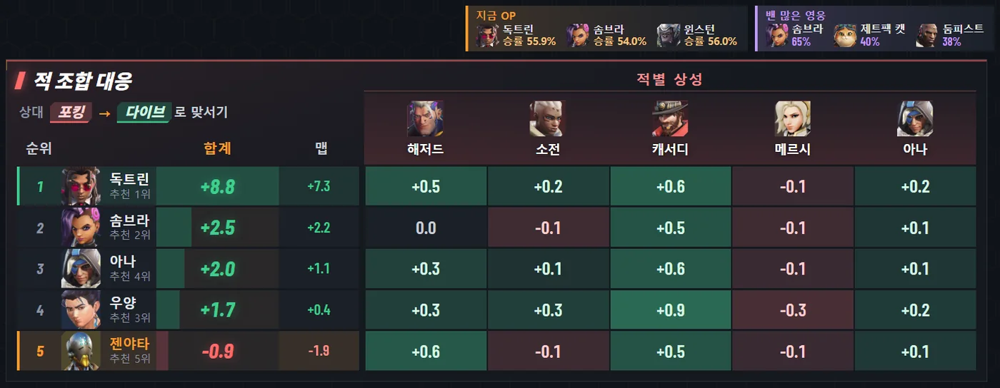
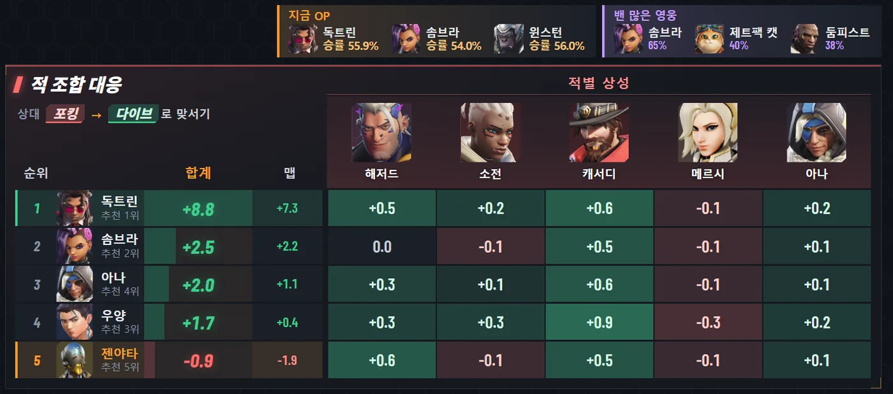

# v0.9.7 판 결과 칸 간단하게, 새 판에 지난 판 영웅이 안 남음

[← 릴리스 받기](https://github.com/no2thingmore/ow-map-picker-release/releases/tag/v0.9.7) · [처음 화면(README)](../../README.md) · [지난 사진 v0.9.6](v0.9.6.md)

판 결과는 베스트 픽과 내 픽 두 줄로. 나올 만한 영웅은 사진을 줄 높이에 맞추고, 지금 OP·밴 많은 영웅과 적 영웅 사진을 키움. 다음 판이 시작돼도 지난 판 내 영웅이 남던 문제도 고침.

## 판 결과

세 줄로 흩어지던 내용을 두 줄로. 점수 근거는 영웅에 마우스를 올리면.

| 개선 전 v0.9.6 | 개선 후 v0.9.7 |
|---|---|
|  |  |

## 나올 만한 영웅

사진을 줄 높이에 맞게 크게, 이름과 승률·픽률은 가운데에 붙여서.

| 개선 전 v0.9.6 | 개선 후 v0.9.7 |
|---|---|
|  |  |

## 지금 OP · 밴 많은 영웅 · 적 조합 대응

위 두 칸과 적별 상성 영웅 사진을 크게. 위 칸 오른쪽 끝을 아래 칸과 맞춤.

| 개선 전 v0.9.6 | 개선 후 v0.9.7 |
|---|---|
|  |  |
